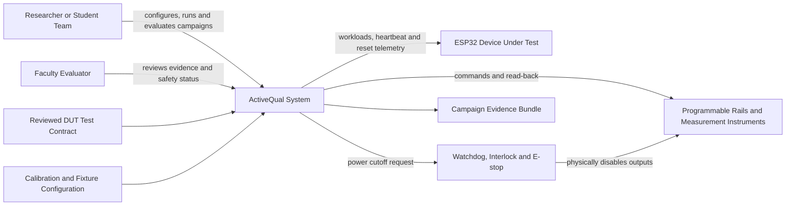
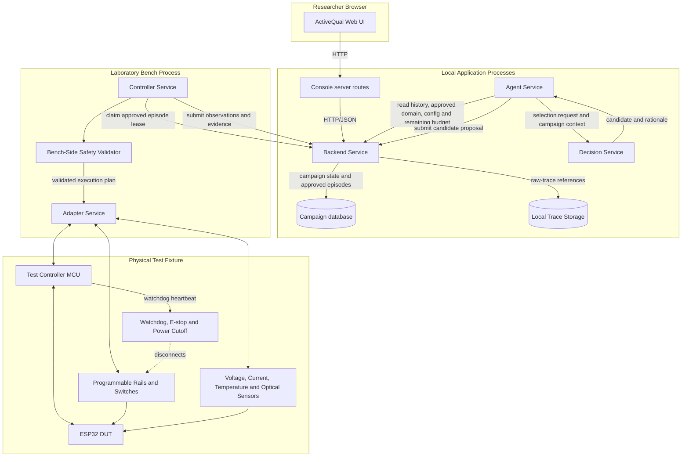
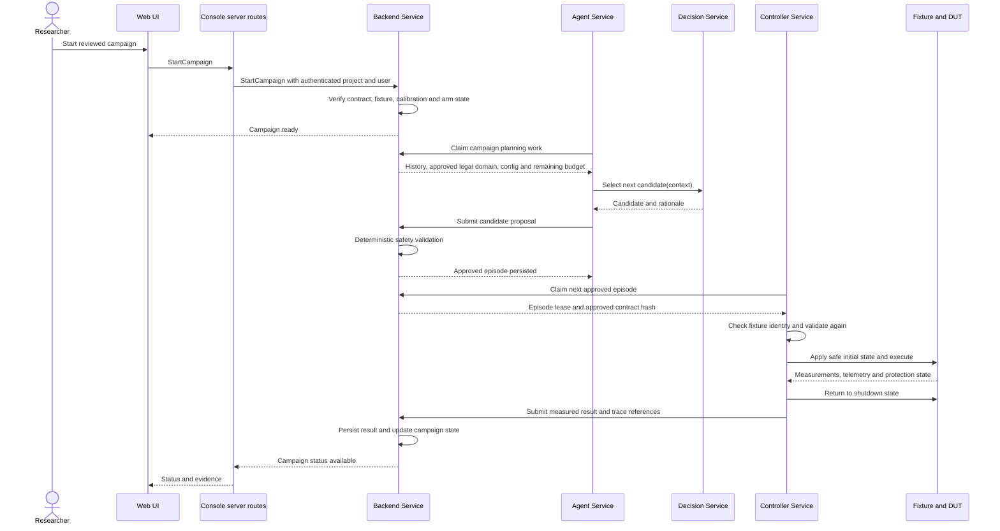

# ActiveQual HLD 01: System Context and Platform Boundaries

**Project:** ActiveQual: AI-Driven Adaptive Physical Testing for Embedded Systems  
**Document type:** High-Level Design  
**Status:** Draft for team review  
**Target delivery:** 12-week proof of concept  
**Primary audience:** Student implementation team, faculty guide, and technical evaluators  
**Implementation reference:** Current internal application-stack conventions were inspected before drafting  

## 1. Purpose

This document defines the boundary of the first ActiveQual implementation and shows how it fits the selected application stack.

ActiveQual runs budgeted physical experiments against a declared low-voltage embedded device. For each experiment, it selects a legal operating condition, checks the condition against deterministic safety rules, applies the condition to real hardware, records what actually happened, classifies the outcome, and uses that result when selecting later experiments.

This document answers five high-level questions:

1. Who interacts with ActiveQual?
2. Which parts run in the application platform?
3. Which parts must remain beside the physical hardware?
4. Where do safety authority and data ownership live?
5. What crosses each system boundary?

Detailed hardware circuitry, RPC schemas, database tables, adaptive-search mathematics, and episode state transitions belong in later HLD documents.

## 2. Decision labels

The document uses these labels so that verified stack conventions are not confused with new ActiveQual design decisions.

- **Verified stack pattern:** Confirmed from the current implementation repository.
- **ActiveQual decision:** Proposed as the implementation direction for the 12-week project.
- **Open decision:** Requires a later spike, hardware inventory, or team decision.

## 2.1 Stack amendment

**ActiveQual decision (supersedes the Kotlin/JVM, gRPC and BFF statements elsewhere in this document):**

- Backend, Agent, Decision, Oracle, Controller, and Adapter are implemented in **Python**. The Decision Service must be Python because the planners depend on Optuna and, for GP-BO, torch.
- The MVP deploys as **two Python processes** plus the web UI: a **control-plane process** (Backend, Agent, Decision, Oracle as separate modules) and a **bench process** (Controller, bench-side safety validator, Adapter). The bench process stays separate so it can shut the fixture down safely if the control plane fails, and it pulls approved work instead of accepting inbound connections.
- The Console is a **Next.js** application. Its server-side route handlers play the backend-for-frontend role. There is **no separate BFF service**.
- One safety-rule library is shared by Backend and Controller so the two checks cannot drift apart.

**Recommended, to be confirmed in HLD 05 and HLD 08:** HTTP/JSON between processes, a framed serial protocol to the test controller (HLD 02 §8.3), and SQLite behind a repository interface.

Statements below that mention Kotlin/JVM, protobuf/gRPC between services, a BFF Service, JPA, Liquibase, or PostgreSQL describe the earlier plan and are superseded by this amendment. Section 18 records the reference repository that plan was modelled on, not ActiveQual's stack.

## 3. Product boundary

### 3.1 Problem statement

A low-voltage embedded product may work when each subsystem is exercised separately and still fail under a rare combination of rail voltage, component states, workload, and timing. Exhaustively executing every combination on physical hardware may take too long.

ActiveQual investigates whether adaptive test selection can find and characterize these failures using fewer physical experiments than fixed, random, grid, space-filling, and pairwise baselines under the same experiment budget.

### 3.2 Twelve-week MVP

The first implementation contains:

- one ESP32-based device-under-test design;
- at least three independently settable or switchable low-voltage rails;
- at least four discrete workload or component states;
- a bounded set of parameterized event sequences;
- voltage, current, heartbeat/reset, workload, timing, and external OLED observations;
- one disclosed seeded interaction fault with hidden parameters during search;
- random, fixed/corner, space-filling, and pairwise baselines, and two adaptive planners (multivariate TPE and GP-BO);
- failure confirmation and basic failure minimization;
- a local Console, Backend Service, Agent Service, Decision Service, Controller Service, Adapter Service, and database (see the stack amendment in section 2.1);
- deterministic software safety validation, local instrument limits, a watchdog, and a physical emergency cutoff.

### 3.3 Stretch scope

- A second DUT design or board revision.
- A naturally occurring electrical interaction fault.
- Five independently adjustable rails.
- Camera-based display-content validation.
- Remote deployment of the application control plane.

### 3.4 Non-goals

The MVP does not:

- test arbitrary electronics without a DUT-specific fixture and test contract;
- operate mains voltage or perform destructive voltage, clock, or electromagnetic glitching;
- derive safe electrical limits autonomously from an LLM or the Internet;
- use an LLM as the numerical planner, failure oracle, or safety authority;
- certify the complete operating envelope after a finite set of passing tests;
- replace laboratory safety review or accredited product qualification;
- support unattended operation outside a supervised laboratory;
- require production integration with existing customer data or workflows.

## 4. Architecture principles

1. **Use one language for application services.** Backend, agent, decision, controller, and adapter services use Python and share one safety-rule library; the frontend uses React, Next.js, and TypeScript. See section 2.1.
2. **Keep the DUT separate from the test controller.** A DUT crash must not prevent ActiveQual from measuring the crash or removing power.
3. **Keep safety outside candidate selection.** The Decision Service selects candidates but cannot approve or execute them.
4. **Validate twice.** The Backend Service validates a proposed episode before making it available, and the Controller Service validates it again immediately before execution.
5. **Use measured values as evidence.** Requested voltage and measured voltage are stored separately. An experiment with invalid or missing measurements is not silently counted as a DUT failure.
6. **Persist before physical execution.** Every episode receives a durable identity, approved contract version, and execution lease before hardware changes begin.
7. **Pull work from the bench.** The Controller Service requests the next approved episode from the Backend Service. The application does not initiate an inbound connection to a laboratory laptop.
8. **Report bounded evidence.** A failure is a counterexample to a requirement. Passing samples mean only that no counterexample was found within the executed budget.

## 5. System context



### 5.1 Human actors

| Actor | Responsibilities | Authority |
|---|---|---|
| Researcher | Selects reviewed contracts, confirms the physical setup, arms campaigns, monitors execution, handles lockout, and defines benchmarks, budgets, planners, seeds, metrics, and evaluation protocols | May arm, pause, abort, and disarm; may configure legal research campaigns; may never override hard limits or directly energize hardware through the planner |
| Faculty evaluator | Reviews the declared space, observes the demo, and examines evidence and limitations | Read-only during normal execution; may request that the researcher abort |
| Hardware/safety owner | Reviews fixture wiring, calibration, autonomous bounds, cutoff behavior, and recovery procedure | Approves the hardware/contract tuple before it can be armed |

### 5.2 External systems

| External system | Information sent by ActiveQual | Information returned to ActiveQual |
|---|---|---|
| Programmable rails | Setpoint, enable state, current limit, slew or sequence command | Measured voltage/current, output status, trip status, instrument errors |
| Measurement instruments | Arm, trigger, capture configuration | Waveforms, measurements, timestamps, quality indicators |
| DUT firmware | Reset and named bounded workload commands | Heartbeat, boot/reset reason, event markers, application acknowledgements |
| Optical observer | Capture/measurement command | Expected-pattern visibility or image-derived score |
| Hardware interlock | Arm and controlled shutdown request | E-stop, watchdog, temperature/current trip, cutoff state |

## 6. Service architecture

**Verified stack pattern:** The current repository uses separate `api`, `model`, optional `storage`, and `service` modules. The frontend uses Next.js, React, and TypeScript, calls a dedicated BFF, and uses protobuf/gRPC contracts. Backend service classes use coroutine gRPC dispatch and delegate business behavior to focused implementations. The repository also contains a separate Kotlin worker process and JPA/Liquibase persistence. ActiveQual does not adopt this stack (section 2.1).

**ActiveQual decision:** Organize ActiveQual into six named application layers: Console, Backend Service, Agent Service, Decision Service, Controller Service, and Adapter Service. The Console's server routes provide the browser-facing request shaping that a BFF would. These are responsibility boundaries; they do not all require separate deployment processes in the 12-week MVP. The Decision Service owns algorithm implementations and the common planner interface. The Agent Service owns campaign orchestration and invokes the Decision Service with the campaign context it obtains from Backend.



### 6.1 Why these services exist

```text
Console
  -> Console server routes (no separate BFF service)
  -> Backend Service
       -> Agent Service orchestrates planning and submits proposals
            -> Decision Service selects a candidate and returns its rationale
       -> Controller Service claims and executes an approved experiment
            -> Adapter Service translates generic actions for each instrument
                 -> Test-controller MCU, supplies, sensors and DUT
```

The Decision Service implements the common planner interface and candidate-selection algorithms. The Agent Service reads campaign history, the approved legal domain, planner configuration, and remaining budget from the Backend Service, then supplies that context for each selection request. The Decision Service returns a candidate and rationale; it does not submit or persist the candidate. Agent remains responsible for budget accounting, confirmation and failure-minimization scheduling, and all other campaign lifecycle work.

The **Controller Service is required as a logical component** because the Adapter Service alone should not own the experiment sequence. An adapter knows how to perform one instrument-specific action, such as setting a supply voltage or reading a current measurement. The Controller Service knows the complete episode procedure: reset, configure, settle, stimulate, observe, shut down, recover, and submit evidence.

For the MVP, the Controller Service and Adapter Service run in the same local Python bench process. Keeping them in one process avoids an unnecessary network boundary while preserving separate interfaces and responsibilities. They can be separated later if multiple benches or remote instruments require it.

### 6.2 Proposed repository/module map

The exact package layout will be confirmed during the implementation bootstrap. The intended ownership is:

```text
activequal/
├── model/                 Shared domain types, contract schema and the safety-rule library
├── storage/               Repository interfaces and the campaign database implementation
├── service/               Backend: authorization, contract validation, campaign APIs and the Oracle
├── agent/
│   └── service/           Campaign orchestration, budget accounting, confirmation and minimization scheduling
├── decision/
│   └── service/           Common planner interface, baseline/adaptive algorithms, candidate selection and rationale
├── controller/
│   └── service/           Local episode state machine, leases and safety coordination
├── adapter/
│   └── service/           Instrument-neutral interfaces and device-specific drivers
├── console/
│   └── ui/                Next.js, React, TypeScript, and the server routes that call the control plane
└── firmware/
    ├── test-controller/   Real-time controller firmware
    └── dut/               ESP32 workloads, telemetry and seeded benchmarks
```

The Decision Service may initially be a logical module in the Agent worker process; a separate deployed process is not required for the MVP. It has no hardware/control access and no authority to persist campaign state or approve candidates. The firmware modules are the unavoidable exception to Python application code because they run directly on microcontrollers. They still communicate through versioned, bounded message contracts.

### 6.3 Service responsibilities

| Service | Owns | Must not own |
|---|---|---|
| Console | Contract review, campaign controls, live status, maps, and evidence presentation; its server routes handle browser session context, request shaping, forwarding, and UI-safe error translation | Instrument commands, safety decisions, planner internals, physical execution, durable scientific data |
| Backend Service | Authorization, durable campaign state, contract/version management, episode leases, result acceptance, and the deterministic Oracle that classifies submitted evidence against the approved contract | USB/serial drivers, sub-millisecond timing, direct rail control |
| Agent Service | Campaign planning lifecycle, loading history/domain/configuration/budget context, invoking Decision Service, submitting proposals for durable Backend recording, budget accounting, failure confirmation, and minimization scheduling | Implementing candidate-selection algorithms, approving proposals, instrument access, final safety authority |
| Decision Service | Common planner interface and baseline/adaptive candidate-selection algorithms; returns a candidate with rationale for the supplied campaign context | Campaign lifecycle or budget ownership, persistence, contract/safety approval, instrument access, or hardware control |
| Controller Service | Fixture checks, final candidate validation, episode state machine, lease execution, safe recovery, and submission of measured evidence (not the final outcome) | Inventing tests, widening limits, or containing vendor-specific instrument commands |
| Adapter Service | Translation between generic rail/measurement operations and vendor-specific USB, serial, LAN, or instrument APIs | Selecting experiments, campaign state, safety-policy ownership, or deciding the episode sequence |
| Test-controller firmware | Deterministic event timing, watchdog heartbeat, immediate local shutdown signalling | Research planning, long-term persistence, UI logic |
| Hardware interlock | Independent cutoff on E-stop/watchdog/protection trip | Functional pass/fail decisions or search logic |
| DUT firmware | Named workloads, heartbeat, reset reason, event markers, disclosed seeded fault implementation | Safety enforcement or authoritative verdicts about itself |

### 6.4 Service versus deployment boundary

In this document, “service” describes a component with a clear interface and responsibility. It does not automatically mean a separate server, container, or network call.

| Deployment process | Components inside it for the MVP |
|---|---|
| Web process | Console (UI and server routes) |
| Control-plane process | Backend Service, Agent Service, Decision Service, and the Oracle, as separate modules |
| Local bench process | Controller Service, bench-side safety validator, and Adapter Service |
| Microcontroller firmware | Test-controller firmware |

## 7. Control-plane and bench-plane boundary

The most important system boundary separates the **control plane** from the **bench plane**.

- The **control plane** contains the Console, Backend Service, Agent Service, Decision Service, persistence, and reports. The Decision Service selects a candidate; Agent orchestrates the campaign, submits proposals, and handles lifecycle work. Backend records authoritative campaign state and validates candidates.
- The **bench plane** contains the Controller Service, Adapter Service, test-controller MCU, instruments, sensors, interlock, and DUT. It decides whether an already approved experiment can be executed on the currently connected fixture and performs the physical operation.

The control plane can request an experiment such as:

```text
OLED rail = 3.25 V
Red LED = ON
Green LED = OFF
Workload = OLED_REFRESH
Observe for 500 ms
```

The bench plane returns evidence such as:

```text
requested OLED rail = 3.25 V
measured OLED rail = 3.247 V
peak current = 41 mA
heartbeat = healthy
OLED optical pattern = absent
instrument quality = valid
outcome = DUT_FAILURE
```

The Agent Service supplies measured history and classified outcomes to the Decision Service through its selection context. Neither Agent nor Decision receives hidden seeded-fault thresholds or a private firmware failure label.

## 8. Primary end-to-end flow



### 8.1 Why the Controller Service pulls work

The pull model means the backend never needs to open a connection into the researcher's laptop or laboratory network. It also gives each physical episode a durable lease:

- only one Controller Service instance may own an episode at a time;
- an expired lease can be investigated before retry;
- a backend or UI restart does not erase the episode record;
- disconnecting the backend does not grant the agent permission to invent more work;
- the Controller Service moves the fixture to its safe shutdown state when communication is lost.

This is conceptually aligned with the existing claim-and-worker pattern, but ActiveQual needs its own physical-execution lease semantics.

## 9. Authority and trust boundaries

| Component | Propose experiment | Approve against contract | Energize hardware | Classify functional result | Emergency stop |
|---|---:|---:|---:|---:|---:|
| Optional LLM assistant | Suggestions only | No | No | No | No |
| Decision Service | Selects candidate | No | No | No | No |
| Agent Service | Orchestrates and submits proposal | No | No | No | No |
| Backend safety validator | No | Yes | No | No | Requests abort |
| Bench safety validator | No | Yes again | Authorizes driver call | No | Yes |
| Instrument/controller limits | No | Enforces local bounds | Yes | No | Yes |
| Oracle | No | No | No | Yes, using reviewed rules | Requests abort |
| Hardware interlock | No | Not applicable | Disconnect only | No | Yes |
| Researcher | Selects campaign | Arms reviewed tuple | Indirectly | Reviews evidence | Yes |

No single software component is sufficient to make an unsafe candidate physically execute. This reduces risk but is not a claim that hardware accidents are impossible. Protection latency, overshoot, wiring faults, and component failures must be measured and handled in the hardware and safety designs.

## 10. Identity and scope

**Verified stack pattern:** Public API contracts use `project_id`; database entities use `company_id` where required by existing storage conventions. Browser calls pass through a session-aware BFF, while backend services enforce project-scoped authorization. ActiveQual keeps the same split, with the Console server routes in the BFF role.

**ActiveQual decision:** Every durable ActiveQual entity is project-scoped. The Console server routes supply authenticated caller context, and the backend verifies access for every campaign, contract, fixture, episode, and evidence read.

The Controller Service is not a human browser session. It requires a separately provisioned machine identity bound to:

- one application project;
- one registered fixture identity;
- allowed RPCs for claiming work, heartbeating, and submitting results;
- a revocable credential;
- an optional expiry time for a demonstration deployment.

**Open decision:** Select the existing machine-to-service authentication mechanism during the API/security HLD. Do not reuse a human session cookie or store a user credential in the bench process.

## 11. Data ownership

The backend database is authoritative for:

- test-contract versions and approval state;
- fixture registrations and compatible firmware/calibration hashes;
- campaigns, budgets, planner configuration, and random seeds;
- episode proposals and Decision Service rationale, safety decisions, leases, state, and outcomes;
- reproduction and minimization relationships;
- audit records and researcher actions;
- references and checksums for raw evidence.

Large waveforms, images, and trace files are stored outside normal relational rows. The database stores their content hash, size, media type, capture metadata, and location.

The Controller Service may keep a local recovery spool while disconnected. Locally spooled results are pending evidence until the backend accepts them and verifies episode identity, lease, contract/fixture hashes, and checksums.

## 12. Failure and disconnect behavior

| Failure | Required high-level behavior |
|---|---|
| Browser closes | Campaign continues only if already armed and allowed by the researcher policy; UI can reconnect and read durable state |
| Console server restarts | No physical authority is lost or gained; browser retries status reads |
| Backend unavailable | Controller Service finishes only the currently leased bounded episode if safe, shuts down outputs, spools evidence, and claims no new work |
| Agent Service fails | No new episode is proposed; current persisted episode state remains inspectable |
| Decision Service is unavailable or returns no valid candidate | Agent does not submit a proposal; campaign remains inspectable and may resume after the planner failure is resolved |
| Controller Service crashes | Test-controller watchdog/interlock moves outputs to shutdown; episode becomes indeterminate until lease reconciliation |
| Instrument disconnects | Abort the episode, remove power where possible, and classify it as an invalid experiment or safety abort rather than DUT failure |
| DUT stops heartbeating | Continue independent measurements long enough for the reviewed oracle, then shut down and classify using the measured evidence |
| E-stop or protection trip | Cut power independently, enter lockout, preserve available traces, and require physical review before re-arming |
| Result upload fails | Keep checksummed evidence in the local spool and retry submission idempotently; do not rerun automatically |

## 13. Deployment boundary for the MVP

All application processes run on one laboratory laptop or workstation for the 12-week proof of concept:

```text
Browser
  -> ActiveQual Next.js web UI and server routes
  -> ActiveQual Python control-plane process (Backend, Agent, Decision, Oracle)
  -> campaign database + local trace storage
  -> ActiveQual Python Controller and Adapter bench process
  -> USB/LAN instruments + test-controller MCU + DUT
```

Processes remain separate where the deployment table specifies a boundary, even when they run on one machine. This allows the Controller Service, Adapter Service, and hardware to be tested independently. Production Kubernetes deployment, multi-bench scheduling, and Internet-accessible control are outside the MVP.

## 14. Key high-level requirements

| ID | Requirement |
|---|---|
| CTX-01 | Every physical episode references an immutable contract version, fixture identity, firmware identity, planner configuration, and calibration record |
| CTX-02 | Only reviewed and armed campaigns may produce claimable physical episodes |
| CTX-03 | Decision Service output cannot reach an instrument without Agent submission, backend validation, and bench-side deterministic validation |
| CTX-04 | The Controller Service cannot widen contract limits or create experiments |
| CTX-05 | The test controller and hardware cutoff remain able to shut down if application processes freeze or disconnect |
| CTX-06 | Requested and measured conditions are stored separately |
| CTX-07 | Outcomes distinguish `PASS`, `DUT_FAILURE`, `INVALID_EXPERIMENT`, and `SAFETY_ABORT` |
| CTX-08 | Large evidence files are checksummed and traceable to exactly one episode |
| CTX-09 | Baseline and adaptive algorithms behind the Decision Service use the same planner interface and execute through the same safety and bench path |
| CTX-10 | The UI displays failures, safety aborts, invalid experiments, budget usage, and uncertainty without hiding execution errors |
| CTX-11 | Loss of backend connectivity prevents new work and causes a bounded move to the safe shutdown state |
| CTX-12 | A passing campaign is reported as “no counterexample found within this campaign budget” |

## 15. Decisions made in this document

1. The implementation uses the selected module and technology conventions.
2. ActiveQual is a bounded project rather than physical-test logic embedded in an unrelated existing service.
3. The 12-week MVP deploys locally on one laboratory workstation.
4. The control plane and bench plane communicate over a versioned, typed interface; HTTP/JSON is recommended and is confirmed in HLD 05.
5. The Controller Service is part of a local Python bench process and pulls approved work using an episode lease.
6. Microcontroller firmware is the only required non-Python execution environment for application services.
7. Safety validation occurs before persistence as approved work and again at the bench.
8. A campaign database (SQLite recommended, confirmed in HLD 08) owns campaign metadata; large evidence uses checksummed trace storage.
9. The first DUT, three rails, bounded event templates, and two adaptive methods (multivariate TPE and GP-BO) with random as the baseline define the implementation baseline. The rail count remains an open hardware decision (see HLD 02).
10. Candidate-selection algorithms live behind the Decision Service interface; Agent owns campaign lifecycle and can initially host Decision as a logical module in its worker.
11. **ActiveQual decision:** The stack is Python in two processes plus a Next.js Console with no separate BFF service (section 2.1).
12. **ActiveQual decision:** Multivariate TPE and GP-BO are the two adaptive planners; random is the baseline every comparison includes.
13. **ActiveQual decision:** The Oracle runs inside the Backend Service. The Controller submits measured evidence; Backend classifies it with the reviewed contract rules (HLD 04) so the outcome is computed once, by the component that holds the approved contract version.

## 16. Open decisions and follow-up documents

| Decision | Recommended direction | Resolved in |
|---|---|---|
| Exact programmable supply and measurement instruments | Choose from the actual laboratory inventory before designing adapters | HLD 02: Hardware Architecture |
| ESP32 board, OLED, sensor, storage, and rail partition | Select parts whose legal ranges and power sequencing can be independently controlled | HLD 02: Hardware Architecture |
| Test-controller MCU | RP2040 or STM32 with hardware watchdog and deterministic timers | HLD 02: Hardware Architecture |
| Episode lifecycle and lease transitions | Explicit persisted state machine with idempotent result submission | HLD 03: Episode Execution and Safety State Machine |
| Test-contract protobuf structure | Typed variables, units, constraints, transitions, oracle rules, and budget | HLD 04: Test Contract and Domain Model |
| Bench-agent RPC surface | Claim, heartbeat, renew, submit, abort acknowledgement, and fixture health | HLD 05: APIs and Instrumentation Protocols |
| Decision Service planner interface and adaptive methods | **Decided:** common candidate-selection interface with multivariate TPE and GP-BO as adaptive methods and random as baseline. Open: coverage settings, primary metric, benchmark sizing | HLD 06: Adaptive Search and Research Evaluation |
| Machine authentication | Reuse a verified service identity suitable for the local Controller Service | HLD 07: Security and Deployment |
| Trace storage mechanism | Local filesystem for MVP behind an interface; object storage later | HLD 08: Persistence and Observability |

## 17. Acceptance criteria for this HLD

This design is ready for the next HLD when the team agrees on:

- the 12-week MVP and stretch boundary;
- ActiveQual as a standalone project using the selected stack;
- the control-plane versus bench-plane split;
- the local deployment assumption;
- the lease-based bench pull model;
- component authority, especially that Decision Service can select candidates but cannot approve them or execute hardware commands, while Agent owns campaign orchestration;
- the first DUT category and minimum three-rail fixture.

## 18. Implementation evidence used

The design was checked against the current implementation patterns for:

- standard `api`, `model`, `storage`, and `service` module boundaries;
- Kotlin DSL builds and centrally managed dependencies;
- protobuf domain models and gRPC service contracts;
- coroutine gRPC service dispatch and focused business-logic implementations;
- a separately deployed Kotlin worker using claim-and-scan patterns;
- a dedicated BFF with generated backend coroutine stubs;
- Next.js, React, TypeScript, generated protobuf clients, and Vitest;
- shared design tokens, layout primitives, and theme components;
- JPA persistence and Liquibase-managed schema changes.

The inspected working checkout was on an older feature branch, so this draft used the current upstream branch directly without modifying or rebasing the checkout.
