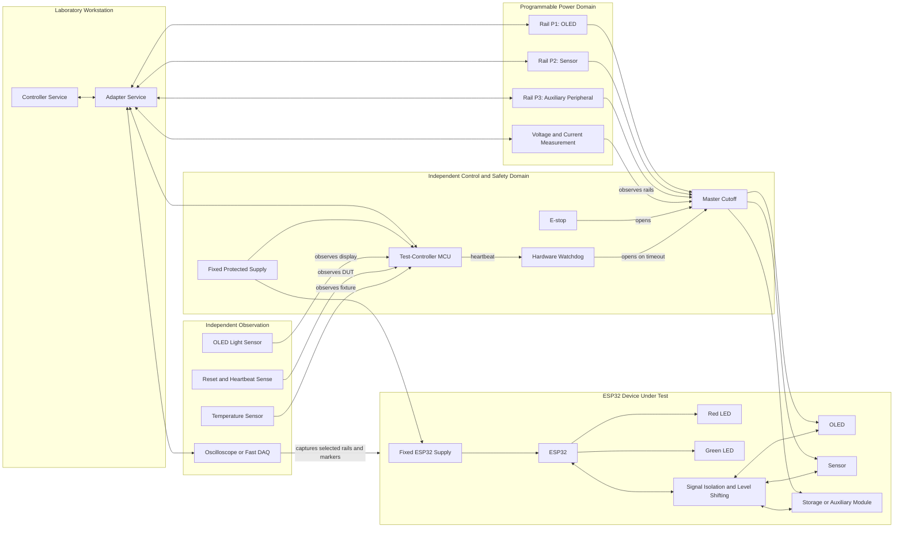
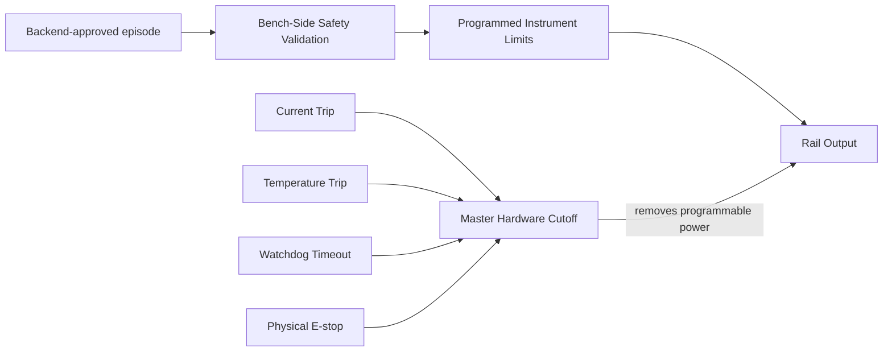

# ActiveQual HLD 02: Hardware Architecture

**Project:** ActiveQual: AI-Driven Adaptive Physical Testing for Embedded Systems  
**Document type:** High-Level Design  
**Status:** Initial draft for team review  
**Target delivery:** 12-week proof of concept  
**Depends on:** HLD 01 — System Context and Platform Boundaries  

## 1. Purpose

This document defines the physical architecture for the first ActiveQual test bench. It explains how the system:

- changes selected low-voltage power rails independently;
- commands workloads and component states on an ESP32-based device under test;
- measures what actually happens;
- detects functional and electrical failures;
- prevents a software proposal from directly becoming an unsafe electrical command;
- remains able to observe and shut down the test even if the device under test crashes.

Exact part numbers are not fixed in this document because the available laboratory instruments must be inventoried first. The design instead defines the electrical responsibilities and interfaces that every selected part must satisfy.

## 2. Hardware design goals

The hardware must:

1. expose at least three independently controllable low-voltage rails;
2. keep the test controller powered independently from the device under test;
3. measure actual voltage and current rather than trusting commanded values;
4. execute repeatable component states and bounded event timing;
5. externally observe at least one DUT output, initially the OLED;
6. detect ESP32 resets, heartbeat loss, and workload timeouts;
7. prevent back-powering through signal connections when a peripheral rail is off;
8. enforce current, voltage, temperature, watchdog, and emergency-stop protection;
9. return every controlled output to a defined shutdown state after an experiment;
10. support the same execution path for manual, baseline, and adaptive campaigns.

## 3. MVP decisions

| Area | MVP decision | Reason |
|---|---|---|
| DUT | One purpose-built ESP32 carrier with OLED, sensor, red LED, green LED, and one auxiliary peripheral | Provides continuous, discrete, and timed variables on one understandable board |
| Programmable rails | Three peripheral rails | Sufficient for the research demonstration while remaining buildable in 12 weeks |
| ESP32 supply | Fixed, stable DUT-controller rail for the first benchmark | Keeps the seeded peripheral-failure demo separate from an ESP32 power crash |
| Test controller | Separate RP2040- or STM32-class controller | Preserves timing, telemetry, and shutdown control when the DUT fails |
| Rail source | Borrowed programmable instruments preferred; custom rail cards supported | Reduces early hardware risk while retaining a lower-cost fallback |
| Measurement | Per-rail voltage/current read-back plus transient capture on selected channels | Confirms applied conditions and captures short electrical events |
| OLED oracle | External light sensor observing a known flashing region | Provides evidence independent of the DUT firmware's own claim |
| Event timing | Test-controller MCU schedules reviewed event templates | Laptop timing is not sufficiently deterministic for millisecond experiments |
| Safety | Software bounds, bench-side validation, instrument limits, hardware cutoff, fuse, watchdog, E-stop | No single application component is the only protection |

## 4. Physical architecture

Candidate-selection algorithms run in the Decision Service, which returns a candidate and rationale to the Agent Service. Agent submits that candidate to Backend; only a Backend-approved episode is available to the Controller Service. The Decision Service and Agent Service have no direct instrument, test-controller, or DUT connection. The physical architecture below begins at the Controller Service boundary and contains the independent bench-side checks and hardware protections.



## 5. Power domains

The test bench contains three different kinds of power. They must not be treated as one shared rail.

### 5.1 Control-domain supply

The control-domain supply powers:

- the test-controller MCU;
- hardware watchdog;
- emergency cutoff control;
- safety-status indicators;
- measurement circuitry that must remain alive after DUT power is removed.

This supply is fixed and protected. Adaptive search cannot change it.

### 5.2 Fixed DUT-controller supply

The fixed DUT-controller supply powers the ESP32 during the first benchmark. This allows the ESP32 to continue reporting heartbeat and event markers while ActiveQual changes peripheral rails.

The fixed ESP32 supply does not mean the ESP32 can authoritatively report whether the whole DUT worked. External rail measurements and the OLED light sensor remain independent observers.

### 5.3 Programmable peripheral rails

The three programmable rails are:

| Rail | Initial load | Controllable values | Primary observation |
|---|---|---|---|
| P1 | OLED | Voltage, enable state, slew within reviewed range | Voltage, current, visible OLED activity |
| P2 | Sensor | Voltage and enable state | Voltage, current, sensor response and timing |
| P3 | Storage or auxiliary module | Voltage and enable state | Voltage, current, workload completion |

The final autonomous ranges must come from the exact selected components' recommended operating conditions and fixture measurement uncertainty. Absolute-maximum ratings are not test values.

The system records:

- requested voltage;
- instrument-reported voltage;
- independently measured voltage where available;
- average and peak current;
- settling time;
- whether the rail remained inside tolerance;
- any protection trip.

## 6. Why the ESP32 rail is fixed initially

If ActiveQual lowers the ESP32 rail until the processor stops, the firmware can no longer command workloads or report telemetry. That is a valid future test, but it complicates the first implementation.

The first benchmark asks a narrower question:

> Can a peripheral fail under a legal combination of its supply voltage and DUT operating states while the test infrastructure remains observable?

After this path is stable, a later benchmark may vary the complete DUT input or ESP32 supply and use the independent test controller to detect brownouts and resets.

## 7. Signal isolation and back-power protection

Independent rails create a hidden electrical problem. Turning off a peripheral supply does not necessarily remove power from the peripheral. An ESP32 signal pin can push current through the peripheral's input-protection diode and partially power it.

For example:

```text
OLED rail OFF
ESP32 I2C signal HIGH
        ↓
current enters OLED through signal pin
        ↓
OLED is partially powered
```

This would make the experiment invalid and could stress the component.

The fixture must therefore include:

- signal buffers or level shifters that become high impedance when the target rail is off;
- output-enable control tied to rail state or power-good status;
- defined pull-up locations for I2C and similar buses;
- current-limiting resistors where appropriate;
- safe power-on and power-off sequencing;
- protection against a peripheral driving back into an unpowered ESP32;
- a wiring review for every signal crossing between power domains.

For the MVP, using separate ESP32 interfaces for independently powered I2C peripherals is preferred over placing all peripherals on one shared bus. Each branch can then be isolated and validated independently.

The hardware owner must verify the selected buffer or switch supports:

- the voltage range on both sides;
- powered-off high-impedance behavior;
- the required bus direction;
- the required communication speed;
- acceptable leakage at minimum rail voltage.

## 8. Test-controller MCU

The test-controller MCU is separate from the ESP32 DUT. It owns bench timing and safety communication.

### 8.1 Responsibilities

- receive a bounded episode plan from the Controller Service;
- verify protocol version, message length, checksum, and allowed command types;
- drive hardware trigger and workload-control lines;
- timestamp event execution;
- sample digital safety and observation inputs;
- maintain a heartbeat to the hardware watchdog;
- stop the episode on local timeout or trip;
- return execution timestamps and status;
- move controllable outputs to their shutdown state after every episode.

### 8.2 It does not own

- adaptive experiment selection;
- campaign budgets;
- test-contract editing;
- authoritative voltage limits derived from documentation;
- database persistence;
- final research conclusions.

### 8.3 Communication

The initial host connection may use USB serial with a versioned framed protocol. Every command should contain:

```text
protocol_version
message_type
episode_id
sequence_number
payload_length
payload
checksum
```

The protocol must support acknowledgement, timeout, explicit rejection, duplicate detection, and an emergency shutdown command.

## 9. Controller Service and Adapter Service boundary

The Controller Service executes the complete episode procedure. It uses the Adapter Service for equipment-specific actions.

Example:

```text
Controller Service:
  "Set OLED rail to 3.25 V and verify it settled within ±0.03 V"

Adapter Service:
  1. translate 3.25 V into the selected instrument command;
  2. send the command over USB, serial or LAN;
  3. read the instrument response;
  4. return measured voltage, status and errors.
```

An adapter must expose capabilities rather than pretending every instrument behaves identically:

```text
supports_voltage_setpoint
supports_output_enable
supports_current_limit
supports_voltage_readback
supports_current_readback
supports_hardware_trigger
minimum_setpoint
maximum_setpoint
resolution
settling_characteristics
```

The Controller Service refuses to arm a contract if the connected equipment lacks a required capability.

## 10. Measurement architecture

### 10.1 Slow measurements

Slow measurements determine whether a commanded operating point was correctly applied:

- steady rail voltage;
- steady current;
- fixture temperature;
- output-enabled state;
- instrument trip state.

Instrument read-back, a calibrated external ADC, or a DMM/DAQ may provide these values.

### 10.2 Fast measurements

Fast measurements capture events that averages can hide:

- voltage droop during Wi-Fi transmission;
- current spikes during storage writes;
- reset-line pulses;
- event timing between workloads;
- short rail overshoot during a setpoint change.

An oscilloscope or sufficiently fast DAQ receives a trigger from the test-controller MCU. At least one voltage channel and one timing marker should be captured for the MVP.

### 10.3 Measurement quality

An experiment is valid only if the required measurements:

- were captured;
- correspond to the correct episode;
- have synchronized timestamps or a known alignment marker;
- fall within the instrument's calibrated range;
- show that the commanded rail settled within tolerance;
- contain no unresolved overflow, clipping, communication, or trigger error.

Missing or untrustworthy measurement data produces `INVALID_EXPERIMENT`, not `DUT_FAILURE`.

## 11. OLED failure oracle

The DUT firmware will display a known pattern containing a flashing region. A light sensor is physically positioned over that region.

```text
ESP32 requests OLED refresh
        ↓
test controller records event marker
        ↓
light sensor must observe expected transitions
        ↓
oracle compares timing and intensity with reviewed thresholds
```

This distinguishes several cases:

| ESP32 heartbeat | OLED command acknowledgement | Optical activity | Interpretation |
|---|---|---|---|
| Healthy | Present | Present | Normal pass |
| Healthy | Present | Absent | Candidate OLED/display-path failure |
| Healthy | Absent | Absent | Workload or communication failure |
| Lost/reset | Unknown | Absent | DUT-controller failure |
| Healthy | Present | Invalid sensor data | Invalid experiment |

The exact failure verdict is made later by the software oracle using the captured evidence. The sensor itself only supplies observations.

## 12. DUT firmware interface

The ESP32 firmware exposes a small set of named workloads:

- `SET_RED_LED(ON|OFF)`;
- `SET_GREEN_LED(ON|OFF)`;
- `OLED_REFRESH(pattern_id)`;
- `SENSOR_READ`;
- `AUXILIARY_OPERATION`;
- `GET_HEARTBEAT`;
- `GET_RESET_REASON`;
- `RESET_TO_KNOWN_STATE`.

Every workload returns:

- episode ID;
- command sequence number;
- accepted/rejected status;
- start and completion timestamps or event markers;
- error code;
- relevant result value.

The seeded failure may change the OLED behavior under a hidden combination, but the firmware must not emit “seeded fault active” to the Agent Service, Decision Service, Controller Service, or oracle during an evaluation campaign.

## 13. Physical safety chain



### 13.1 Required protection

- current-limited upstream supply;
- per-channel current limit or fuse;
- software-configured instrument over-voltage and over-current limits where supported;
- master high-side switch, protected relay, or equivalent cutoff;
- normally safe behavior when control power or watchdog heartbeat is lost;
- physical E-stop reachable without using the UI;
- board-temperature monitoring;
- covered or keyed connectors to reduce wiring errors;
- visible armed, running, tripped, and safe indicators.

### 13.2 Shutdown state

The shutdown state is:

- programmable rails disabled or set to the reviewed zero-output condition;
- isolated signal paths disabled;
- DUT workload commands stopped;
- pending triggers cleared;
- E-stop and trip status preserved;
- control-domain measurement and logging kept alive.

A shutdown state is different from a lockout. Shutdown is a normal safe end state. Lockout requires the researcher to inspect and reset the physical system before another campaign.

## 14. Power and event sequence

Every physical episode follows this high-level sequence:

1. Confirm E-stop released, watchdog healthy, fixture identity correct, and no active trip.
2. Confirm the connected adapters support the contract's required capabilities.
3. Set all controllable outputs and signal isolators to shutdown state.
4. Reset the DUT to a known state.
5. Configure current limits and capture equipment.
6. Apply peripheral rails using the reviewed sequence and slew limits.
7. Read back rail values and wait for stable measurements.
8. Enable the corresponding signal paths.
9. Apply LED states and execute the bounded workload/event template.
10. Capture electrical, digital, firmware, temperature, and optical observations.
11. Disable signal paths before removing their peripheral rails.
12. Return all controllable outputs to shutdown state.
13. Upload the measured result and trace references.

Any failed prerequisite or invalid read-back stops the sequence before later steps execute.

## 15. Initial seeded benchmark

The first repeatable demo benchmark is:

```text
OLED rail is within a hidden interval around 3.2–3.3 V
AND red LED is ON
AND green LED is OFF
AND OLED_REFRESH is executed
        ↓
expected visible OLED pattern is absent
```

The final hidden interval must remain inside the selected OLED's reviewed operating range. Its exact width should be chosen through rehearsal so the benchmark is neither trivial nor practically undiscoverable within the declared budget.

The seeded predicate provides known ground truth for evaluation. It does not count as evidence of a naturally occurring electrical defect.

## 16. Hardware failure handling

| Condition | Immediate action | Recorded outcome |
|---|---|---|
| Rail fails to settle | Disable affected outputs | `INVALID_EXPERIMENT` |
| Instrument disconnects | Request cutoff and stop sequence | `INVALID_EXPERIMENT` or `SAFETY_ABORT` |
| Current or temperature trip | Hardware cutoff and lockout | `SAFETY_ABORT` |
| Test-controller heartbeat stops | Watchdog opens cutoff | `SAFETY_ABORT` |
| ESP32 heartbeat stops | Preserve independent capture for bounded time, then shut down | Candidate `DUT_FAILURE` |
| OLED optical response absent with healthy ESP32 and valid measurements | Complete bounded observation, then shut down | Candidate `DUT_FAILURE` |
| E-stop pressed | Immediate hardware cutoff and lockout | `SAFETY_ABORT` |
| Trace trigger missing | Shut down normally | `INVALID_EXPERIMENT` |
| Host application crashes | Watchdog/controller moves bench to shutdown | `SAFETY_ABORT` or indeterminate episode |

## 17. Instrument acquisition paths

### 17.1 Path A: borrowed laboratory instruments

Preferred when the laboratory can provide:

- remotely controllable power-supply channels;
- voltage/current read-back;
- programmable current limits;
- oscilloscope or DAQ with external trigger;
- calibrated DMM for verification.

Advantages:

- faster path to repeatable measurements;
- less analog power-supply design work;
- clearer calibration and protection specifications.

Risks:

- limited availability;
- incompatible remote-control interfaces;
- insufficient channel count;
- equipment cannot be reserved for repeated final experiments.

### 17.2 Path B: custom low-cost rail modules

A protected upstream supply feeds three independently controlled regulator/source modules. Each module requires:

- hardware-bounded output range;
- enable/gating control;
- calibrated voltage read-back;
- current sensing;
- local filtering and stability verification;
- output-discharge behavior;
- protection compatible with the connected load.

This path adds significant analog design, calibration, and safety work. It should be chosen only if appropriate laboratory instruments cannot be secured early.

### 17.3 Week-one inventory checklist

Record the following before selecting parts:

| Item | Information required |
|---|---|
| Programmable supply | Make/model, channel count, minimum voltage, resolution, current limit, read-back, remote interface |
| Oscilloscope | Make/model, channel count, bandwidth, sample rate, memory, external trigger, export/control interface |
| DMM/DAQ | Accuracy, calibration status, channel count, remote interface |
| Logic analyzer | Voltage compatibility, sample rate, trigger capability |
| Development boards | Exact ESP32, RP2040, and STM32 boards available |
| Safety equipment | E-stop, relays/switches, fuses, enclosed terminals, temperature sensors |
| Lab access | Hours per week and whether instruments can remain connected |

## 18. Acceptance tests

The hardware architecture is accepted for DUT campaigns only after:

1. Each rail rejects setpoints outside its hardware and software bounds.
2. Each rail is calibrated at minimum, midpoint, and maximum test values.
3. Requested and measured voltage remain distinguishable in recorded data.
4. An unpowered peripheral receives no unsafe back-power through signal pins.
5. Signals are disabled before a corresponding peripheral rail is removed.
6. Current-limit and temperature-trip tests open the cutoff.
7. Disconnecting the host or stopping the test-controller heartbeat returns the bench to shutdown.
8. The E-stop removes programmable power without application cooperation.
9. The test controller executes event templates within the declared timing tolerance.
10. The optical observer distinguishes known OLED pass and fail cases.
11. One hundred nominal episodes complete with fewer than 5% invalid experiments.
12. One thousand generated out-of-contract proposals result in zero instrument commands.

These tests demonstrate the behavior observed during acceptance. They do not prove that every possible hardware fault is impossible.

## 19. Implementation order

| Week | Hardware outcome |
|---:|---|
| 1 | Inventory instruments; select DUT modules, test controller, and rail strategy |
| 2 | Freeze block diagram, interfaces, connectors, limits, and initial bill of materials |
| 3 | Bring up test-controller communications and watchdog |
| 4 | Control and measure one rail using a dummy load |
| 5 | Add master cutoff, E-stop, trip handling, and shutdown sequence |
| 6 | Expand to three rails and verify back-power protection |
| 7 | Integrate ESP32 DUT workloads, heartbeat, and timing markers |
| 8 | Integrate optical observer and fast trace capture |
| 9 | Execute repeatable fixed-plan seeded benchmark |
| 10 | Run safety and disconnect acceptance tests |
| 11 | Rehearse repeated campaigns and repair invalid-experiment causes |
| 12 | Freeze hardware, calibration, wiring, and final evidence |

## 19.1 Part research findings (2026-11-05)

These findings narrow the open choices below. They are **Recommended, pending the laboratory inventory and the hardware/safety owner's review**; none is a final selection.

| Item | Finding | Implication |
|---|---|---|
| SSD1306 OLED controller | Solomon Systech lists the charge-pump supply VBAT at 3.3–4.2 V and logic VDD at 1.65–3.3 V; that page is marked preliminary. Some module datasheets give VBAT down to 3.0 V. [S1][S2] | The example OLED rail range of 3.00–3.60 V (PRD §9.2, HLD 04 §12) may sit partly below the controller's specified supply, and so may the seeded fault window around 3.20–3.30 V. The contract's autonomous range must come from the exact module's datasheet. |
| SSD1306 breakout modules | Many 0.96" modules carry an onboard 3.3 V regulator ("662K") and accept 3.3–5 V on VCC; not all do. [S3][S4] | On such a module, varying VCC between 3.0 and 3.6 V mostly operates the regulator in dropout, so the controller does not see the commanded voltage. Either use a module without the regulator, bypass it, or measure the rail on the controller side. |
| SSD1306 power-up | Reset pulse of at least 3 µs; panel on about 100 ms after VCC is stable. [S5] | Sets the minimum settle time before an OLED workload (HLD 03 §21.1). |
| BME280 sensor | VDD 1.71–3.6 V, VDDIO 1.2–3.6 V; absolute maximum 4.25 V. [S6] | A sensor rail of 3.0–3.6 V is inside the recommended range. Interface pins must stay within VDDIO + 0.3 V, which matters when the sensor rail is lowered (§7). |
| ESP32-S3 | Recommended supply 3.0–3.6 V, 3.3 V typical, at least 500 mA; power-on to `app_main` about 320 ms with default settings. [S7][S8] | Keeps the fixed DUT supply at 3.3 V (§6). DUT reset and boot timeout should allow at least 1 s. |
| I²C isolation | TI TCA9517/TCA9517A: high-impedance I²C pins when powered off, 5.5 V tolerant, independent supply rails in any order. [S9] | A candidate for the per-peripheral isolation required in §7. Confirm leakage and the powered-off current limits in the datasheet before selection. |
| Rail current and voltage monitoring | INA226: 16-bit, 2.5 µV shunt LSB, 10 µV max offset, 0.1% max gain error, selectable conversion time 140 µs–8.2 ms. INA219: 12-bit, lower cost. [S10] | INA226 preferred for read-back accuracy (NFR-05). Choose the shunt so the maximum current gives close to 81.92 mV. |
| Rail switching | TI TPS22918: 1–5.5 V, 2 A, configurable rise time, quick output discharge. [S11] | A candidate per-rail load switch: controlled slew limits inrush, and quick discharge helps confirm the shutdown state (§13.2). |
| Test-controller watchdog | RP2040 hardware watchdog maximum about 8.3 s. [S12] | Suitable as a backstop; the faster host-loss shutdown (1 s, HLD 05 §9.3) must be implemented in firmware, and the independent interlock remains required. |
| Custom programmable rails (Path B) | A DAC can trim an adjustable regulator by injecting current into its feedback node; current DACs such as LM10011 and LTC7106 exist for this. [S13][S14] | Supports the low-cost rail path in §17.2 and `SIMPLIFIED-PLAN.md`, but the start-up state, accuracy, and stability must be verified on a dummy load before any DUT use. |

Sources:
[S1] [Solomon Systech SSD1306](https://www.solomon-systech.com/?p=5534) ·
[S2] [DEP 096016B-W module datasheet](https://cdn.soselectronic.com/productdata/e3/cc/8632cd9a/dep-096016b-w.pdf) ·
[S3] [DM-OLED069-642 datasheet](https://cdn.shopify.com/s/files/1/0264/7629/files/DM-OLED069-642.pdf) ·
[S4] [0.96" SSD1306 OLED notes](https://docs.circuit.rocks/displays/oled-ssd1306/) ·
[S5] [Digilent PmodOLED reference](https://www.electrokit.com/upload/product/41010/41010136/PmodOLED_rm.pdf) ·
[S6] [Bosch BME280 datasheet](https://cdn.sparkfun.com/assets/5/3/0/f/7/BME280_Datasheet.pdf) ·
[S7] [ESP32-S3 hardware design guidelines](https://documentation.espressif.com/esp-hardware-design-guidelines/en/latest/esp32s3/index.html) ·
[S8] [ESP startup time optimization](https://docs.espressif.com/projects/esp-techpedia/en/latest/esp-friends/advanced-development/performance/reduce-boot-time.html) ·
[S9] [TI TCA9517](https://www.ti.com/product/TCA9517) ·
[S10] [INA219 vs INA226 comparison](https://esp32.co.uk/ina219-vs-ina226-vs-ina260-best-current-sensor-esp32/) ·
[S11] [TI TPS22918 datasheet](https://www.ti.com/lit/pdf/SLVSD76) ·
[S12] [Pico SDK hardware_watchdog](https://picodocs.pinout.xyz/group__hardware__watchdog.html) ·
[S13] [TI SLVA861](https://edgeworker.ti.com/lit/pdf/slva861) ·
[S14] [Analog Devices: dynamically adjust output voltage](https://www.analog.com/en/resources/technical-articles/dynamically-adjust-the-right-output-voltage.html)

## 19.2 Planning estimates (2026-11-06)

**ActiveQual decision:** software, simulator profiles, firmware test vectors and the initial contract use the values below until WP5 (HLD 10) measures the real ones. **They are planning estimates derived from datasheets and published measurements, not reviewed safety limits.** No physical campaign may use them without the hardware owner's review (HLD 04 §15), and every value replaced by a measurement is recorded with the fixture version that produced it.

### Latency measurement noise and guard band

The OLED latency observation (limit 120 ms, HLD 06 §6) has three main sources of timing jitter:

| Source | Estimate | Basis |
|---|---|---|
| Panel scan phase | Frame period about 9.3 ms (about 107 Hz from Fosc / (D × K × MUX) = 370 kHz / (1 × 54 × 64)); a write waits uniformly for the scan, σ ≈ 9.3 / √12 ≈ 2.7 ms | SSD1306 typical oscillator and default settings [S15] |
| Firmware tick | ESP-IDF's default `CONFIG_FREERTOS_HZ` is 100 (10 ms ticks, σ ≈ 2.9 ms); at 1000 Hz, σ ≈ 0.3 ms | ESP-IDF FreeRTOS Kconfig [S16] |
| Optical detection | Photodiode or phototransistor into a comparator, timed by test-controller timer capture: microseconds, negligible | — |

A full 128×64 frame over I²C at 400 kHz takes about 1,024 bytes × 9 clocks / 400 kHz ≈ 23 ms. That is a fixed offset in the latency, not noise.

- **Decision:** DUT firmware sets `CONFIG_FREERTOS_HZ=1000`, removing the tick term.
- **Planning σ = 3 ms, guard band U = 2σ = 6 ms.** The inconclusive band is 114–126 ms against the 120 ms limit. With the default 100 Hz tick, σ would be about 4 ms (5 ms with margin, U = 10 ms).
- Kill criterion K4 (HLD 10 §8) is far away: it needs σ near 10 ms, which these sources do not produce. A measured σ well above 3 ms points to an unmodelled source (I²C clock stretching, Wi-Fi task preemption) to be found in WP5 before campaigns.
- The HLD 06 simulator profiles at σ = 2.5 ms remain the closest match. The σ = 10 ms rows are a stress case.

### Rail accuracy and settling

| Quantity | Planning value | Basis |
|---|---|---|
| Rail read-back error (INA226 bus voltage) | ±5 mV at 3.6 V: 0.1% maximum gain error (3.6 mV) plus one 1.25 mV LSB | INA226 datasheet [S17] |
| Settled tolerance | ±10 mV, one search step, so read-back error uses at most half of it | — |
| Search step | 10 mV, as in the HLD 06 benchmarks | HLD 06 §3 |
| Settle check | Three consecutive in-tolerance readings at 1.1 ms conversion with 16-sample averaging (about 18 ms each for bus voltage alone, 35 ms with shunt and bus both converted); timeout 500 ms gives `INVALID_EXPERIMENT` | INA226 conversion times [S10] |
| OLED ready after rail settles | 150 ms: about 100 ms panel-on time [S5] plus margin | [S5] |
| DUT boot timeout | 1 s: about 320 ms to `app_main` [S8] | [S8] |

### Current and temperature limits

| Rail or quantity | Expected | Planning trip | Basis |
|---|---|---|---|
| OLED rail (0.96" SSD1306 module) | About 20 mA typical, 25 mA measured peak with all pixels lit | 40 mA (1.6× peak); warning at 30 mA | Vendor specification and a published bench measurement [S18][S19] |
| ESP32-S3 fixed 3.3 V rail | Wi-Fi transmit peaks about 285–355 mA, depending on mode and module | Supply rated at least 500 mA [S7]; trip at 600 mA | Third-party reproductions of the Espressif current tables [S20]; confirm in the current module datasheet |
| Sensor rail (BME280) | Sub-milliampere | 10 mA, to cover pull-ups and the isolation buffer | Not yet sourced: confirm from the BME280 datasheet [S6] |
| Fixture temperature | Room temperature | 45 °C | Policy choice, well inside the parts' rated ranges: a heating fixture stops the campaign before it can bias measurements. Confirm against each part's datasheet |

### Episode duration

Boot (up to 1 s) + rail settle and OLED ready (about 0.2 s) + workload and observation (2–5 s) + ordered shutdown and discharge (about 0.5 s) gives **about 4–7 s, planned as 8 s**. This sits inside the 6–10 s HLD 06 §8 uses for bench-time estimates, so its estimate of about 3–5 hours per two-planner comparison stands.

### Part defaults

| Choice | Planning default | Reason |
|---|---|---|
| OLED module (§20 Q8, Q9) | A 0.96" SSD1306 module without an onboard regulator, or with it bypassed; autonomous range 3.00–3.60 V | With the regulator in dropout the controller does not see the commanded voltage [S3][S4]; some module datasheets allow VBAT down to 3.0 V [S2]. The seeded window 3.20–3.30 V stays inside the range |
| Test-controller MCU | RP2040 (Raspberry Pi Pico) | HLD 01 lists RP2040 or STM32; the RP2040 has a hardware watchdog [S12] and timer capture, and it is cheap and easy to get |
| OLED oracle (§20 Q7) | Light sensor over a flashing region, as in §11 | Enough for the MVP; checking displayed content is a stretch goal |
| Monitoring and isolation (§20 Q10) | INA226 on the OLED and sensor rails; supply read-back or INA219 on the fixed ESP32 rail; TCA9517 on each I²C branch | §19.1 |

Sources:
[S15] [SSD1306 frame-rate relation and typical Fosc, as quoted from the datasheet](https://hackaday.com/2018/05/08/push-it-to-the-limit-ssd1306-at-150-fps) and the [SSD1306 datasheet](https://academy.cba.mit.edu/classes/output_devices/OLED/SSD1306.pdf) ·
[S16] [ESP-IDF FreeRTOS Kconfig (mirror), `FREERTOS_HZ` default 100](https://git.eaw.app/eaw/esp-idf/raw/branch/master/components/freertos/Kconfig) and the [CircuitPython discussion of the 100 Hz default](https://github.com/adafruit/circuitpython/issues/9133) ·
[S17] [TI INA226 datasheet](https://www.ti.com/document-viewer/INA226/datasheet/GUID-XXXXXXXX-SF0T-XXXX-XXXX-000000348723) ·
[S18] [Soldered 0.96" SSD1306 module](https://docs.soldered.com/ssd1306/overview/) ·
[S19] [SSD1306 128×64 current measurement](https://preamp.org/static/ssd1306-oled-current-consumption/index.html) ·
[S20] [ESP32-S3 power consumption table (Deneyap Kart)](https://deneyapkart.org/en/docs/guc-tuketimi-esp32-s3)

## 20. Decisions required next

The team must next determine:

1. Which programmable supplies, oscilloscope, DMM/DAQ, and logic analyzer are available?
2. Which exact ESP32 development board will be the DUT?
3. Which OLED, sensor, and auxiliary/storage module will be used?
4. Will the laboratory allow instruments to remain connected for repeated overnight evaluation?
5. Can three independent programmable channels be borrowed, or must rail modules be built?
6. What current and temperature limits will the hardware owner and faculty guide approve?
7. Is a light-sensor OLED oracle sufficient, or must the benchmark detect incorrect displayed content?
8. Which OLED module (with or without an onboard regulator), and what autonomous OLED rail range its datasheet supports (§19.1)?
9. Is the seeded fault window inside that range, or must it move?
10. Which rails get INA226-class monitoring, and which isolation part is used per peripheral branch?

Questions 7–10 have planning defaults in §19.2, and question 6 has planning values there that still need approval. Questions 1–5 depend on the laboratory inventory and are answered in week 1 (HLD 10 §6). Until the hardware owner reviews them, this HLD fixes responsibilities and interfaces, and the component-specific electrical limits remain planning values only.
