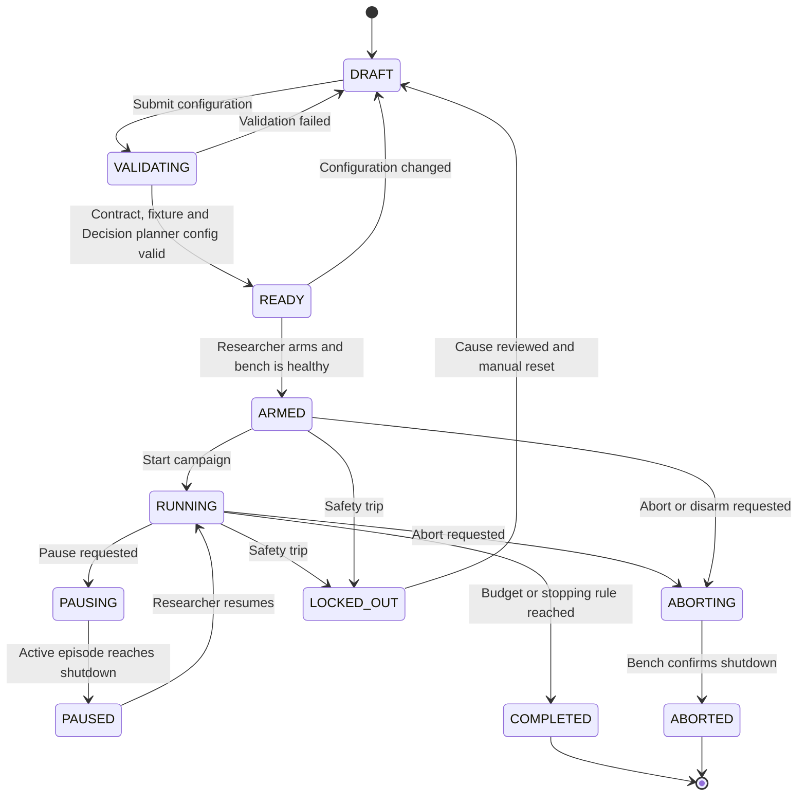
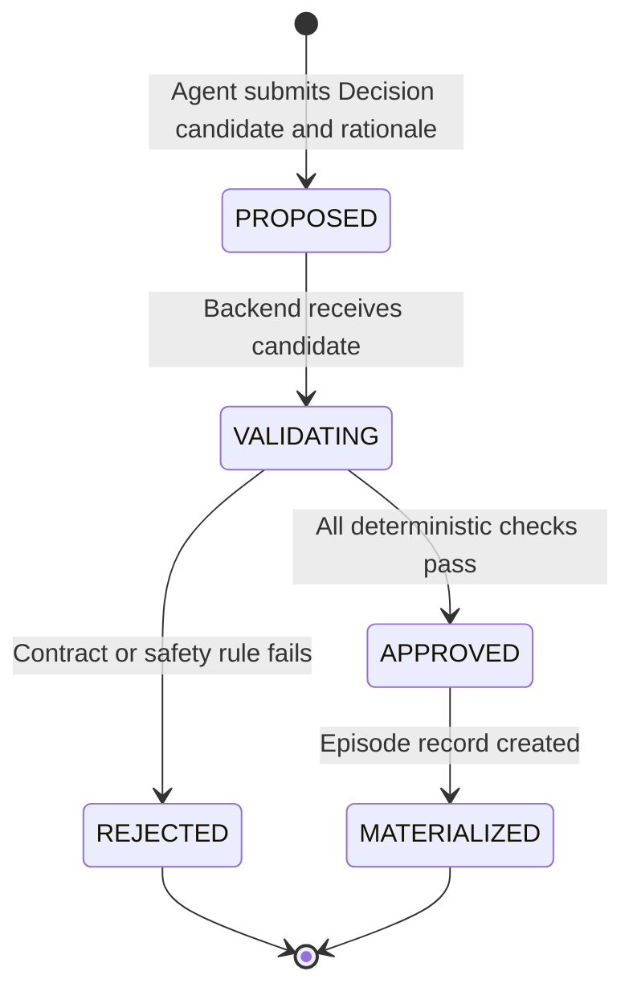
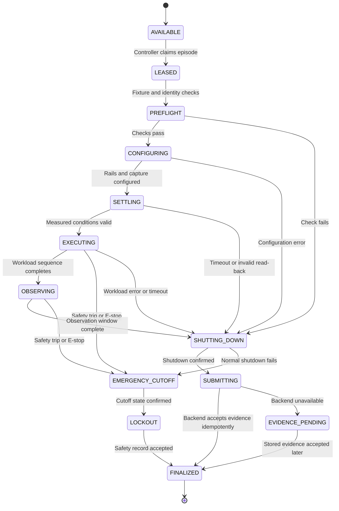
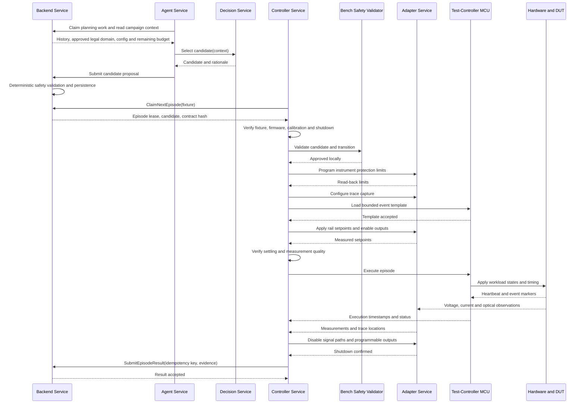

# ActiveQual HLD 03: Episode Execution and Safety State Machine

**Project:** ActiveQual: AI-Driven Adaptive Physical Testing for Embedded Systems<br>
**Document type:** High-Level Design<br>
**Status:** Initial draft for team review<br>
**Target delivery:** 12-week proof of concept<br>
**Depends on:** HLD 01 — System Context and Platform Boundaries; HLD 02 — Hardware Architecture

## 1. Purpose

This document defines how ActiveQual safely executes physical experiments.

It specifies:

- campaign states;
- experiment-proposal states;
- physical episode states;
- ownership and lease rules;
- safety checks performed before and during execution;
- normal shutdown and emergency cutoff behavior;
- result classification;
- retries, recovery, and idempotency;
- responsibilities of the Backend, Agent, Decision, Controller, and Adapter Services.

The goal is to make every physical action explainable and recoverable. At any moment, the system should be able to answer:

1. Which campaign and episode are active?
2. Which component currently owns the episode?
3. Which approved contract and fixture are being used?
4. What physical phase is running?
5. What was requested and what was measured?
6. Why did execution continue, stop, or enter lockout?

## 2. Key terms

| Term | Meaning |
|---|---|
| Campaign | A complete budgeted research run using one contract, fixture, planner, seed, and stopping policy |
| Candidate | An experiment selected by the Decision Service, submitted by the Agent Service, and awaiting safety approval |
| Decision context | Campaign history, approved legal domain, planner configuration, and remaining budget supplied by Agent for one selection request |
| Episode | One durable reset-to-reset physical experiment |
| Attempt | One effort to physically execute an episode; an episode is not silently retried |
| Lease | Time-bounded ownership allowing one Controller Service instance to execute one approved episode |
| Phase | The current physical step inside a leased episode |
| Outcome | The scientific classification assigned after execution |
| Shutdown | Normal transition to the defined zero-output or disabled state |
| Safety abort | Execution stopped because a safety rule, protection device, watchdog, or E-stop was triggered |
| Lockout | State preventing further physical execution until the cause is reviewed and manually cleared |
| Invalid experiment | A trial whose conditions or evidence are not trustworthy enough for scientific analysis |

## 3. Design principles

1. **Persist intent before action.** No physical command executes until the candidate, validation result, contract version, and fixture identity are stored.
2. **One physical owner.** Only the Controller Service holding the active lease may execute an episode.
3. **Lease does not bypass safety.** A valid lease authorizes ownership, while safety validation separately decides whether commands may execute.
4. **State and outcome are separate.** Execution state describes where the process is; outcome describes what the experiment demonstrated.
5. **Shutdown is part of every episode.** Success, DUT failure, invalid data, timeout, and most errors all lead through a bounded shutdown path.
6. **Hardware protection does not wait for software.** E-stop, watchdog, current, and temperature protection can open the cutoff directly.
7. **Unknown is recorded as unknown.** Missing evidence is not converted into a DUT failure or pass.
8. **Physical retries are explicit experiments.** A repeated run receives a new episode ID linked to the original.
9. **The same runner executes every planner.** Manual, fixed, random, pairwise, space-filling, and adaptive candidates selected through Decision use the same states and safety checks.
10. **Every transition has a reason.** State changes are recorded as append-only events with actor, timestamp, and reason.

## 4. Responsibility boundaries

| Component | State-machine responsibility |
|---|---|
| Console | Requests campaign actions and displays state; does not directly change hardware state |
| BFF Service | Adds trusted researcher/project context and forwards valid user actions |
| Backend Service | Owns authoritative campaign, candidate, episode, lease, and outcome records |
| Agent Service | Owns campaign planning lifecycle, obtains history/domain/configuration/budget from Backend, supplies Decision context, submits returned candidates, accounts for budget, and schedules confirmation/minimization work |
| Decision Service | Implements the common planner interface and candidate-selection algorithms; returns a candidate and rationale for supplied context |
| Backend Safety Validator | Evaluates proposed candidates against the approved test contract |
| Controller Service | Claims one episode, runs the physical state machine, and submits evidence |
| Bench-Side Safety Validator | Rechecks the episode and current fixture state immediately before execution |
| Adapter Service | Executes typed instrument operations and returns read-back or explicit errors |
| Test-controller MCU | Executes bounded real-time event templates and maintains the hardware-watchdog heartbeat |
| Oracle | Classifies valid observations using reviewed deterministic rules |
| Hardware interlock | Removes programmable power independently on trip, timeout, or E-stop |
| Researcher | Arms, pauses, aborts, disarms, and manually clears lockout after investigation |

## 5. Separation of lifecycle and scientific outcome

An episode can finish executing without being a pass.

For example:

```text
Lifecycle state: FINALIZED
Scientific outcome: DUT_FAILURE
```

The lifecycle tells us that ActiveQual safely completed and stored the experiment. The outcome tells us that the DUT violated a requirement.

The MVP uses these outcomes:

| Outcome | Meaning | May update Decision Service model? |
|---|---|---:|
| `PASS` | All required observations were valid and requirements passed | Yes |
| `DUT_FAILURE` | Valid independent evidence shows a requirement violation | Yes |
| `INVALID_EXPERIMENT` | Requested conditions were not applied correctly or required evidence is unreliable | No |
| `SAFETY_ABORT` | A safety limit, protection mechanism, watchdog, or E-stop stopped the episode | No for the functional model; yes for safety reporting |

An optional `SYSTEM_ERROR` operational reason may be stored internally, but the corresponding scientific outcome remains `INVALID_EXPERIMENT` unless a safety event requires `SAFETY_ABORT`.

## 6. Campaign state machine



### 6.1 Campaign states

| State | Meaning | New physical episode allowed? |
|---|---|---:|
| `DRAFT` | Configuration is editable and not approved for execution | No |
| `VALIDATING` | Backend checks contract, fixture, Decision planner configuration, budget, and compatibility | No |
| `READY` | Configuration is valid but the physical bench is not armed | No |
| `ARMED` | Researcher confirmed the fixture and the bench reports healthy | No, until campaign start |
| `RUNNING` | Agent Service may request candidate selection from Decision and submit candidates; Controller Service may claim approved episodes | Yes |
| `PAUSING` | No new lease is issued; active episode must reach shutdown | No |
| `PAUSED` | Campaign state is retained but no physical work is available | No |
| `ABORTING` | Active work is being stopped and the bench is moving to shutdown | No |
| `COMPLETED` | Budget or stopping rule ended the campaign normally | No |
| `ABORTED` | Researcher or system ended the campaign before normal completion | No |
| `LOCKED_OUT` | Safety event requires physical investigation and manual reset | No |

### 6.2 Arming conditions

A campaign may enter `ARMED` only when:

- the contract version is approved and immutable;
- fixture identity matches the contract;
- DUT and test-controller firmware identities match approved values;
- calibration is present and current;
- required adapters report compatible capabilities;
- programmable outputs report shutdown state;
- E-stop is released;
- hardware interlock and watchdog report healthy;
- no unresolved trip or lockout exists;
- the researcher explicitly arms the campaign.

Changing the contract, fixture, firmware, calibration, planner configuration, or safety limits invalidates the arm state.

## 7. Candidate state machine

Candidates are Decision Service selections returned to Agent. Agent submits them to Backend; they are not yet executable episodes.



### 7.1 Candidate rejection

Rejection does not consume a physical-experiment budget because the hardware was not touched. It does consume planner effort and is recorded with the candidate rationale for diagnostics.

The Backend Service returns a structured reason such as:

- value outside autonomous range;
- forbidden state combination;
- unsafe transition from shutdown state;
- slew or dwell constraint violated;
- event template not approved;
- episode duration exceeds maximum;
- required observation missing;
- planner output malformed;
- stale contract version;
- fixture cannot provide a required capability.

Repeated candidate rejection is visible in the Console because it may indicate a planner or contract-design error.

## 8. Episode lifecycle



### 8.1 Episode states

| State | Owner | Required behavior |
|---|---|---|
| `AVAILABLE` | Backend Service | Approved episode is durable and may be claimed |
| `LEASED` | Backend + Controller | One Controller instance owns a time-bounded execution lease |
| `PREFLIGHT` | Controller Service | Revalidate identities, contract, current bench state, adapters, and shutdown state |
| `CONFIGURING` | Controller Service | Program protection limits, capture settings, initial outputs, and event plan |
| `SETTLING` | Controller Service | Wait for and verify measured rail stability |
| `EXECUTING` | Test-controller MCU + Controller | Execute the approved workload and timing template |
| `OBSERVING` | Controller Service | Complete the bounded measurement window |
| `SHUTTING_DOWN` | Controller Service | Disable signals, remove programmable rails, and confirm safe state |
| `EMERGENCY_CUTOFF` | Hardware + Controller | Open cutoff immediately and stop ordinary sequencing |
| `LOCKOUT` | Hardware + Backend | Prevent new physical work until manual review |
| `SUBMITTING` | Controller Service | Submit episode facts, observations, events, and trace references |
| `EVIDENCE_PENDING` | Controller Service | Retain checksummed local evidence until Backend is available |
| `FINALIZED` | Backend Service | Outcome and evidence manifest are durable and immutable except for annotations |

## 9. Episode lease

The lease prevents two Controller Service instances from executing the same episode.

The lease record contains:

```text
lease_id
episode_id
controller_instance_id
fixture_id
issued_at
expires_at
last_heartbeat_at
attempt_number
contract_hash
```

### 9.1 Lease rules

- Only an `AVAILABLE` episode in a `RUNNING` campaign can be leased.
- The claim is an atomic Backend operation.
- A Controller instance can hold only one physical episode per fixture.
- The lease is bound to a fixture, contract hash, and Controller identity.
- Heartbeats may extend the lease only up to the episode's maximum declared duration plus bounded shutdown allowance.
- Pausing or aborting prevents new leases.
- Losing a lease does not instruct hardware to continue.
- The Backend does not issue a second lease while the first Controller may still be physically active.

### 9.2 Expired lease behavior

An expired lease is not automatically made available for immediate physical retry.

The Backend marks it for reconciliation because the original Controller may have:

- executed the episode but failed to upload;
- lost network connectivity while hardware remained active;
- crashed and triggered watchdog shutdown;
- never started the physical sequence.

The researcher or reconciliation logic must establish the observed bench state and retrieve any local evidence before deciding what happens next.

## 10. Detailed physical execution flow



## 11. State-specific safety checks

### 11.1 Candidate validation

Before an episode exists, the Backend Safety Validator checks:

- static voltage, current, temperature, duration, and timing bounds;
- categorical values and required fields;
- forbidden combinations;
- approved event-template structure;
- safe transition from the defined initial state;
- maximum slew and minimum dwell constraints;
- required observations and oracle compatibility;
- fixture capability compatibility.

### 11.2 Preflight validation

Immediately before hardware commands, the Controller Service checks:

- campaign remains `RUNNING`;
- lease remains valid and belongs to this Controller;
- contract and firmware hashes match;
- fixture identity matches;
- E-stop, interlock, watchdog, and adapters are healthy;
- outputs are currently in shutdown state;
- no stale instrument error or protection trip exists;
- the candidate still passes local deterministic validation.

### 11.3 Live validation

During `CONFIGURING`, `SETTLING`, `EXECUTING`, and `OBSERVING`, the system monitors:

- measured voltage against hard and experiment-specific limits;
- measured current against trip limits;
- fixture temperature;
- test-controller watchdog heartbeat;
- maximum episode duration;
- instrument communication;
- requested versus measured rail tolerance;
- manual E-stop.

A functional symptom such as missing OLED activity does not immediately trigger emergency cutoff unless it is accompanied by a safety condition. The system captures the bounded observation window and then shuts down normally.

## 12. Normal shutdown

Normal shutdown is ordered:

1. Stop new DUT workload commands.
2. End or disarm trace capture after the required observation window.
3. Disable signal paths into independently powered peripherals.
4. Disable programmable peripheral rails.
5. Confirm measured rails reached their shutdown threshold.
6. Clear pending test-controller triggers.
7. Preserve trip and instrument status.
8. Keep control-domain measurement and communication powered.
9. Submit evidence.

If a required normal-shutdown step fails or times out, the Controller requests emergency cutoff and records the failure.

## 13. Emergency cutoff and lockout

Emergency cutoff bypasses the normal ordered sequence when waiting would increase risk.

Triggers include:

- E-stop pressed;
- hardware watchdog timeout;
- hard over-current trip;
- hard over-voltage trip;
- hard temperature trip;
- critical instrument error with uncertain output state;
- normal shutdown unable to disable an energized rail.

The required behavior is:

1. Hardware cutoff removes programmable power.
2. Test controller stops event outputs.
3. Controller Service stops issuing ordinary commands.
4. Available measurements and trigger reasons are preserved.
5. Campaign enters `LOCKED_OUT`.
6. Console displays the reason and physical checks required.
7. Researcher inspects the fixture and manually resets the interlock.
8. Campaign returns to `DRAFT`; it is not automatically re-armed.

**Open decision: resuming after a lockout.** Returning to `DRAFT` discards the campaign's place in its budget, which breaks the research accounting for a campaign that tripped once for a fixture reason.

**Recommended:** keep the safety behavior above (no automatic re-arm, physical review required). After review, allow the researcher to create a *continuation* campaign that links to the locked-out one, inherits its history and remaining budget, and must pass validation and arming again. A continuation is allowed only if the contract, fixture, firmware, and calibration hashes are unchanged; otherwise a new campaign starts. Reports present the two as one campaign with a recorded lockout gap.

## 14. Pause, abort, and disarm

These actions are intentionally different.

| Action | Effect |
|---|---|
| Pause | Stop issuing new leases; allow the current safe episode to finish and shut down |
| Abort | Stop new work and request the current episode to end at the earliest safe boundary |
| E-stop | Immediately open the hardware cutoff without waiting for a software boundary |
| Disarm | Remove authorization for future physical execution after the bench is shut down |

If an abort is requested during a phase where immediate normal shutdown could create an unsafe transition, the Controller follows the contract's safe abort sequence. The E-stop remains available independently.

## 15. Outcome classification

Outcome classification occurs only after the required evidence is available or explicitly known to be unavailable.

### 15.1 Classification order

1. Did a safety mechanism trigger? If yes, `SAFETY_ABORT`.
2. Were the requested conditions applied and measured within tolerance? If no, `INVALID_EXPERIMENT`.
3. Are all required observations present and trustworthy? If no, `INVALID_EXPERIMENT`.
4. Did a reviewed failure rule evaluate true? If yes, `DUT_FAILURE`.
5. Did all reviewed pass requirements hold? If yes, `PASS`.
6. Otherwise, `INVALID_EXPERIMENT` with an inconclusive-oracle reason.

### 15.2 Example

```text
Requested OLED rail: 3.250 V
Measured OLED rail: 3.247 V
Red LED: ON
Green LED: OFF
ESP32 heartbeat: healthy
OLED command acknowledged: yes
Optical pattern observed: no
Safety trip: none

Lifecycle: FINALIZED
Outcome: DUT_FAILURE
Reason: expected OLED optical transition absent
```

## 16. Idempotency and duplicate handling

Network retries must not create duplicate episodes, leases, or results.

Required idempotency keys:

- candidate submission: campaign ID + planner sequence number;
- episode creation: approved candidate ID;
- lease claim: Backend-generated lease ID;
- result submission: episode ID + attempt number + evidence-manifest hash;
- trace upload: content hash.

If the same result is submitted again with the same hash, Backend returns the previous success. If the episode and attempt match but the hash differs, Backend rejects the request and raises an integrity error.

## 17. Retry policy

### 17.1 Safe automatic retries

Only non-physical operations may be retried automatically, such as:

- reading campaign state;
- renewing a healthy lease;
- uploading an unchanged trace;
- resubmitting the identical evidence manifest;
- reconnecting to a disabled instrument;
- refreshing Console status.

### 17.2 Physical retries

ActiveQual never silently repeats a physical episode after an ambiguous timeout.

A confirmation or retry:

- receives a new episode ID;
- links to the original episode;
- records why it was repeated;
- consumes budget according to the pre-registered policy;
- passes through all safety and lease checks again.

This preserves scientific accounting and prevents an unseen first attempt from being mistaken for a single experiment.

## 18. Recovery matrix

| Failure point | Physical assumption | Recovery |
|---|---|---|
| Agent Service fails before proposal | No episode exists | Restart Agent; campaign remains running but idle |
| Decision Service is unavailable or returns no candidate | No proposal is submitted | Keep campaign state and budget authoritative in Backend; resume planning after Decision is available |
| Backend fails before lease | No physical owner | Restart Backend and expose the existing available episode |
| Backend fails during a leased episode | Controller may be active | Controller completes only its bounded lease, shuts down, and spools evidence |
| Controller fails before enabling rails | Shutdown expected | Verify instrument read-back before reconciling |
| Controller fails with rails enabled | State uncertain | Watchdog opens cutoff; enter lockout |
| Adapter returns timeout | Instrument state uncertain | Request cutoff; do not assume command failed |
| Test-controller MCU resets | Timing and outputs uncertain | Hardware watchdog/cutoff; enter lockout |
| DUT resets | Test infrastructure remains alive | Complete bounded independent capture and classify using valid evidence |
| Trace storage unavailable | Physical run may be valid but evidence incomplete | Spool locally; classify only after required evidence is accepted |
| Console disconnects | Backend and Controller remain authoritative | Continue only under campaign policy; researcher can reconnect |

## 19. Persisted events and audit trail

Every state transition appends an event containing:

```text
event_id
campaign_id
episode_id, when applicable
attempt_number, when applicable
previous_state
new_state
actor_type
actor_id
reason_code
human_readable_reason
backend_timestamp
controller_timestamp, when applicable
contract_hash
fixture_id
```

Important hardware events, including output enable, setpoint read-back, workload trigger, DUT reset, trip, and cutoff, are also stored with trace-alignment timestamps.

The current-state columns make normal reads efficient. The append-only event history explains how that state was reached.

## 20. Concurrency

The MVP allows:

- one active campaign per physical fixture;
- one leased or executing episode per fixture;
- one Agent Service planning lifecycle step per campaign, including at most one outstanding Decision Service selection request;
- multiple researchers viewing the campaign;
- only one accepted state-changing researcher action for a given version.

Optimistic concurrency prevents two browser actions from both changing the same campaign state. A request includes the campaign version it was based on; stale requests are rejected and the Console refreshes.

## 21. Timeouts

Every wait is bounded and configured by the reviewed contract or fixture configuration.

| Timeout | Example purpose |
|---|---|
| Lease heartbeat | Detect lost Controller ownership |
| Instrument command | Detect non-responsive adapter or instrument |
| Rail settling | Prevent indefinite wait for an unreachable voltage |
| DUT command acknowledgement | Detect communication/workload failure |
| Workload completion | Bound the active experiment |
| Observation window | Define when the oracle has enough data |
| Normal shutdown | Escalate to cutoff if outputs cannot be disabled |
| Total episode duration | Final software bound independent of individual phase timers |
| Hardware watchdog | Remove power if the test controller stops proving liveness |

Exact values belong to the test contract and fixture configuration. The system must reject configurations where the total phase limits exceed the maximum episode duration.

### 21.1 Recommended starting values

**Recommended, to be replaced by measurements from the thin hardware slice (HLD 10, WP5).** Each value states its basis so it can be re-derived when parts change.

| Timeout | Starting value | Basis |
|---|---|---|
| Lease heartbeat interval / expiry | 1 s / 5 s | Detects a lost Controller well inside one episode (HLD 05 §11) |
| Host → MCU heartbeat / MCU host-loss shutdown | 250 ms / 1 s | HLD 05 §9.3 |
| MCU hardware watchdog | 2 s (maximum available about 8.3 s on RP2040) | Backstop for firmware lockup only; the interlock remains independent (HLD 02 §19.1) |
| Instrument or MCU command acknowledgement | 100 ms | USB round trip of a few ms plus margin |
| DUT reset and boot to heartbeat | 2 s | ESP32-S3 reaches `app_main` in about 320 ms with default settings; margin for firmware start-up (HLD 02 §19.1) |
| Rail settling | 200 ms, requiring 3 consecutive in-tolerance read-backs | Linear regulators and load switches settle in milliseconds; the read-back requirement guards against overshoot |
| OLED ready after its rail is stable | 150 ms | SSD1306 panel on about 100 ms after VCC is stable (HLD 02 §19.1) |
| DUT command acknowledgement | 250 ms | Firmware command loop plus UART latency |
| Workload completion | From the event template; at most 5 s | Bounded by the contract's `maxEpisodeS` |
| Observation window | 500 ms to 2 s, from the contract | Long enough for several OLED frames and heartbeats (heartbeat limit 500 ms) |
| Normal shutdown | 500 ms | Escalate to emergency cutoff if outputs are not confirmed off |
| Total episode | 10 s (PRD example `total_episode_s_max`) | Final software bound |

## 22. Console behavior

The Console displays:

- campaign state and allowed researcher actions;
- current episode and physical phase;
- lease owner and last heartbeat;
- requested and measured values;
- remaining episode and phase time;
- E-stop, watchdog, interlock, and trip status;
- latest outcome and reason;
- candidate rejection reasons;
- invalid-experiment reasons;
- shutdown confirmation;
- lockout cause and manual recovery checklist.

Errors cannot appear only in logs. A researcher must be able to understand why a campaign stopped without opening backend or Controller process output.

## 23. State-machine acceptance tests

### 23.1 Software tests

- every allowed transition succeeds;
- every unlisted transition is rejected;
- stale campaign versions cannot change state;
- only one Controller can claim an episode;
- malformed and unsafe candidates never become available episodes;
- duplicate result submission is idempotent;
- conflicting result hashes are rejected;
- pause prevents new leases;
- physical retry creates a linked new episode;
- `INVALID_EXPERIMENT` does not update the functional Decision Service model;
- all transitions create audit events.

### 23.2 Simulator tests

- normal pass;
- valid DUT failure;
- rail-settling timeout;
- missing OLED observation;
- DUT heartbeat loss;
- instrument disconnect before output enable;
- instrument disconnect after output enable;
- Backend loss during execution;
- Controller crash during execution;
- test-controller watchdog expiry;
- E-stop during each physical phase;
- failed normal shutdown escalating to cutoff;
- evidence upload failure and later recovery.

### 23.3 Physical acceptance tests

- dummy-load pass through every normal phase;
- pause during an active episode;
- researcher abort at safe boundaries;
- physical E-stop while rails are enabled;
- unplug Controller host connection and confirm watchdog cutoff;
- unplug instrument communication and confirm uncertain state is treated safely;
- deliberately prevent a rail from settling;
- cause a known DUT reset while independent capture continues;
- repeat the same stored counterexample as a new linked episode;
- run 100 nominal episodes without an unexplained state or orphaned lease.

## 24. Decisions made in this document

1. Campaigns, candidates, episode lifecycle, and scientific outcomes use separate state models.
2. Decision selects candidates and returns rationale; Agent owns campaign orchestration, budget accounting, proposal submission, confirmation, and minimization scheduling. Decision has no persistence, safety approval, or hardware authority.
3. The Backend Service owns authoritative durable state.
4. The Controller Service owns the local physical state machine.
5. Physical ownership uses a time-bounded, fixture-bound episode lease.
6. Expired or ambiguous leases are reconciled before any physical retry.
7. Every episode ends through confirmed shutdown or emergency cutoff.
8. Safety abort, invalid experiment, DUT failure, and pass are distinct outcomes.
9. Physical retries are new linked episodes and are never silent.
10. The current state is stored for efficient reads, and every transition is also appended to an audit history.
11. One fixture executes at most one episode at a time in the MVP.

## 25. Follow-up decisions

| Decision | Resolved in |
|---|---|
| Exact contract fields and constraint representation | HLD 04: Test Contract and Domain Model |
| Exact RPC messages for claims, leases, heartbeats, and result submission | HLD 05: APIs and Instrumentation Protocols |
| Oracle rules and adaptive-model update contract | HLD 06: Planner and Evaluation Design |
| Machine identity and credential lifecycle | HLD 07: Security and Deployment |
| Database tables, trace manifests, metrics, and logs | HLD 08: Persistence and Observability |

## 26. Review checklist

This HLD is ready for implementation planning when the team agrees that:

- the four scientific outcomes are sufficient for the MVP;
- campaign and episode states cover normal, pause, abort, failure, and lockout paths;
- the Controller Service is the physical state-machine owner;
- the lease and retry rules prevent duplicate or ambiguous physical execution;
- shutdown order matches the final hardware design;
- every safety trip leads to cutoff and lockout;
- missing measurements cannot become a false pass or false DUT failure.
