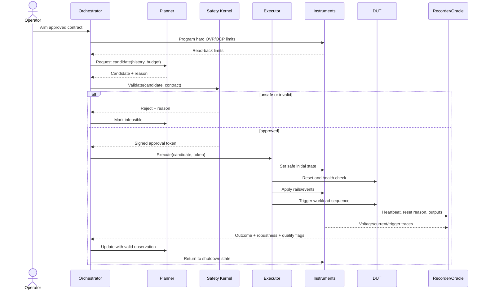
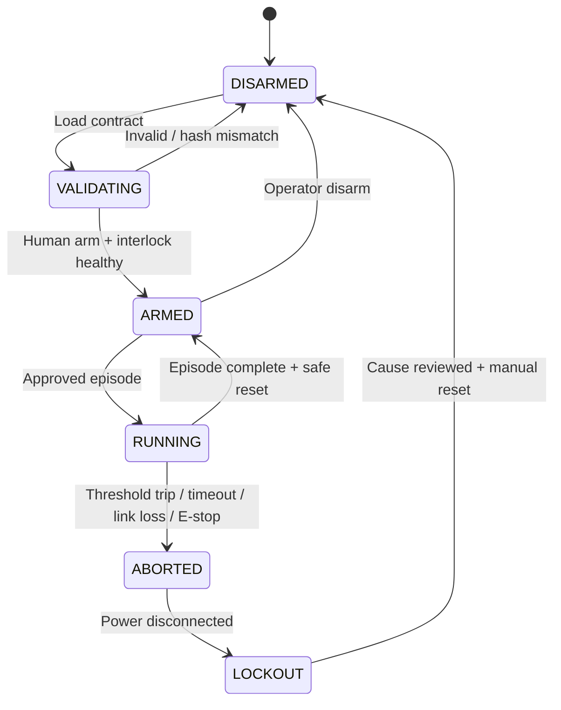
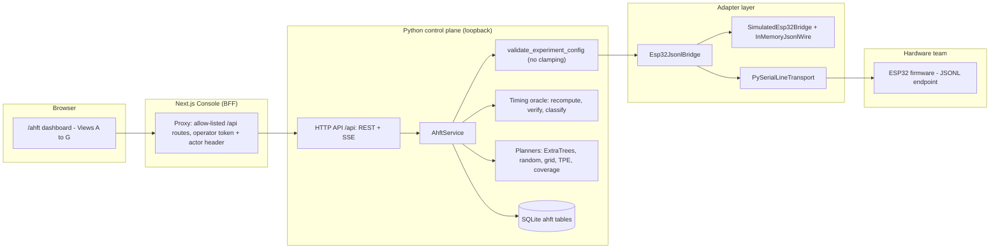
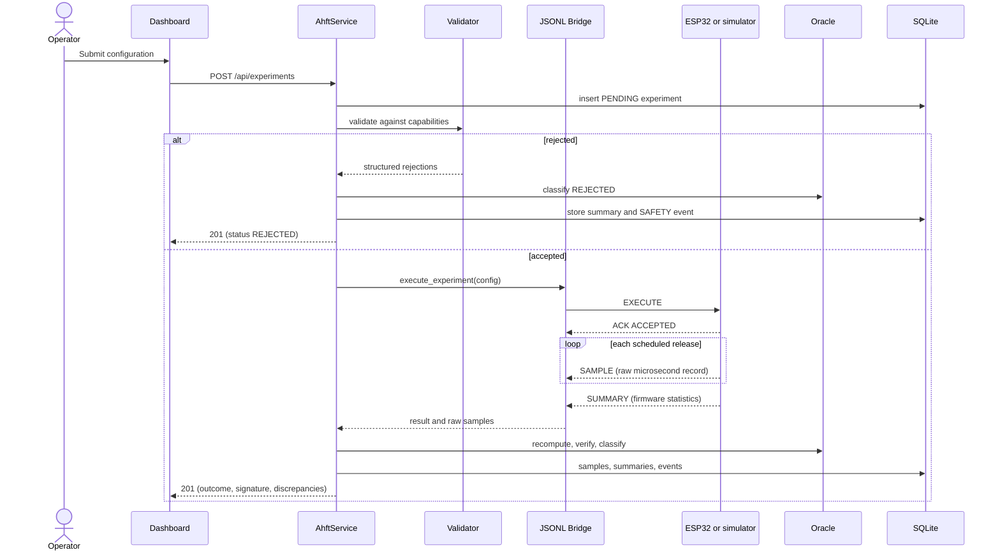
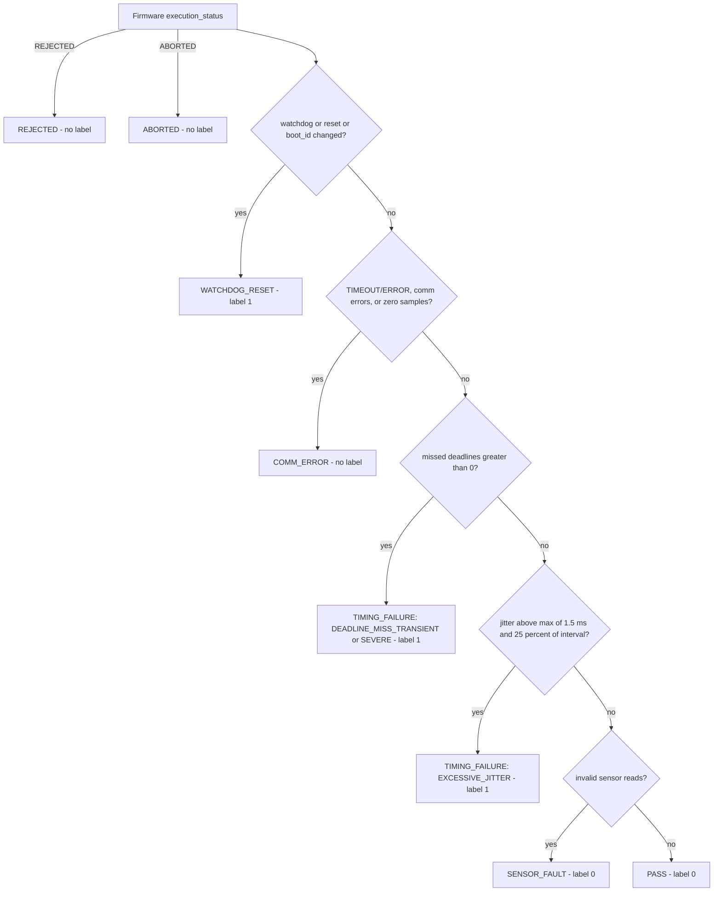
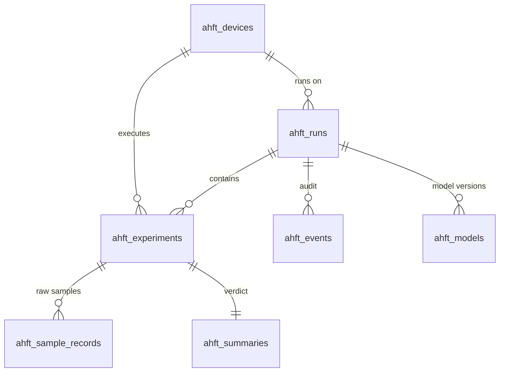

# Product Requirements Document: Safety-Constrained Adaptive Physical Fuzzing for Embedded Systems

**Working name:** Adaptive Hardware Fuzzing Testbench (AHFT)  
**Short name used in this document:** Adaptive Fuzzer  
**Document type:** Product Requirements Document and research protocol  
**Status:** Research POC definition (Part I) + AHFT V1 Feature 1 specification (Part II) — **draft awaiting team confirmation**  
**Version:** 2.0 (draft)  
**Prepared:** 3 September 2026 · **Revised:** 12 November 2026  
**Primary audience:** Final-year project team, faculty guides, evaluators, embedded-systems researchers, and laboratory staff  
**Target team:** Five undergraduate CS/engineering students with access to an electronics laboratory  
**Literature cutoff:** Sources checked through 3 September 2026

> **Central claim to test:** Given a large, mixed continuous/discrete/temporal operating space and a strict budget of real experiments, can an adaptive test-selection system find and minimize system-level embedded failures in fewer physical experiments than fixed, random, grid, and standard space-filling test strategies—without ever executing an out-of-envelope test?

> **Scientific honesty rule:** One reproducible counterexample can disprove a claimed operating condition. A finite set of passing experiments does **not** prove that every untested condition is safe. The product must say “no counterexample found within this test budget,” never “the entire product is proven safe,” unless a separate formal verification argument actually supports that statement.

---

## Reader notes (2026-11-05)

This PRD remains the research vision. The HLDs (`docs/00`–`docs/10`) define the current design, and where they differ, the HLDs win. Notable differences:

- **Scope and schedule:** the HLDs plan a 12-week MVP with one DUT; this PRD's 24-week plan, second DUT, and natural-fault scenario are stretch goals (HLD 10 §10).
- **Demo validity gate (§17.6):** in simulation, TPE found a narrow seeded island (about 5 failing voltages) within 30 episodes in only about 40% of campaigns. Reaching about 95% needed roughly 15 failing voltages at 30 episodes, or about 9 at 50 episodes (HLD 06 §5).
- **Adaptive method (§13, §31):** TPE and GP-BO are both kept. In simulation neither dominated: GP-BO was better on two benchmarks and worse on one, and adaptive search did not beat random on a fault with no measurable precursor (HLD 06 §3).
- **Robustness (§13.3):** see HLD 04 §13 for the normalized planner signal and the guard-banded verdict.
- **Example limits (§9.2):** the OLED rail range of 3.00–3.60 V may sit partly below the SSD1306's specified supply; limits come from the exact parts (HLD 02 §19.1).

## Document structure and revision history (2026-11-12)

| Part | Sections | Content |
|---|---|---|
| **Part I** | §1–§34 | Research vision, safety model, benchmark design, literature review, plan (v1.0, 3 Sep 2026; unchanged except where Part II overrides V1 scope) |
| **Part II** | §35–§57 | **AHFT V1 — Feature 1: Timing-Related Failure Detection**: ESP32 JSONL protocol, microsecond timing metrics, deadline oracle, ExtraTrees adaptive planner, persistence, REST/SSE API, dashboard, verification status, hardware bring-up, milestones, traceability and project-report mapping |

| Version | Date | Change |
|---|---|---|
| 1.0 | 3 Sep 2026 | Initial research PRD |
| 2.0 (draft) | 12 Nov 2026 | Added Part II integrating the Hardware Team *AHFT V1 Handoff (12 Nov 2026)* and the software implementation; V1 scope narrowed to Feature 1; hardware-ready simulator-first architecture |

**Precedence:** for V1 scope, **Part II overrides Part I** (e.g., Part I's multi-rail OLED/Wi-Fi/flash rig is deferred; Feature 1 changes no voltages). Part I remains the governing document for safety philosophy, honest-result language and long-term evaluation design.

---

## 1. Executive summary

Embedded products often pass nominal bench tests but fail under rare combinations of otherwise legal conditions: low input voltage, a radio-current burst, a flash write, a peripheral wake-up, temperature, timing, or a substituted power component. These failures are difficult to reproduce because the state space grows multiplicatively and because each physical experiment costs time, instrument access, and device wear.

The Adaptive Fuzzer is a hardware-in-the-loop test station that:

1. accepts an engineer-written **test contract** defining controllable variables, measurable outputs, legal operating limits, hard safety limits, and failure requirements;
2. chooses an informative next physical experiment within that contract;
3. controls external programmable rails and workloads while the real device under test (DUT) runs;
4. records synchronized electrical and firmware observations;
5. assigns a pass/fail result and a continuous “distance to failure” or robustness score;
6. updates its model of likely failure and uncertain regions;
7. repeats under a fixed experiment or time budget;
8. minimizes and reproduces any discovered failure; and
9. produces an evidence package with the exact test sequence, measured traces, safety decisions, repeatability, and residual uncertainty.

The AI is not allowed to improvise voltages directly at the bench. A numerical planner may propose a candidate, but a deterministic safety kernel rejects invalid candidates, instrument firmware enforces a second limit, and independent hardware protection can disconnect power. An optional language model may help draft a test contract from datasheets or explain results, but it is not the authority for limits, pass/fail decisions, or emergency control.

The student POC is intentionally bounded to extra-low-voltage embedded devices, one reusable test station, two DUT designs, and parameterized episodes lasting seconds—not arbitrary electronics, mains equipment, certification, destructive fault injection, or universal component qualification.

### 1.1 Product outcome

The POC succeeds if it demonstrates all of the following:

- a faculty evaluator can understand the test space and start a run without editing code;
- the station physically controls at least three independent voltage/power channels and at least four firmware workload states, with a stretch goal of five independent rails;
- no command outside the declared autonomous test envelope reaches an instrument;
- no hard safety violation is executed;
- seeded and naturally occurring failures are detected from independent observations, not only from a hidden firmware label;
- discovered failures are reproduced and reduced to a simpler condition;
- the proposed adaptive method beats at least the random and fixed-corner baselines on pre-registered primary metrics over repeated trials; and
- passing campaigns are reported as limited evidence, not certification.

### 1.2 Product thesis in one sentence

**The Adaptive Fuzzer spends scarce physical experiments where they are most likely to reveal or clarify an interaction failure, while a separate deterministic safety system makes unsafe experiments impossible to execute.**

---

## 2. Definitions and terminology

| Term | Meaning in this project |
|---|---|
| **DUT** | Device under test: the complete embedded product or instrumented prototype, not merely one component. |
| **Test contract** | Machine-readable description of controls, ranges, safety limits, workloads, observations, temporal constraints, and failure oracles for one DUT. |
| **Operating envelope** | Conditions under which the project claims the DUT should function. It is narrower than or equal to every applicable component's recommended operating conditions. |
| **Absolute maximum** | A stress limit that must not be treated as a normal operating point. Autonomous testing stays away from it. |
| **Episode / experiment** | One reset-to-reset physical trial with a complete initial state, parameter values, ordered workload events, measurements, and outcome. |
| **Oracle** | Deterministic rule that converts observations into pass, fail, inconclusive, or safety-abort. |
| **Robustness score** | Continuous margin to the nearest requirement violation; positive is passing margin, zero is the boundary, negative is failure. |
| **Falsification** | Finding a concrete input or event sequence that violates a stated requirement. It disproves that requirement for the tested envelope. |
| **Adaptive testing** | Selecting the next experiment using results of prior experiments rather than following a fully fixed schedule. |
| **Physical fuzzing** | In this PRD, feedback-guided generation of legal physical conditions and workload sequences for a real embedded DUT. It is not destructive voltage glitching. |
| **HIL** | Hardware-in-the-loop: real hardware participates in a controlled test loop driven by software and instruments. |
| **Coverage** | A declared, measurable notion such as parameter-bin, t-way interaction, event-transition, or behavioral-novelty coverage. It is never shorthand for “all real behavior.” |
| **Seeded fault** | An intentionally programmed, documented failure rule used to make the demonstration reproducible and to create ground truth. It must be disclosed as seeded. |
| **Natural fault** | A failure caused by actual electrical/firmware interaction rather than the demo predicate. |
| **Safety kernel** | Small deterministic module that rejects unsafe candidates before instrument commands are issued. |
| **Counterexample** | A complete, reproducible test condition and trace that violates one requirement. |
| **Failure minimization** | Removing events and relaxing parameters while preserving failure, yielding the smallest useful reproducer. |

---

## 3. Product purpose

### 3.1 What the product does

The product automates a constrained scientific loop:

```text
Define legal test space and requirements
                 ↓
Choose an informative legal experiment
                 ↓
Validate it through independent safety layers
                 ↓
Apply physical rails + firmware workload sequence
                 ↓
Measure voltage, current, timing, resets, heartbeat, and outputs
                 ↓
Score pass/fail and closeness to failure
                 ↓
Learn where failure or uncertainty is concentrated
                 ↺
```

It answers questions such as:

- “Can this IoT board reset anywhere inside its claimed battery-input and workload envelope?”
- “Which combination of low input voltage, Wi-Fi transmission, flash activity, and sensor wake-up triggers the failure?”
- “Does a regulator or capacitor substitution change the full product's failure boundary?”
- “Which 30 experiments give more failure-finding evidence than a hand-written 30-test plan?”
- “What exact minimal sequence reproduces the failure, and how often?”

### 3.2 What it does not claim to do

The product does not:

- prove universal correctness from finite samples;
- discover valid limits from absolute-maximum ratings;
- test arbitrary unknown devices without a fixture and test contract;
- replace an accredited certification laboratory;
- perform destructive HALT/HASS, accelerated-life, EMC, RF, mechanical, chemical, mains, medical, automotive, or functional-safety qualification;
- guarantee that an AI model's uncertainty is calibrated outside evaluated DUT families;
- determine whether a component manufacturer “lied”; or
- allow an LLM to control power or override a safety interlock.

---

## 4. Problem statement

### 4.1 User problem

Small embedded teams validate products with a mixture of nominal tests, a few corner cases, manual stress scenarios, and engineer intuition. This is often reasonable when the space is small. It becomes insufficient when failures depend on interactions and timing.

For example, suppose the station discretizes only five rail settings into 20 values each and four operating states into two values each:

```text
20^5 × 2^4 = 51,200,000 combinations
```

This count excludes order, delay, duration, temperature, history, repeated cycles, and measurement noise. At two seconds per experiment, exhaustive execution would take more than three years without setup or recovery time.

The practical problem is therefore not “how do we sweep one voltage?” It is:

> **With only N real experiments, which N conditions and event sequences should be executed to maximize the probability of finding and characterizing a relevant failure?**

### 4.2 Why ordinary binary search is insufficient

Binary search assumes a monotonic boundary: all points on one side fail and all on the other side pass. Embedded interaction failures can be non-monotonic:

```text
OLED rail: 2.8 V ─────────────── 3.6 V
           PASS PASS | FAIL | PASS PASS
                      3.2–3.3 V

and only when:
Red LED   = ON
Green LED = OFF
```

Both 2.9 V and 3.5 V can pass while a narrow middle interval fails. A binary search can miss the region completely. The system therefore needs initial space-filling and interaction coverage, followed by feedback-guided local search and boundary mapping.

### 4.3 Why a complete product is the correct test object

Individual components can remain within their datasheet specifications while the assembled product fails due to interactions. For example:

```text
Wi-Fi transmit burst
        +
flash-write current transient
        +
low battery-equivalent input
        ↓
regulator output droop for 20 ms
        ↓
microcontroller brownout reset
```

The project therefore evaluates the product-level operating envelope. Component substitution and manufacturing variation are valuable scenarios, but not the universal scope.

### 4.4 Why now

The current research landscape has mature pieces but no simple, standard student-scale system that combines them for this target:

- coverage-guided fuzzing efficiently explores software inputs;
- firmware rehosting and in-place firmware fuzzing improve embedded-code testing;
- HIL rigs automate real embedded hardware;
- CPS falsification uses optimization to search temporal requirements, mostly in simulation;
- active level-set estimation maps threshold boundaries;
- safe Bayesian optimization limits exploration of unknown systems; and
- recent physical fault-injection work shows strong value from structured feedback and adaptive search.

The POC investigates whether these ideas can be combined, with careful boundaries, for low-voltage, non-destructive, product-level physical validation.

---

## 5. SDG 9 mapping

The project maps to **United Nations Sustainable Development Goal 9: Industry, Innovation and Infrastructure**, especially:

- **Target 9.5:** enhance scientific research and upgrade technological capabilities of industrial sectors;
- **Target 9.b:** support domestic technology development, research, and innovation in developing countries;
- **Target 9.4:** upgrade industries for greater resource-use efficiency; and
- indirectly, **Target 9.1:** improve reliability and resilience of infrastructure products.

The official UN framing states that Goal 9 spans infrastructure, industrialization, and innovation and explicitly calls for stronger R&D and domestic technology capability [R1].

### 5.1 Credible causal path

```text
Adaptive test-selection research
        ↓
fewer costly physical experiments per discovered interaction fault
        ↓
earlier detection of weak designs, substitutions, and production-tail units
        ↓
less rework, scrap, field replacement, and engineering time
        ↓
stronger domestic embedded-product development and more reliable infrastructure devices
```

### 5.2 What the project can and cannot claim about SDG impact

The POC can claim alignment with research capability, reliable product development, and resource-efficient validation. It cannot claim measured reductions in national waste, field failures, or manufacturing cost without a deployment study. Those remain downstream hypotheses.

---

## 6. Users, jobs, and use cases

### 6.1 Primary personas

| Persona | Job to be done | Current pain | POC value |
|---|---|---|---|
| Embedded validation engineer | Find rare product-level failure conditions before release | Manual plans miss interactions; physical tests are slow | Prioritizes informative tests and creates reproducers |
| Hardware startup engineer | Revalidate a board after BOM substitution | Full requalification is costly; nominal boot test is weak | Compares failure boundaries across revisions |
| Researcher | Evaluate adaptive test-selection algorithms on real hardware | Most benchmarks are simulated or software-only | Reproducible physical benchmark and logs |
| Laboratory instructor/faculty evaluator | Understand and assess the project quickly | AI claims can be vague or staged | Transparent live test, ground truth, baselines, and safety evidence |
| Test-lab operator | Run repeatable campaigns safely | Instrument scripts are brittle and device-specific | Contract-driven execution and deterministic safety controls |

### 6.2 Prioritized use cases

1. **Rare interaction discovery:** find a failure involving voltage, state, and timing.
2. **Failure minimization:** reduce a long sequence to the essential trigger.
3. **Board-revision comparison:** run the same contract on board A and board B.
4. **Weak-tail unit detection:** compare nominally identical boards under the same adaptive or replayed campaign.
5. **Regression replay:** rerun stored counterexamples after a firmware or hardware fix.
6. **Operating-space visualization:** show observed pass/fail regions, uncertainty, and coverage.

### 6.3 Deferred use cases

- automated datasheet ingestion into draft contracts;
- temperature-chamber control;
- network impairment and RF attenuation;
- parallel multi-DUT farms;
- production-line screening;
- continuous integration scheduling; and
- formal probabilistic guarantees over a physical envelope.

---

## 7. Scope and non-goals

### 7.1 POC scope

| Dimension | Required POC boundary |
|---|---|
| DUT class | ESP32-/STM32-class extra-low-voltage embedded products |
| DUT count | Two designs; three units per design recommended |
| Electrical range | DUT-specific; system-wide hard ceiling ≤ 12 V DC and ≤ 1 A per channel for the student rig |
| Power controls | ≥3 independently settable/gated rails; stretch goal 5 |
| Discrete controls | ≥4 workloads/states such as LED state, display update, sensor wake, Wi-Fi TX, flash write |
| Temporal controls | Parameterized event order, offset, and duration; not arbitrary unbounded programs |
| Observations | Rail voltage, current, reset/boot reason, heartbeat, workload acknowledgements, application output, timestamps |
| Campaign budget | 30, 50, or 100 episodes; maximum wall-clock budget declared before run |
| Algorithms | Random, fixed/corner, space-filling, t-way, and at least one adaptive method |
| Environment | Supervised laboratory bench; no unattended remote operation in V1 |
| Safety | Deterministic software validation + instrument limits + independent hardware disconnect + manual E-stop |

### 7.2 Explicit non-goals

- universal plug-and-play fixtures;
- mains voltage, batteries under abuse, motors above protected bench scale, high-current power electronics, lasers, radiation, pressure, or chemicals;
- destructive voltage/clock/EM glitching;
- security exploit generation;
- production certification or compliance sign-off;
- lifetime or MTBF estimation;
- thermal/vibration ageing in the initial POC;
- full arbitrary-sequence reinforcement learning;
- replacing experienced test engineers;
- autonomous derivation of safe ranges from the Internet; and
- claims about the correctness of unobserved regions.

### 7.3 Product principles

1. **Contract before autonomy.** Every control and limit must exist in a reviewed contract.
2. **Safety outside the optimizer.** The planner cannot approve its own candidate.
3. **Measurement before inference.** Raw traces are preserved; model summaries are secondary.
4. **Counterexamples over confidence theater.** A reproducible failure is stronger than an unsupported percentage.
5. **Honest uncertainty.** “Not found” is not “does not exist.”
6. **Same budget, same bench, repeated seeds.** Baseline comparisons must be fair.
7. **Separate demo truth from research truth.** Seeded faults prove the pipeline; natural faults test external validity.
8. **Reusable engine, device-specific contract and fixture.** Generality is bounded and explicit.

---

## 8. Requirements

### 8.1 Functional requirements

| ID | Requirement | Priority | Acceptance evidence |
|---|---|---:|---|
| FR-01 | Import and validate a versioned YAML/JSON test contract | Must | Invalid schema rejected with a human-readable reason |
| FR-02 | Enumerate controls, observations, requirements, and safety constraints before arming | Must | Review screen matches contract hash |
| FR-03 | Require explicit operator arm action and show physical E-stop state | Must | Run cannot begin without both conditions |
| FR-04 | Generate fixed, random, space-filling, t-way, and adaptive experiment plans | Must | Same seed reproduces the same proposed sequence |
| FR-05 | Reject any candidate violating static bounds, slew, dwell, concurrency, or sequence constraints | Must | Automated negative tests show 100% rejection |
| FR-06 | Program instrument-side OVP/OCP/current limits before enabling output | Must | Instrument query/read-back confirms values |
| FR-07 | Execute synchronized rail and workload sequences with timestamps | Must | Trace shows commanded and measured event times |
| FR-08 | Detect heartbeat loss, reset, incorrect output, timeout, and rail-tolerance violation | Must | Seeded tests trigger each oracle |
| FR-09 | Compute a continuous robustness score where requirements permit | Must | Score crosses zero at known threshold |
| FR-10 | Persist raw measurements, proposed/approved commands, software versions, calibration, and outcomes | Must | A campaign can be replayed and audited |
| FR-11 | Stop safely on operator E-stop, software watchdog, instrument error, overcurrent, overvoltage, overtemperature, or lost controller link | Must | Fault-injection acceptance test cuts power within specified latency |
| FR-12 | Adapt candidate selection after each valid result | Must | Planner state and reason logged |
| FR-13 | Reproduce each discovered failure at least 10 times or report its measured reproduction rate | Must | Report contains numerator, denominator, and traces |
| FR-14 | Minimize discrete events and continuous ranges while preserving failure | Must | Reduced reproducer is no more complex than original |
| FR-15 | Export a Markdown/HTML report and machine-readable campaign bundle | Must | Report links every claim to test IDs |
| FR-16 | Display observed points, failure regions, uncertainty, safety rejections, and budget use live | Should | Teacher demo uses the UI without terminal access |
| FR-17 | Compare two DUT revisions with the same replay set | Should | Side-by-side report shows changed outcomes |
| FR-18 | Support an optional LLM-assisted contract draft with mandatory human approval and source links | Could | No generated limit becomes active automatically |

### 8.2 Non-functional requirements

| ID | Requirement | Target |
|---|---|---|
| NFR-01 Safety integrity | Unsafe executed experiments | Exactly 0 |
| NFR-02 Command traceability | Instrument command → approval → measurement linkage | 100% of episodes |
| NFR-03 Reproducibility | Same contract, seed, firmware, and simulator mode reproduce plan | Exact plan match |
| NFR-04 Timing | Host-to-instrument timestamp uncertainty | Characterized; target ≤5 ms for POC, use instrument triggering for sub-ms tests |
| NFR-05 Measurement | Voltage/current accuracy | Calibrated and reported; target error ≤1% of reading or instrument specification, whichever is larger |
| NFR-06 Recovery | Recover from DUT reset without manual rewiring | ≥95% of expected resets |
| NFR-07 Availability | Campaign completes without orchestration crash | ≥95% across 100-episode qualification runs |
| NFR-08 Explainability | Every adaptive choice has a machine-generated reason code | 100% |
| NFR-09 Data integrity | Campaign bundle includes hashes of contract, firmware, planner, and raw files | 100% |
| NFR-10 Usability | New operator starts approved demo after a 10-minute briefing | ≥80% success in formative test |

### 8.3 POC exit criteria

The project may be called a successful POC only if:

- all Must requirements pass;
- the complete safety acceptance suite passes before adaptive runs;
- the adaptive method has statistically and practically better failure-discovery performance than uniform random testing on the pre-registered benchmark set, or the team reports a negative result without changing metrics after seeing outcomes;
- at least one result is shown on a second DUT design;
- at least one natural or electrically emergent failure is evaluated in addition to seeded firmware predicates, even if the natural result is negative; and
- the final report includes all raw runs and failures, not only favorable examples.

---

## 9. Test contract

The test contract is the boundary between reusable infrastructure and per-device engineering. The system must not invent missing values.

### 9.1 Required contract fields

- DUT identity, revision, serial number, firmware hash, and fixture version;
- controls: type, unit, minimum, maximum, step/resolution, slew limit, default, and safe shutdown value;
- discrete workloads and allowed concurrent combinations;
- temporal templates: event names, allowed order, delay bounds, duration bounds, and maximum episode time;
- observations: source, sample rate, units, calibration identifier, and valid range;
- hard safety constraints;
- functional requirements and oracle definitions;
- reset/recovery procedure;
- stabilization and cool-down requirements;
- experiment budget and stopping conditions;
- planner configuration and random seed; and
- reviewer identity and approval timestamp.

### 9.2 Example contract

```yaml
contract_version: 1
dut:
  name: "ESP32-S3 display-sensor demo"
  revision: "A"
  serial: "DUT-A-01"
  firmware_sha256: "<recorded-at-build>"

controls:
  oled_rail_v:
    type: continuous
    min: 3.00
    max: 3.60
    resolution: 0.01
    slew_v_per_s_max: 0.5
    shutdown: 0.0
  sensor_rail_v:
    type: continuous
    min: 3.00
    max: 3.60
    resolution: 0.01
    slew_v_per_s_max: 0.5
    shutdown: 0.0
  red_led:
    type: categorical
    values: [off, on]
  green_led:
    type: categorical
    values: [off, on]
  workload:
    type: categorical
    values: [idle, oled_refresh, sensor_read, wifi_tx, flash_write]

hard_safety:
  oled_rail_v_max: 3.60
  sensor_rail_v_max: 3.60
  channel_current_a_max: 0.20
  dut_board_temp_c_max: 60
  total_episode_s_max: 10
  forbid:
    - "wifi_tx and programming_mode"

requirements:
  heartbeat:
    rule: "gap_ms <= 500"
  oled_refresh:
    rule: "frame_latency_ms <= 120"
  rail_regulation:
    rule: "abs(measured_v - commanded_v) <= 0.03"
  reset_count:
    rule: "reset_count == 0"

campaign:
  method: adaptive_mixed_v1
  budget_episodes: 30
  seed: 20260903
  initial_design_episodes: 8
  repeat_on_failure: 10
```

### 9.3 Contract validation rules

- Autonomous maxima must be no greater than reviewed recommended operating limits and must include measurement tolerance.
- If two sources disagree, the narrower verified range wins until an engineer resolves it.
- Absolute-maximum values may be stored for display but never used as autonomous test bounds.
- A control with no calibrated read-back cannot be used as a continuous research variable.
- A failure oracle must be independent of the planner.
- A campaign cannot arm if the firmware, fixture, or contract hash differs from the approved tuple.

---

## 10. System architecture

### 10.1 Context diagram

```mermaid
flowchart LR
    Engineer[Engineer / Teacher] --> UI[Experiment UI]
    Docs[Datasheets + Requirements] --> Contract[Test Contract]
    Contract --> UI
    UI --> Orchestrator[Campaign Orchestrator]
    Orchestrator --> Planner[Adaptive Planner]
    Planner --> Candidate[Candidate Experiment]
    Candidate --> Safety[Deterministic Safety Kernel]
    Safety -->|approved| Executor[Real-time Executor]
    Safety -->|rejected| Log[(Audit Log)]
    Executor --> Instruments[Programmable Supplies / Loads / Switches]
    Instruments --> DUT[Physical DUT]
    Executor --> Workload[Firmware Workload API]
    Workload --> DUT
    DUT --> Sensors[DAQ / Scope / UART / Logic Inputs]
    Sensors --> Oracle[Oracle + Robustness Scorer]
    Oracle --> Planner
    Oracle --> Store[(Raw Data + Metadata)]
    Store --> Report[Evidence Report]
    Interlock[Independent Interlock + E-stop] -. cuts power .-> Instruments
    Sensors -. threshold trip .-> Interlock
```



### 10.2 Trust and authority boundaries

| Layer | May propose | May approve | May energize hardware | May declare functional failure | May emergency-stop |
|---|---:|---:|---:|---:|---:|
| Optional LLM | Draft dimensions/hypotheses | No | No | No | No |
| Adaptive planner | Candidate experiment | No | No | No | No |
| Safety kernel | No | Yes, within contract | No | No | Requests stop |
| Real-time executor | No | Checks approved token | Yes, through instrument API | No | Yes |
| Oracle/scorer | No | No | No | Yes, by approved rule | Requests stop |
| Instrument limits | No | Enforces local limits | Yes | No | Yes |
| Hardware interlock | No | N/A | Disconnect only | No | Yes |
| Human operator | Selects contract/run | Arms | Indirectly | Reviews | Yes |

### 10.3 Episode sequence



### 10.4 Safety state machine



### 10.5 Deployment boundary

The POC runs on one host computer connected locally to instruments. The safety microcontroller and hard interlock continue enforcing limits if the host freezes or disconnects. No cloud service is required for running a campaign. Optional cloud/LLM processing receives only datasheet text and summarized, non-sensitive logs after operator approval.

---

## 11. Hardware components

### 11.1 Required bench hardware

| Subsystem | Minimum POC | Preferred research setup | Purpose |
|---|---|---|---|
| Host | Laptop/desktop with USB and Ethernet | Linux workstation with isolated USB hub | UI, planner, storage, report |
| DUT A | ESP32-S3 development board on custom carrier | Three identical units | Visible Wi-Fi/display/sensor demo |
| DUT B | STM32 Nucleo or second ESP32-class product | Three identical units with different peripheral mix | Generalization evidence |
| Programmable rails | ≥3 independently controlled, measured, current-limited channels | Five channels with SCPI and read-back | Continuous physical controls |
| Rail gating | High-side load switch or protected relay per rail | Independent safety-rated cutoff stage | Fast de-energization and isolation |
| Primary measurement | Calibrated DMM/DAQ | Multi-channel DAQ plus oscilloscope | Rail/current validation |
| Transient capture | 2-channel oscilloscope or adequate DAQ | 4-channel digital scope with external trigger | Observe droop, event timing, reset |
| Current measurement | Shunt + amplifier/current probe | Per-channel power analyzer | Load behavior and safety |
| Digital observation | UART + logic inputs | Logic analyzer/JTAG/SWO where available | Heartbeat, event timing, reset |
| Instrument controller | RP2040/STM32 board separate from DUT | Real-time controller/FPGA | Deterministic triggering and watchdog |
| Physical safety | Fuses, current limits, covered terminals, E-stop | Contactor/solid-state disconnect and temperature probes | Independent protection |
| Peripherals | 3.3 V SSD1306 OLED, red and green LEDs with resistors, 3.3 V sensor | Add SD card or external flash on protected rail | Visible mixed-state demo |
| Networking | Controlled local Wi-Fi access point | RF-isolated test network | Repeatable radio workload |

### 11.2 Two implementation tiers

#### Tier A: student-feasible three-rail rig

- Rail 1: DUT or regulator input.
- Rail 2: OLED power.
- Rail 3: sensor/peripheral power.
- Discrete states: red LED, green LED, Wi-Fi TX, flash write, sensor wake.
- Event timing: delays between Wi-Fi, flash, sensor, and display actions.

This is sufficient to demonstrate mixed continuous/discrete/temporal search.

#### Tier B: five-rail research rig

- Rail 1: main DUT/regulator input.
- Rail 2: MCU 3.3 V domain, only if the board is explicitly designed for separated injection.
- Rail 3: OLED/display.
- Rail 4: sensor.
- Rail 5: storage or auxiliary peripheral.

Five separate rails require deliberate signal-level translation and back-power prevention. Do not cut or vary a peripheral rail while its signal pins can source current into the unpowered device. Use suitable bus switches/level shifters, series protection, defined power sequencing, and fixture review.

### 11.3 Source-control options

1. **Borrowed laboratory instruments (recommended):** two multi-output programmable supplies or modular source-measure/DAQ channels controlled through documented APIs.
2. **Custom low-cost rail cards:** one current-limited upstream supply feeds five independently adjustable buck/LDO outputs controlled by a dedicated instrument controller and external DACs. Each output requires calibrated read-back and a hardware maximum that software cannot exceed.
3. **Do not use:** raw PWM filtered into a DUT rail, uncalibrated ESP ADC readings as the only measurement, software-only current limits, or an ESP32 DUT that also controls its own supposedly independent supply.

### 11.4 Planning budget, not vendor quotation

| Build path | Approximate incremental cost in India | Assumption |
|---|---:|---|
| Lab-borrowed instruments | ₹15,000–₹35,000 | Team buys boards, fixture, switching, sensors, cabling, safety parts |
| Student-owned functional rig | ₹60,000–₹1,50,000 | Lower-cost programmable supplies, scope/DAQ, fixture, and safety hardware |
| Research-grade five-channel rig | ₹3,00,000+ | Branded multi-channel sources, scope, DAQ, electronic load, isolation |

Prices are only planning bands and must be replaced with current institutional quotations before procurement.

### 11.5 Calibration and traceability

- Calibrate every programmable channel against a trusted meter at minimum, midpoint, and maximum.
- Record gain/offset, date, operator, meter identity, and uncertainty.
- Verify transient capture with a known pulse source.
- Characterize command-to-output settling time and timing jitter.
- Re-run a short calibration check before every evaluation block.
- Store commanded values separately from measured values; analysis uses measured values.

---

## 12. Software components

| Component | Responsibility | Suggested implementation |
|---|---|---|
| Web/desktop UI | Contract review, arming, live map, timeline, reports | Local web app |
| Contract service | Schema validation, versioning, hashes, approval | Python typed models + JSON Schema |
| Campaign orchestrator | Episode lifecycle, budget, recovery, state machine | Python async service |
| Planner interface | Common API for every baseline/adaptive method | `suggest(history) -> candidate` |
| Candidate generator | Mixed variable and temporal-template encoding | NumPy/SciPy/scikit-learn/BoTorch as feasible |
| Safety kernel | Pure deterministic validation of every candidate | Small separately tested library/process |
| Instrument adapters | SCPI/serial/USB/GPIO control and read-back | Driver abstraction; PyVISA where supported |
| Real-time executor | Instrument triggers, precise workload scheduling | Dedicated MCU/FPGA + host command protocol |
| DUT workload agent | Execute named workload; emit heartbeat/markers | Minimal firmware API, separate from safety |
| Recorder | Synchronized command, telemetry, waveform, and event storage | Append-only episode records + binary trace files |
| Oracle/scorer | Evaluate requirements and data-quality flags | Deterministic rules and robustness functions |
| Adaptive model | Failure probability, uncertainty, novelty, boundary estimate | GP/RF/TPE depending on dimension type |
| Minimizer | Discrete event reduction and continuous boundary bracketing | `ddmin`-style reducer + local interval search |
| Reporter | Evidence table, charts, limitations, bundle manifest | Markdown/HTML generator |
| Optional LLM assistant | Draft hypotheses/contracts and plain-language summaries | Read-only suggestion mode; mandatory citations/review |

### 12.1 Storage model

Each campaign directory contains:

```text
campaign-id/
├── manifest.json
├── contract.yaml
├── approvals.json
├── calibration.json
├── planner-config.json
├── episodes.jsonl
├── traces/
│   ├── episode-0001.parquet
│   └── episode-0001-waveform.bin
├── counterexamples/
│   └── CE-001.yaml
├── report.md
└── checksums.sha256
```

### 12.2 Minimum episode record

```json
{
  "episode_id": 14,
  "candidate": {"oled_rail_v": 3.24, "red_led": "on", "green_led": "off"},
  "planner_reason": {"code": "HIGH_BOUNDARY_PROBABILITY", "score": 0.81},
  "safety_decision": {"approved": true, "contract_hash": "..."},
  "commands": [{"target": "rail_oled", "value": 3.24, "t_ms": 0}],
  "measurements_summary": {"oled_v_mean": 3.238, "frame_latency_ms": 151},
  "oracle": {"outcome": "FAIL", "requirements": ["oled_refresh"], "robustness": -31},
  "quality": {"valid": true, "timing_jitter_ms": 1.2},
  "artifacts": ["traces/episode-0014.parquet"]
}
```

---

## 13. How the adaptive loop works

### 13.1 Input-space representation

The planner receives a bounded mixed-domain space:

- **continuous:** voltage, delay, duration, load level;
- **ordinal:** workload intensity, packet rate;
- **categorical:** workload type, peripheral state, board revision;
- **binary:** LED on/off, radio enabled/disabled;
- **sequence template:** ordered events with parameterized delays; and
- **conditional:** flash offset exists only when flash workload is enabled.

V1 does not search arbitrary programs. It searches a small library of human-reviewed episode templates, for example:

```text
set_rails → stabilize → [event A] → delay d1 → [event B] → delay d2 → [event C] → observe → reset
```

### 13.2 Three-stage search

#### Stage 1: safe initialization and broad coverage

Reserve 20–30% of the budget for:

- nominal point;
- reviewed corners;
- Latin-hypercube or low-discrepancy continuous samples;
- pairwise/t-way combinations of categorical states; and
- known-good safe seed points needed by safe-optimization methods.

This prevents the optimizer from overcommitting to a narrow model before seeing the space.

#### Stage 2: adaptive discovery

For each safe candidate `x`, estimate:

- `p_fail(x)`: probability of functional failure;
- `u(x)`: predictive uncertainty or boundary entropy;
- `n(x)`: behavioral novelty relative to prior traces;
- `c(x)`: estimated episode time/wear cost; and
- `r(x)`: safety distance from the autonomous boundary.

A feasible V1 acquisition score is:

```text
score(x) = w_fail·p_fail(x)
         + w_uncertainty·u(x)
         + w_novelty·n(x)
         - w_cost·c(x)
```

Only candidates already accepted by contract constraints are scored, and the selected candidate is validated again by the independent safety kernel.

Use a Gaussian-process classifier/regressor for low-dimensional continuous spaces; use a random forest, TPE, or mixed-kernel model when categorical and conditional variables dominate. The algorithm choice is an experimental factor, not a marketing claim.

#### Stage 3: confirmation and minimization

After a failure:

1. replay the exact episode immediately;
2. if repeatability is below the declared threshold, classify as intermittent and estimate rate rather than discarding it;
3. remove discrete events one at a time or with delta debugging;
4. relax continuous stress toward nominal values;
5. bracket both sides of any non-monotonic interval;
6. test nearby points to map local geometry;
7. replay the minimized sequence 10 times; and
8. save the original and minimal counterexamples.

### 13.3 Robustness scoring examples

For a maximum heartbeat gap of 500 ms:

```text
robustness_heartbeat = 500 - observed_max_gap_ms
```

For a voltage rail required to remain in `[3.135, 3.465] V`:

```text
robustness_rail = min(measured_min_v - 3.135,
                      3.465 - measured_max_v)
```

Campaign robustness is the minimum normalized requirement margin. Negative means at least one requirement was violated. Normalization is necessary so milliseconds and volts do not dominate solely by unit scale.

### 13.4 Feedback signals

The planner may use only approved, logged feedback:

- binary functional outcome;
- normalized robustness margin;
- reset class/boot reason;
- current- and voltage-trace features;
- workload latency and timeouts;
- behavioral signature/novelty; and
- data-quality flags.

The planner must not read the hidden seeded-fault predicate. For the public demo, it may observe the same near-failure signals an engineer could measure, such as rising frame latency.

### 13.5 Stop conditions

Stop the campaign when any occurs:

- experiment or wall-clock budget exhausted;
- hard safety abort;
- operator stop;
- required number of distinct failures found;
- failure reproduced and minimized to completion;
- measurement quality becomes invalid for three consecutive attempts;
- DUT recovery fails three times; or
- planner cannot produce a feasible candidate.

---

## 14. Safety model

### 14.1 Safety boundary hierarchy

```text
Absolute maximum / destructive region
┌─────────────────────────────────────────────────────────┐
│ NEVER AUTONOMOUSLY ENTER                                │
│   Reviewed recommended operating conditions             │
│   ┌───────────────────────────────────────────────────┐ │
│   │ Test contract envelope                           │ │
│   │  ┌─────────────────────────────────────────────┐ │ │
│   │  │ Autonomous envelope with tolerance margin  │ │ │
│   │  │                                             │ │ │
│   │  │        adaptive experiments only           │ │ │
│   │  └─────────────────────────────────────────────┘ │ │
│   └───────────────────────────────────────────────────┘ │
└─────────────────────────────────────────────────────────┘
```

For an ESP32-S3-class DUT, Espressif documents recommended 3.0–3.6 V supply operation and warns that transmit activity can produce a sudden current increase and rail collapse; it recommends adequate current capability and decoupling [R3][R4]. Those facts support the demo's power/workload interaction, but actual contract limits must match the exact module, carrier, and peripheral—not a generic example.

### 14.2 Defense in depth

1. **Reviewed test contract:** human-approved autonomous bounds.
2. **Static candidate validation:** range, unit, cross-variable, order, slew, and duration checks.
3. **Signed approval token:** executor accepts only exact approved payload/hash/expiry.
4. **Instrument configuration:** OVP/OCP and current limits set locally and read back.
5. **Instrument-controller watchdog:** outputs return to off if host heartbeat is lost.
6. **Independent threshold circuit:** comparator/fuse/interlock can remove power without software.
7. **Manual E-stop:** latching, accessible, and tested before the demo.
8. **Thermal and current monitoring:** immediate abort on threshold or implausible rate of rise.
9. **Safe recovery:** after abort, outputs remain off until manual review/reset.
10. **Audit log:** proposed, rejected, approved, commanded, and measured values are separate.

### 14.3 Safety requirements

- Unsafe proposed candidates may occur during algorithm development, but must be counted.
- Unsafe executed candidates must equal exactly zero.
- The safety kernel must be testable without instruments and achieve complete decision coverage for its rule set.
- Every instrument output must have a physical or local firmware maximum no greater than the fixture rating.
- The project must follow the laboratory's operating procedure. IEC 61010-1 is relevant to measurement/control/laboratory equipment but the student rig is not automatically compliant merely because the PRD references it [R2].
- Use only extra-low-voltage DC in V1.
- Never expose people to an open energized fixture during autonomous motion or switching.
- Do not charge, puncture, heat, or directly stress lithium batteries; emulate a battery with a protected source.
- Do not vary ESP32 supply beyond the exact module's recommended conditions. If testing a “battery input” of 3.6–5.2 V, apply it to a carrier regulator rated for that range, not directly to a 3.3 V MCU rail.
- Treat smoke, odor, unexpected heat, oscillation, short circuit, or repeated instrument protection trips as a safety event, not a promising failure region.

### 14.4 Failure classes

| Class | Examples | System response |
|---|---|---|
| Functional failure | OLED freezes, wrong sensor value, packet loss, reset, missed deadline | Record; return to safe state; reproduce if permitted |
| Inconclusive | Measurement dropout, ambiguous timing, invalid calibration | Do not train model as pass/fail; retry under policy |
| Expected protective reset | DUT brownout detector or watchdog acts as designed | Record as requirement-dependent outcome |
| Safety abort | Overcurrent, overvoltage, overtemperature, host loss, E-stop | Immediate independent power removal and lockout |
| Equipment fault | PSU/scope/DAQ communication error | Safe shutdown; maintenance review |

### 14.5 Preliminary hazard analysis

| Hazard | Cause | Severity | Prevention/detection | Residual rule |
|---|---|---:|---|---|
| DUT overvoltage | Wrong unit, model error, driver bug | High | Contract validation, OVP, divider/comparator cutoff | No run without read-back |
| Overcurrent/short | Wiring fault, rail contention, back-power | High | Fuse/OCP, protected load switches, current trip | Manual inspection after trip |
| Back-powering | Powered signal into unpowered peripheral | Medium/High | Bus isolation, sequence rules, current monitoring | Tier B requires fixture review |
| Excess heat | Sustained load or faulty part | High | Temperature limit/rate alarm, max episode time | Lockout on trip |
| Unexpected actuator motion | Future motor use | High | Out of V1 scope | Not permitted |
| Data-driven unsafe proposal | Optimizer extrapolation | High | Safety kernel before executor | Count but never execute |
| Host freeze | Software fault | Medium/High | Hardware watchdog and de-energize timeout | Test monthly/demonstration day |
| Misleading “safe” result | Sparse testing/model error | High scientific risk | Honest report language, coverage and uncertainty | No certification claim |

---

## 15. User flows

### 15.1 Engineer onboarding a DUT

1. Select an existing fixture or design a new protected adapter.
2. Collect exact module, regulator, peripheral, and carrier limits.
3. Define controllable variables and measurable signals.
4. Define functional requirements and robustness margins.
5. Write the test contract and validate schema.
6. Perform fixture continuity, ground, polarity, and isolation checks with power off.
7. Calibrate each channel and record uncertainty.
8. Run nominal smoke tests manually.
9. Run safety negative tests using a dummy load, not the DUT.
10. Approve the contract/fixture/firmware hash tuple.
11. Run a fixed pilot campaign.
12. Permit adaptive campaigns only after all previous steps pass.

### 15.2 Operator running a campaign

1. Choose DUT serial and approved contract.
2. UI shows limits, firmware hash, calibration age, E-stop status, and expected maximum runtime.
3. Operator confirms wiring checklist and presses **Arm**.
4. System programs and reads back instrument limits.
5. System runs a nominal health episode.
6. Operator presses **Start campaign**.
7. UI displays each proposal, safety decision, applied values, live traces, outcome, robustness, and remaining budget.
8. On failure, system returns hardware to safe state and asks whether the contract permits automatic reproduction.
9. System minimizes/replays within the declared failure-handling budget.
10. Operator reviews and exports the evidence package.

### 15.3 Engineer replaying a counterexample

1. Open a stored `CE-xxx.yaml` record.
2. Verify DUT/fixture compatibility and contract hash.
3. Select exact replay or parameter sweep around the reproducer.
4. Arm and execute.
5. Compare new trace with the original using aligned event markers.
6. Mark outcome as reproduced, not reproduced, or inconclusive.

---

## 16. Detailed demonstration equipment and setup

### 16.1 Visible teacher-demo DUT

Use an ESP32-S3 carrier with:

- stable, separately protected 3.3 V MCU supply;
- SSD1306-class 3.3 V OLED on its own programmable rail;
- red and green LEDs controlled as firmware states;
- one 3.3 V I²C sensor on a third rail;
- optional external flash/SD peripheral on a protected rail;
- heartbeat output pin and UART telemetry;
- reset/enable monitor;
- analog measurement of relevant rails through correctly designed dividers, used for telemetry only;
- external trigger input from the instrument controller; and
- load switches/level translation that prevent back-powering.

The rail instruments are controlled by the host or a dedicated instrument controller, **not by the DUT ESP32**. The ESP32 executes workloads and emits observations; it does not grant itself power authority.

### 16.2 Minimum equipment checklist

- 1 host laptop;
- 1 ESP32-S3 development board and custom carrier;
- 1 secondary STM32/ESP32 DUT for the generalization demonstration;
- 3 programmable, current-limited channels (5 preferred);
- 1 DMM/DAQ and 1 oscilloscope or a combined instrument with adequate channels;
- 1 dedicated RP2040/STM32 instrument controller;
- 1 protected cutoff board with E-stop, fuse, MOSFET/relay, comparator, and watchdog;
- 1 3.3 V OLED, 1 compatible sensor, 2 LEDs and correct series resistors;
- logic-level translation/bus switches where separately powered I/O domains require them;
- shunts/current monitors, temperature sensor, terminal covers, labeled cables, common reference plan, and dummy loads;
- controlled local Wi-Fi network if the workload includes radio transmission.

### 16.3 Wiring topology

```text
Host PC
  ├── USB/LAN ──> programmable rail channels ──> protected rail gates ──> DUT rails
  ├── USB ──────> instrument controller ───────> workload trigger / reset / timing markers
  ├── USB/LAN ──> oscilloscope or DAQ <──────── rail, shunt, reset, trigger probes
  └── USB/UART <──────────────────────────────── DUT heartbeat and telemetry

Independent safety chain
  E-stop + watchdog + current/voltage comparators ──> master output enable OFF
```

### 16.4 Pre-demo setup procedure

1. Photograph and label the wiring.
2. Confirm the fixture version matches the approved contract.
3. With DUT disconnected, verify every channel's 0 V shutdown state.
4. Connect dummy loads; command minimum, nominal, and maximum values; compare commanded and measured values.
5. Test OVP/OCP and E-stop using dummy loads.
6. Verify host disconnect causes power-off.
7. Connect DUT with all channels off.
8. Apply nominal rails in the approved order.
9. Confirm heartbeat, OLED animation, sensor data, red/green states, and no unexpected current.
10. Run the seeded-condition unit test and one known passing test.
11. Run 20 full demo rehearsals with different planner seeds.
12. Proceed only if discovery-within-budget and safety acceptance targets are met.

---

## 17. Seeded ESP demo failure

### 17.1 Purpose

The seeded failure proves that the entire pipeline can discover, reproduce, minimize, and explain a hidden interaction. It does not prove the algorithm can discover unknown natural failures. The presentation and report must label it **intentionally programmed ground truth**.

### 17.2 Seeded predicate

In `DEMO_FAULT_ENABLED` firmware only:

```text
3.20 V ≤ measured OLED rail ≤ 3.30 V
AND red LED = ON
AND green LED = OFF
AND OLED refresh workload active
for at least 300 ms
```

When all conditions hold, the ESP32 intentionally stalls the OLED-refresh task long enough to violate the 120 ms frame-latency requirement. The heartbeat remains alive so the visible failure is specifically an OLED functional fault, not a total device crash.

Pseudocode:

```c
if (DEMO_FAULT_ENABLED &&
    oled_mv >= 3200 && oled_mv <= 3300 &&
    red_led_on && !green_led_on &&
    workload == OLED_REFRESH &&
    condition_duration_ms >= 300) {
    delay_oled_task_ms(250);      // creates measurable requirement violation
    emit_demo_fault_marker();     // stored for ground-truth analysis, hidden from planner
}
```

### 17.3 Near-failure signal

A binary-only, narrow hidden region gives an adaptive algorithm no useful gradient until it accidentally hits the region. To avoid a misleading “AI magically knew” demo, the seeded firmware also creates a measurable but non-failing rise in OLED frame latency near the interval **only under the relevant LED state**. The planner sees latency/robustness, not the predicate or ground-truth marker.

Example robustness surface:

```text
far from 3.25 V                  frame latency ≈ 30 ms
near 3.25 V, wrong LED state    frame latency ≈ 30 ms
near 3.25 V, red ON/green OFF   frame latency rises toward 120 ms
inside trigger interval         frame latency > 120 ms → FAIL
```

This makes the demonstration a valid illustration of robustness-guided falsification. A separate binary-only benchmark must measure how methods behave when no precursor exists.

### 17.4 Why the condition is safe

- The OLED rail remains within the exact selected module's reviewed operating range.
- The ESP32 core rail remains stable at its approved nominal value.
- Current limits, rail slew, duration, and temperature are bounded.
- The failure is a delayed display task, not electrical overstress.
- The ground-truth marker is recorded but unavailable to the planner.

### 17.5 Alternative advanced seeded scenario

On a carrier whose **upstream regulator input** is rated for the full range, seed a reset condition such as:

```text
3.70–3.76 V regulator input
AND Wi-Fi transmit active
AND flash write begins 8–16 ms after TX start
AND sensor wake occurs within the following 5 ms
```

The ESP32 then intentionally requests a controlled reboot and records a demo fault marker. The 3.70–3.76 V value is applied to the carrier regulator input, never directly to a 3.0–3.6 V MCU rail. A natural variant may remove the intentional reboot and investigate real rail droop, but only after fixture review.

### 17.6 Demo validity gate

Before the public demonstration:

- run at least 20 independent adaptive campaigns;
- require ≥95% of campaigns to find the seeded fault within the 30-episode budget;
- if the target is missed too often, increase the budget or widen the **disclosed demo benchmark** rather than cherry-picking a successful random seed;
- keep the evaluation benchmark unchanged after preregistration; and
- show the exact seed and run log during the demo.

---

## 18. Teacher demo experience

### 18.1 Eight-minute presentation script

#### Minute 0–1: establish normal behavior

The display updates, sensor readings change, Wi-Fi workload responds, and both LEDs can be toggled. The presenter states:

> “Every control we will use is inside this reviewed, non-destructive test contract. The AI cannot change those limits.”

The UI shows the autonomous voltage bounds, current cutoff, temperature cutoff, episode budget, and E-stop status.

#### Minute 1–2: explain the state-space problem

Show five rail variables with 20 candidate settings and four binary states:

```text
20^5 × 2^4 = 51.2 million static combinations
```

Then explain that timing creates additional possibilities. Clarify that a single-voltage sweep would not justify AI, while this interaction space may.

#### Minute 2–3: manual challenge

Invite a teacher to choose three to five safe combinations with sliders/toggles. The same safety kernel checks every manual selection. Most choices pass. This is illustrative, not a statistically fair human-versus-AI experiment.

#### Minute 3–5: start adaptive campaign

Press **Find a counterexample — 30 tests**. For each episode show:

- proposed condition;
- safety-approved badge;
- actual measured values;
- OLED latency/robustness;
- pass/fail;
- reason for the next choice; and
- remaining budget.

The map should visibly move from broad samples toward the suspicious voltage/state region.

#### Minute 5–6: failure discovery

Expected on the seeded preset:

```text
Episode 14 (example; actual number is not scripted)
OLED rail measured: 3.24 V
Red: ON
Green: OFF
Workload: OLED refresh
Frame latency: 251 ms
Requirement: ≤120 ms
Result: FAIL
```

The presenter states that the failure was intentionally seeded for reproducible demonstration and that the planner did not receive its rule.

#### Minute 6–7: minimization and reproduction

Show automatic checks:

```text
Red OFF                              PASS
Green ON                             PASS
OLED refresh absent                 PASS
3.18 V, red ON, green OFF           PASS
3.22 V, red ON, green OFF           FAIL
3.28 V, red ON, green OFF           FAIL
3.32 V, red ON, green OFF           PASS
```

Then show `10/10` reproduction for the final minimized condition if that is the observed result; otherwise show the actual fraction.

#### Minute 7–8: evidence and limits

Show the counterexample report and baseline comparison. End with:

> “We found a reproducible violation with fewer experiments on this benchmark. If no failure had been found, the honest result would be ‘no counterexample found within 30 tests,’ not ‘the device is proven safe.’”

### 18.2 Teacher questions and defensible answers

| Question | Answer |
|---|---|
| “Did you hardcode the failure?” | Yes, this demonstration has disclosed seeded ground truth so the pipeline is repeatable. The research evaluation also includes blind predicates and at least one non-seeded electrical scenario. |
| “Why not sweep every voltage?” | For one variable, we should. Intelligence is justified only by mixed combinations and temporal sequences whose joint space exceeds the budget. |
| “Is it binary search?” | No. The failure can be non-monotonic and conditional; broad exploration must find the region before local boundary search. |
| “Can it burn the board?” | The planner has no direct authority. Contract checks, instrument limits, an independent controller, hardware cutoff, and E-stop constrain execution. Risk is reduced, not magically eliminated. |
| “Does 30 passing tests prove the device works?” | No. It is evidence within a declared design and budget. The report exposes untested/uncertain regions. |
| “What part is AI?” | The adaptive numerical model chooses informative candidates. An LLM is optional and advisory. Safety and oracles are deterministic. |
| “Is this just HIL?” | HIL automation is established. The research question is whether safety-constrained adaptive selection and minimization improve sample efficiency for this physical mixed-domain failure search. |
| “What is new?” | The proposed integration and benchmark are hypotheses, not assumed novelty. Closest work is compared explicitly in the literature section. |

---

## 19. Reporting and UI

### 19.1 Main screen

- DUT/contract/fixture identity and hashes;
- physical E-stop and interlock state;
- instrument limits and live measured rails;
- current episode and budget;
- pass/fail/abort counts;
- 2D slice of the selected continuous dimensions;
- filters for categorical states;
- event-sequence timeline;
- robustness and uncertainty history;
- rejected unsafe proposals; and
- prominent **Stop and de-energize** control.

### 19.2 Result language

Allowed:

- **Counterexample found:** requirement R failed at measured condition X; reproduced 9/10.
- **No counterexample found within budget:** 50 valid episodes; highest residual model uncertainty in region Y.
- **Campaign inconclusive:** 12/30 episodes invalid due to measurement dropout.
- **Safety abort:** overcurrent threshold triggered; no further adaptive exploration performed.

Forbidden:

- “The manufacturer claim is conclusively correct.”
- “The untested region is safe.”
- “98% certified” unless the exact statistical/formal assumptions and coverage definition justify it.
- “AI guaranteed the board would not burn.”

### 19.3 Counterexample record

Every counterexample includes:

- exact measured parameter values and uncertainties;
- ordered event sequence and timing;
- original and minimized versions;
- violated requirement and oracle calculation;
- raw electrical/firmware traces;
- reproduction count/rate;
- DUT/firmware/fixture/calibration hashes;
- safety decisions;
- nearby passing controls; and
- whether the failure was seeded, natural, or unknown.

---

## 20. Research questions and hypotheses

### RQ1: discovery efficiency

**Question:** Does the adaptive method find known failure regions with fewer physical experiments than fixed corners, grid/space-filling, t-way, and uniform random testing?

**H1:** Across the benchmark suite, the adaptive method will reduce median tests-to-first-failure by at least 30% relative to uniform random testing at equal campaign budgets.

### RQ2: success under budget

**Question:** At budgets of 30, 50, and 100 episodes, does the adaptive method increase probability of discovering at least one failure?

**H2:** At budget 30, the adaptive method will achieve at least a 20 percentage-point absolute improvement in discovery rate over random testing on benchmarks with informative robustness signals.

### RQ3: mixed and temporal interactions

**Question:** Does structured mixed-domain/sequence modeling outperform treating the episode as an untyped flat vector?

**H3:** Typed event templates plus conditional variables will improve discovery rate and produce simpler reproducers than a flat-vector optimizer.

### RQ4: feedback value

**Question:** How much do continuous robustness and behavioral novelty contribute beyond binary pass/fail feedback?

**H4:** Removing robustness feedback will materially increase tests-to-first-failure on precursor-enabled benchmarks but may have little effect on binary-island benchmarks before the first hit.

### RQ5: failure minimization

**Question:** Can automatic reduction produce smaller, more reproducible counterexamples?

**H5:** The minimizer will remove at least one unnecessary event or reduce at least one continuous stress interval in ≥70% of discovered multi-event failures without lowering reproduction rate by more than 10 percentage points.

### RQ6: safety architecture

**Question:** Can the system maintain zero unsafe executions even when candidate generators propose invalid points?

**H6:** In ≥10,000 generated safety test cases and all physical campaigns, 100% of contract-violating candidates will be rejected and zero will reach instrument execution.

### RQ7: transfer across devices

**Question:** Does the same orchestration and planner interface work on a second DUT with only a new fixture, contract, and oracle?

**H7:** The second DUT will require no changes to the orchestrator, safety-kernel engine, storage schema, or report generator.

### RQ8: optional language-model assistance

**Question:** Does an LLM-generated, human-reviewed prior improve early search without increasing unsafe proposals or unsupported constraints?

**H8:** This is exploratory. It is not a POC success dependency. The default system must work without an LLM.

---

## 21. Evaluation methodology

### 21.1 Study design

- Pre-register benchmark definitions, primary metrics, budgets, and analysis before final runs.
- Use the same contract, physical unit, calibration state, episode budget, and recovery procedure for every method.
- Randomize method order within blocks to reduce warm-up, temperature, battery-emulator, and operator effects.
- Use at least 30 independent campaigns per method per benchmark where time permits; report a smaller sample honestly if physical cost prevents this.
- Use fresh planner seeds and record them.
- Restore the DUT to a declared initial state between episodes and campaigns.
- Separate algorithm-development benchmarks from held-out evaluation benchmarks.
- Blind the team member running final campaigns to hidden predicate details when feasible.
- Never drop failed or timed-out campaigns silently.

### 21.2 Evaluation layers

#### Layer 0: offline algorithm validation

Use synthetic mixed-domain functions containing monotonic thresholds, narrow non-monotonic islands, disconnected failure regions, conditional interactions, noisy outcomes, and temporal templates. This cheaply tests implementation correctness and tunes no final benchmark-specific hyperparameters.

#### Layer 1: simulation/model falsification

Use a subset of the public ARCH-COMP falsification benchmarks to validate the planner interface against established simulation-based falsification practice [R15]. This is supportive evidence only; it is not a physical-hardware result.

#### Layer 2: seeded physical benchmark

Run blind, intentionally programmed faults on the ESP32/STM32 rigs. These provide exact ground truth, repeatability, and varying geometry.

#### Layer 3: emergent physical scenarios

Evaluate actual rail/workload interactions, board revisions, deliberate but specification-compliant component substitutions, or controlled decoupling variants. Do not guarantee a fault exists. A negative result is informative.

#### Layer 4: cross-unit variation

Replay the same fixed counterexample neighborhood across three nominally identical units per DUT design and report unit-to-unit variation.

### 21.3 Benchmark suite

| ID | Geometry/type | Controls | Ground truth | Purpose |
|---|---|---|---|---|
| B1 | Monotonic threshold | voltage × load | Seeded/simulated | Sanity check; binary/local search should work |
| B2 | Narrow non-monotonic interval | OLED rail | Seeded | Show why binary search can fail |
| B3 | Conditional island | OLED rail × red × green | Seeded | Core teacher demo |
| B4 | 3-way interaction | input × Wi-Fi × flash | Seeded | Mixed continuous/discrete search |
| B5 | Timed sequence | Wi-Fi → delay → flash → sensor | Seeded | Sequence modeling |
| B6 | Multiple disconnected regions | voltage × workload × duration | Seeded | Diversity/coverage |
| B7 | Probabilistic/intermittent | state × timing with injected jitter | Seeded stochastic | Reproduction-rate estimation |
| B8 | No-fault contract | legal space contains no seeded fault | Seeded negative | False-alarm and honest reporting |
| B9 | Natural power transient | regulator input × Wi-Fi × flash | Emergent | External validity |
| B10 | Revision/unit comparison | board/part revision × replay set | Physical | Generalization and manufacturing relevance |

### 21.4 Baselines

1. **Nominal + fixed corners:** human-authored industry-style small suite.
2. **Uniform random:** random legal candidates.
3. **Full/fractional grid:** practical only on low-dimensional benchmarks.
4. **Latin hypercube / Sobol-like space filling:** broad continuous coverage; LHS originates in design of experiments [R7].
5. **Pairwise or t-way covering array:** categorical interaction coverage following combinatorial-testing principles [R6].
6. **Bayesian optimization on robustness:** standard GP surrogate and acquisition.
7. **Active level-set estimation:** target classification of safe/fail boundary, motivated by threshold-boundary and GP level-set work [R8][R9].
8. **Evolutionary/novelty search:** mutate promising episodes using behavioral feedback.
9. **Proposed hybrid:** space-filling warm start + typed mixed-domain model + risk/uncertainty/novelty acquisition + safety filter + minimizer.
10. **LLM-only planner (optional ablation):** included only to show why free-form language-model control is not the core method; every proposal still passes the safety kernel.

### 21.5 Primary metrics

| Metric | Definition | Window/data source |
|---|---|---|
| Discovery rate at budget `B` | campaigns with ≥1 confirmed target failure / total valid campaigns | Per method × benchmark at B=30/50/100 |
| Tests to first confirmed failure | index of first failure that later reproduces at required rate | Episode log; right-censored at budget |
| Time to first confirmed failure | elapsed armed campaign time to first confirmed failure | Orchestrator timestamps |
| Unsafe executed tests | episodes violating reviewed hard constraints | Safety and command audit; target 0 |
| False-failure rate | failing oracle outcomes attributable to instrument/data faults / all reported failures | Adjudicated raw traces |

### 21.6 Secondary metrics

- unique failure modes found per budget;
- area/volume of observed failure regions under an explicitly discretized reference grid;
- parameter-bin and t-way coverage;
- ordered event-transition coverage;
- boundary estimation error against seeded ground truth;
- Brier score and calibration curve for predicted failure probability;
- robustness-model error;
- counterexample event count and normalized stress distance from nominal;
- reproduction rate with binomial confidence interval;
- invalid/inconclusive episode rate;
- wall-clock overhead per planner update;
- DUT recovery success rate;
- unsafe proposals rejected; and
- operator setup time and task completion in formative usability tests.

### 21.7 Statistical analysis

- Report median, interquartile range, mean where useful, and 95% bootstrap confidence intervals.
- Treat tests-to-failure as censored data when a campaign exhausts its budget; use Kaplan–Meier curves and a pre-selected survival comparison rather than deleting misses.
- For paired seeded runs, use matched seeds/blocks when possible.
- Report effect sizes, not only p-values.
- Correct for multiple benchmark comparisons or state clearly which metric is primary.
- Publish all seeds, raw episode records, excluded runs, and exclusion reasons.
- Do not tune on held-out benchmarks after seeing final results.

### 21.8 Confound controls

- randomized campaign order;
- fixed warm-up and cool-down durations;
- measured board temperature at episode start;
- identical reset procedure;
- periodic nominal reference episode to detect drift;
- blocked analysis by physical unit;
- actual measured rail values used in models;
- identical total physical episode budget, including failed recovery where pre-registered; and
- planner compute time either included for all methods or reported separately for all.

---

## 22. Datasets and benchmark artifacts

### 22.1 Reality: there is no drop-in benchmark for this exact task

Existing public assets cover neighboring problems:

- ARCH-COMP provides simulation falsification models and validated counterexample traces [R15].
- FuzzBench standardizes repeated software-fuzzer evaluation on real-world software [R29].
- P²IM/Fuzzware/Hoedur publish firmware targets and reproducibility artifacts [R18][R19][R21].

They do not provide a standard physical dataset of externally controlled voltage/workload/event episodes across real low-voltage products. The project should therefore create and release a benchmark rather than pretending an unrelated dataset answers the question.

### 22.2 Proposed AHFT benchmark release

For each B1–B10 scenario, release:

- human-readable scenario description;
- machine-readable test contract;
- DUT schematic/fixture diagram and bill of materials where licensing permits;
- seeded firmware source and binary hash;
- hidden-predicate version used by evaluation and a revealed version after results;
- calibration records;
- all candidate, safety, command, telemetry, and outcome logs;
- synchronized voltage/current/event traces;
- planner configuration and random seeds;
- original and minimized counterexamples;
- per-run environment metadata; and
- analysis notebook/script with frozen dependencies.

### 22.3 Data splits

- **Development:** B1–B3 and synthetic surfaces.
- **Validation:** B4–B6.
- **Held-out evaluation:** B7–B10, with predicate constants unknown to planner developers until analysis is frozen.

### 22.4 Dataset quality rules

- Never replace measured values with commanded values.
- Mark missing, saturated, clipped, or time-misaligned samples.
- Preserve aborted and inconclusive episodes.
- Hash immutable raw traces; corrections create a new derived dataset.
- Store units and calibration uncertainty in metadata.
- Publish seeded-fault labels separately so future blind evaluation remains possible.

---

## 23. Established prior work versus proposed contribution

### 23.1 What is already established

| Established area | What prior work demonstrates | What it does not by itself establish for this project |
|---|---|---|
| Coverage-guided fuzzing | Feedback can prioritize software inputs that reach new execution behavior [R5] | Safe physical control or product-level operating envelopes |
| Combinatorial testing | t-way covering arrays reduce the number of discrete combinations while preserving chosen interaction coverage [R6] | Adaptation from measured physical outcomes or continuous temporal boundaries |
| Space-filling DOE | Latin hypercube sampling improves broad multidimensional sampling compared with simple random plans for certain estimators [R7] | Failure-directed online adaptation |
| Threshold/level-set active learning | Sequential queries can learn above/below-threshold regions efficiently under model assumptions [R8][R9] | Mixed event sequences, physical safety interlocks, or embedded oracles |
| Safe Bayesian optimization | Gaussian-process methods can optimize while restricting exploration under explicit assumptions [R10][R11] | A guarantee for arbitrary noisy electronics; hard safety must remain deterministic |
| CPS falsification | S-TaLiRo and later work search for temporal-logic counterexamples using robustness and optimization [R12][R14][R15] | Direct product-level multi-rail physical experimentation at student scale |
| Adaptive stress testing | RL/search can find likely rare failures in complex simulated autonomy scenarios [R16] | Safe low-voltage hardware control or inexpensive physical episodes |
| Firmware rehosting fuzzers | HALucinator, P²IM, Fuzzware, and Hoedur improve scalable firmware execution/input modeling [R17][R18][R19][R21] | Real power integrity, analog rail droop, component variation, or full physical environment |
| In-place firmware fuzzing | µAFL and E-FuzzEdge execute fuzzing on real MCUs and address feedback/throughput [R20][R23] | External continuous rail/workload-envelope falsification |
| Adaptive interrupt fuzzing | AidFuzzer adapts interrupt triggering to runtime firmware state [R22] | Physical non-destructive environmental search |
| HIL automation | PHiLIP and broader HIL practice automate real embedded validation with external reference devices [R24][R28] | A specific adaptive failure-boundary algorithm or research benchmark |
| Failure reduction | Delta debugging can simplify a failure-inducing input/sequence [R26] | Direct handling of noisy continuous physical variables without extensions |
| Accelerated reliability testing | Standards/guidance cover accelerated tests used to reveal weaknesses or estimate reliability [R27] | This POC's within-envelope, non-lifetime claim |
| Adaptive physical fault injection | GlitchLab applies structured adaptive search to a physical voltage/timing fault-injection bench [R25] | Benign within-envelope reliability testing; it is a very close emerging precedent and narrows novelty claims |

### 23.2 Proposed novel contribution—hypothesis, not established fact

The candidate contribution is the **integrated method and benchmark**:

1. a contract-defined mixed space of continuous rails, discrete workloads, and parameterized event sequences;
2. real product-level, non-destructive physical execution rather than only simulation or firmware emulation;
3. deterministic safety enforcement outside the optimizer;
4. adaptive candidate selection using functional robustness, physical trace novelty, and uncertainty;
5. automatic reduction spanning discrete event deletion and continuous boundary bracketing;
6. reporting that separates observed counterexamples, measured coverage, and residual uncertainty; and
7. a reproducible, low-cost physical benchmark containing seeded, stochastic, negative, emergent, cross-revision, and cross-unit scenarios.

This combination appears less directly covered by the reviewed sources, but novelty is **not yet proven**. A formal systematic literature review and patent/product search should be completed before publication. The September 2026 GlitchLab preprint is especially close in its use of structured adaptive search on a physical voltage/timing bench, even though its objective is destructive/security fault injection rather than within-envelope product reliability [R25]. Any paper must compare against it and narrow claims accordingly.

### 23.3 Novelty matrix

| Capability | Firmware fuzzers | CPS falsification | Safe BO | Conventional HIL | GlitchLab | Proposed AHFT |
|---|---:|---:|---:|---:|---:|---:|
| Real physical DUT | Sometimes | Usually no | Sometimes | Yes | Yes | Yes |
| External rail/workload/event controls | Limited | Modeled inputs | Generic controls | Yes | Voltage/timing glitch | Yes, within contract |
| Non-destructive operating-envelope objective | No/partial | Sometimes modeled | Can be | Yes | No | Yes |
| Mixed continuous/discrete/temporal adaptive search | Partial | Yes | Limited by model | Not necessarily | Yes | Yes |
| Hard deterministic safety kernel outside AI | Not central | Not central | Model-based safety | Rig-specific | Different objective | Required |
| Physical trace novelty + requirement robustness | Rare | Robustness common | Objective/constraint | Rig-specific | Structured outcome | Proposed hybrid |
| Automatic physical reproducer minimization | Input minimization sometimes | Counterexample trace | No | Usually manual | Reproduction focus | Required mixed reducer |
| Student-scale open benchmark | Firmware targets | Simulation models | Generic tasks | Device-specific | Preprint bench | Proposed |

---

## 24. Literature review

### 24.1 Fuzzing and feedback-guided search

American Fuzzy Lop (AFL) popularized a pragmatic loop that retains inputs producing new control-flow behavior and mutates promising seeds rather than relying only on blind random generation [R5]. The transferable idea is **feedback-guided allocation of test effort**. The direct transfer is limited: physical episodes are many orders of magnitude slower, have continuous/noisy variables, can wear equipment, and require explicit safety gates.

FuzzBench addresses a second lesson: fuzzer claims require repeated trials across multiple benchmarks, statistical reports, and raw data—not one successful screen recording [R29]. AHFT therefore treats randomized repeated campaigns and public artifacts as product requirements.

### 24.2 Combinatorial and space-filling test design

NIST's practical combinatorial-testing guidance explains how t-way covering arrays cover all chosen low-order value interactions with far fewer tests than exhaustive combinations [R6]. This is a strong baseline for categorical states and ordered event coverage. It is not adaptive and requires discretization, so it can miss narrow continuous regions between chosen levels.

Latin hypercube sampling is an established multidimensional design that stratifies each variable's range and can improve broad initial coverage compared with simple random sampling for relevant estimators [R7]. AHFT uses it as a warm-start or baseline, not as “AI.”

### 24.3 Active learning and failure-boundary mapping

Bryan et al. studied active selection for identifying function threshold boundaries using entropy, misclassification, variance, and combinations of those criteria [R8]. Gotovos et al. formulated Gaussian-process level-set estimation with confidence-bound-driven sampling and sample-complexity guarantees under stated assumptions [R9]. These works closely motivate AHFT's “learn pass/fail boundary” objective.

Their assumptions must not be hidden. Physical response surfaces may be discontinuous, non-stationary, stochastic, and categorical; a smooth Gaussian process can be confidently wrong. AHFT therefore compares model families, records calibration, preserves broad exploration, and does not let model confidence override hard limits.

### 24.4 Safe Bayesian optimization

SafeOpt formalized exploration of an unknown function while maintaining a safety threshold under a Gaussian-process regularity model [R10]. StageOpt separated safe-region expansion from objective optimization [R11]. Later physical work has applied safe BO to real control systems. This validates sample-efficient physical experimentation as a research area.

However, AHFT uses “safe” in two distinct senses:

- **Known hard safety:** engineer-reviewed voltage/current/temperature/timing limits, enforced deterministically.
- **Learned functional safety/performance:** whether the DUT satisfies an application requirement inside those limits.

Safe BO may help with the second. It must not replace the first.

### 24.5 CPS falsification and search-based testing

S-TaLiRo searches Simulink/Stateflow or user models for trajectories with minimal temporal-logic robustness, where negative robustness is a counterexample [R12]. Search-based testing of continuous controllers has combined exploratory and exploitative methods and applied generated tests at HIL level [R13]. Recent Bayesian-optimization work on CPS falsification learns surrogates between parameterized inputs and specification robustness to reduce expensive simulations [R14]. ARCH-COMP 2025 maintains shared falsification benchmarks and validates submitted traces [R15].

These establish the language of **requirements, quantitative robustness, parameterized signals, counterexamples, and budgeted search**. AHFT borrows this structure but replaces a simulator/model with a real small embedded product, adds electrical safety enforcement and instrument uncertainty, and studies mixed workload/rail/event contracts.

### 24.6 Adaptive stress testing

Adaptive Stress Testing frames rare failure discovery in stochastic systems as a sequential decision/search problem and has used MCTS and reinforcement learning for simulated autonomous-vehicle scenarios [R16]. It motivates temporal failure paths and censored time-to-failure metrics. Physical student-scale episodes are slower and offer less training data, so deep RL is a stretch goal, not the recommended V1 method.

### 24.7 Firmware rehosting and embedded fuzzing

HALucinator rehosts firmware by replacing high-level hardware-abstraction functions [R17]. P²IM automatically models processor-peripheral interfaces to run firmware in QEMU and reported evaluation across sample and real firmware [R18]. Fuzzware refines MMIO modeling and focuses mutations on hardware-generated values actually used by firmware, reporting improved coverage and new bugs [R19]. Hoedur restructures opaque firmware input into typed, cohesive streams and reports major coverage/bug-discovery improvements [R21]. AidFuzzer adapts interrupt timing based on runtime firmware state [R22].

These systems demonstrate the importance of **typed input structure, runtime feedback, and peripheral-aware modeling**. Most primarily pursue firmware security/correctness in emulation. They cannot reproduce analog power integrity, real component tolerances, supply droop, or unit variation.

### 24.8 In-place and hardware-in-the-loop firmware fuzzing

µAFL bridges a host fuzzer to real microcontrollers and uses ARM trace features for feedback without ordinary code instrumentation [R20]. The 2026 E-FuzzEdge short paper targets communication overhead in in-place fuzzing and reports up to 2× throughput with parallel host processing on STM32L0 hardware [R23]. These works prove that testing real embedded hardware can retain feedback-guided fuzzing, while highlighting throughput constraints.

AHFT differs because its main input is not only bytes delivered to firmware. It changes external electrical conditions and workload timing and evaluates product requirements from physical and application observations.

### 24.9 Hardware-in-the-loop testing

PHiLIP provides an open external reference device and tools for automated multi-platform embedded OS testing, illustrating a low-cost route to CI/HIL infrastructure [R24]. IEEE 2004-2025 now gives recommended practice for HIL simulation-based testing in electric power apparatus and controls [R28]. HIL itself is therefore established engineering, not the project's novelty.

The research variable is the **test-selection policy** and its evidence efficiency, plus the reusable contract/safety/minimization design.

### 24.10 Failure minimization

Zeller and Hildebrandt's delta debugging systematically simplifies failure-inducing inputs and isolates differences between passing and failing cases [R26]. AHFT extends the concept to physical episodes: remove events, simplify categorical states, move voltages toward nominal, shorten durations, and bracket timing while accounting for stochastic reproduction.

### 24.11 Accelerated and reliability testing

IEC 62506:2023 covers accelerated test techniques for identifying design weaknesses and obtaining reliability information [R27]. NASA guidance similarly distinguishes accelerated stress/life testing. AHFT is not accelerated-life testing: it stays inside a reviewed non-destructive operating envelope and measures functional counterexamples, not lifetime distributions. The distinction prevents overclaiming and unsafe scope expansion.

### 24.12 Closest emerging work: adaptive physical fault injection

GlitchLab, posted 1 September 2026, is a hardware-in-the-loop optimizer for physical voltage/timing fault injection. It uses structured outcomes and adaptive policies to discover and reproduce security-relevant faults and reports substantial improvements over reference configurations on its campaigns [R25]. It is the closest reviewed precedent to AHFT's high-level search loop.

Important differences remain:

- GlitchLab intentionally perturbs execution to induce security faults; AHFT stays within a product's approved non-destructive application envelope.
- GlitchLab's search coordinates are tailored to glitch delay, voltage, and pulse duration; AHFT targets multiple rails, workloads, categorical states, and product requirements.
- AHFT requires a contract-based safety kernel, coverage/uncertainty reporting, cross-DUT validation, and mixed failure minimization.

These differences may support a contribution, but they do not automatically establish novelty. GlitchLab must be included in the eventual related-work and experimental comparison discussion.

### 24.13 Literature synthesis

The literature supports five design decisions:

1. use feedback, not blind enumeration, when the space is large;
2. start with broad combinatorial/space-filling coverage;
3. optimize a quantitative requirement margin where available;
4. structure inputs and outcomes according to physical meaning; and
5. evaluate with repeated, shared benchmarks and failure traces.

The open research question is whether that combination remains useful, safe, and sample-efficient when the loop contains real, slow, noisy, low-cost embedded hardware rather than only software or simulation.

---

## 25. Risks and mitigations

| Risk | Likelihood | Impact | Mitigation / decision rule |
|---|---:|---:|---|
| Search space is too small; grid wins | Medium | High | Include temporal/mixed interactions only when justified; if grid is best, report it and narrow contribution |
| Adaptive model cannot find binary islands | High | High | Use space-filling warm start, t-way coverage, novelty, and binary-only benchmark; do not imply gradient where none exists |
| Demo appears staged | Medium | High | Disclose seeded predicate, blind planner to it, show actual seed/logs, run repeated campaigns, include natural scenario |
| Hardware damage | Low/Medium | Very high | Extra-low-voltage scope, contract margins, OVP/OCP, interlock, dummy-load safety tests, E-stop, supervision |
| Back-powering due to independent rails | Medium | High | Bus isolation/level shifting, sequence rules, fixture review, measure unpowered rail current |
| Measurement noise creates false failures | Medium | High | Calibration, quality flags, independent signals, replay, raw traces, inconclusive class |
| Thermal/state drift biases algorithms | High | Medium | Randomized blocks, temperature logging, cool-down, reference episodes, unit effects |
| Physical trials too slow for statistics | High | High | Offline/simulation layers, parameterized short episodes, overnight supervised blocks, reduce methods before reducing repeats |
| GP model scales poorly or is misspecified | Medium | Medium | RF/TPE alternative, calibration analysis, capped candidate pool, ablation |
| LLM invents unsafe limit | Medium if enabled | Very high | Suggestions only, source citation, human review, deterministic contract; default system works without it |
| No natural failure exists | Medium | Medium | Seeded benchmark establishes system correctness; natural scenario reported as negative; avoid sabotaging hardware |
| Team spends semester building instruments | High | High | Borrow lab equipment, start with 3 rails, freeze interfaces early, mock instruments in simulation |
| Scope drifts to universal tester | High | High | Enforce non-goals and one contract/fixture per DUT |
| “No failure” is marketed as certification | Medium | High | Controlled report vocabulary and faculty review |
| Results do not beat baselines | Medium | High | Treat as valid research outcome; diagnose where adaptation helps/doesn't; no post-hoc metric changes |

### 25.1 Kill or pivot criteria

- **By week 4:** If no safe, remotely controlled, read-back-capable rail setup is available, pivot to simulation + one physical validation channel or choose a different project.
- **By week 8:** If the rig cannot execute 100 repeatable nominal episodes with <5% invalid runs, pause algorithm work and fix instrumentation.
- **By week 12:** If safety negative tests cannot demonstrate zero unsafe command execution, do not run adaptive hardware tests.
- **By week 16:** If the adaptive method does not beat random on development benchmarks with known informative feedback, simplify the method or reframe as an empirical comparison rather than claim superiority.
- **By week 20:** If the second DUT requires major core changes, narrow the generality claim and document device-specific coupling.

---

## 26. Security, privacy, and responsible-use boundaries

- Run on an isolated local test network; do not transmit uncontrolled Wi-Fi traffic.
- Authenticate instrument-control APIs and bind only to localhost/test VLAN.
- Log operator actions and contract approvals.
- Treat firmware binaries, schematics, and traces as potentially confidential; default to local storage.
- Do not upload proprietary artifacts to an LLM without explicit authorization.
- Do not extend the POC to security voltage glitching, authentication bypass, or exploit development under this PRD.
- Rate-limit and disable remote arming.
- Require physical presence to clear lockout.
- Sanitize released datasets so they contain no credentials, network secrets, or proprietary firmware.

---

## 27. Implementation plan

### Phase 0 — research and pre-registration (weeks 1–2)

- freeze scope, DUTs, primary RQs, and metrics;
- complete systematic literature and patent/product search;
- inventory lab instruments and APIs;
- select safety limits with faculty/lab review;
- define B1–B10 benchmark contracts; and
- create risk register and procurement plan.

**Exit:** approved PRD, lab access, benchmark plan, and safety owner.

### Phase 1 — simulator and contracts (weeks 3–5)

- implement schema, campaign records, planner interface, simulator adapters, and synthetic surfaces;
- implement fixed, random, LHS, and t-way baselines;
- implement deterministic oracle and robustness functions;
- add reproducible seeds and reports.

**Exit:** end-to-end simulated campaign and baseline report.

### Phase 2 — safe instrument control (weeks 5–8)

- build/borrow rail channels and dummy-load fixture;
- implement instrument adapters and read-back;
- build safety controller, watchdog, interlock, E-stop, and lockout;
- characterize accuracy, settling, jitter, and abort latency.

**Exit:** 100 dummy-load/nominal episodes and completed safety acceptance suite.

### Phase 3 — DUT A and seeded benchmark (weeks 8–11)

- build ESP32 carrier and workload firmware;
- implement heartbeat, reset reason, timing markers, and display/sensor workloads;
- implement seeded faults B1–B7 and negative B8;
- verify the planner cannot access hidden labels.

**Exit:** repeatable fixed-plan detection and stored ground truth.

### Phase 4 — adaptive algorithms and minimizer (weeks 11–15)

- add GP/RF mixed-domain model;
- add risk/uncertainty/novelty acquisition;
- add candidate-pool and feasibility handling;
- add discrete delta reduction and continuous/timing bracketing;
- perform development benchmark ablations.

**Exit:** adaptive method beats at least random on development benchmarks or produces a documented pivot decision.

### Phase 5 — UI and teacher experience (weeks 14–17)

- implement live status, safe bounds, map, sequence timeline, and evidence view;
- run usability sessions with students not on the team;
- rehearse the disclosed seeded demo across ≥20 random seeds.

**Exit:** ≥95% discovery-within-30 on the demo preset and safe eight-minute presentation.

### Phase 6 — DUT B and natural scenarios (weeks 16–20)

- build second fixture and contract without changing core interfaces;
- evaluate component/revision or decoupling scenario;
- replay counterexamples across units.

**Exit:** cross-DUT evidence and explicit generality limitations.

### Phase 7 — final evaluation (weeks 20–23)

- freeze code/hardware/benchmarks;
- run randomized repeated campaigns;
- perform statistical analysis and threat-to-validity review;
- archive raw data and checksums.

**Exit:** complete result tables with no selective omissions.

### Phase 8 — documentation and defense (weeks 23–24)

- finalize dissertation/paper, PRD update, setup guide, safety SOP, and demo video;
- prepare failure/negative-result explanations;
- package open artifacts where permitted.

**Exit:** reproducible release and faculty-ready defense.

---

## 28. Five-person team split

| Member | Primary ownership | Secondary ownership | Concrete deliverables |
|---|---|---|---|
| A — Product/research lead | RQs, preregistration, scope, teacher narrative, integration decisions | Literature, report | PRD, protocol, weekly decision log, final synthesis |
| B — Hardware/safety lead | Fixture, rail control, interlock, E-stop, calibration, SOP | DUT B | Schematics, hazard analysis, calibration and safety test evidence |
| C — Embedded lead | DUT firmware, workload API, seeded faults, heartbeat/reset telemetry | Timing controller | Firmware binaries/source, ground-truth tests, replay support |
| D — Algorithms/data lead | Baselines, adaptive models, minimizer, statistics | Benchmark generator | Planner implementations, analysis, reproducible result tables |
| E — Platform/UI lead | Orchestrator, instrument adapters, storage, UI, report export | Release engineering | Campaign engine, live dashboard, artifact bundle, setup automation |

### 28.1 Shared responsibilities

- Two-person review for any safety-limit or fixture change.
- No one evaluates only their own algorithm implementation.
- Product/research and safety leads jointly approve final physical campaigns.
- All members rehearse E-stop and lockout procedure.
- Literature and thesis claims receive cross-review against source links.

### 28.2 Weekly cadence

- Monday: integration and risk review.
- Wednesday: 30-minute evidence demo using actual rig/logs.
- Friday: metric snapshot, decision log, and next-week experiment schedule.
- Every two weeks: faculty review of scope, safety, and research validity.

---

## 29. Milestones and timeline summary

| Week | Milestone | Evidence |
|---:|---|---|
| 2 | Scope and study frozen | PRD + preregistration draft |
| 5 | Simulator end to end | Baseline report |
| 8 | Safe physical runner | 100-episode nominal run + safety suite |
| 11 | Seeded ESP benchmark | B1–B8 ground-truth traces |
| 15 | Adaptive V1 + minimizer | Development comparison |
| 17 | Teacher UI/demo ready | 20-seed rehearsal results |
| 20 | Second DUT/natural scenario | Cross-DUT report |
| 23 | Final data frozen | Checksummed campaign bundle |
| 24 | Defense/release | Paper, demo, SOP, code/data package |

### 29.1 Critical path

```text
Lab access → safe rail control → calibrated measurement → repeatable episodes
           → seeded benchmark → adaptive model → repeated evaluation → defense
```

The UI and LLM features are not on the critical path. Safety and repeatability are.

---

## 30. Verification and acceptance test plan

### 30.1 Software-only tests

- contract schema/property tests;
- randomized generation of invalid ranges, units, event orders, and cross-variable constraints;
- safety-kernel mutation/decision coverage;
- deterministic planner seed tests;
- simulated instrument timeout/disconnect/reordered response tests;
- oracle boundary and unit tests;
- corrupted/incomplete trace handling; and
- report claim-to-test-ID integrity checks.

### 30.2 Dummy-load physical tests

- maximum/minimum command accuracy;
- overshoot/undershoot;
- slew-rate enforcement;
- OCP/OVP trip and read-back;
- host crash/disconnect power-off;
- E-stop and manual reset;
- thermal threshold input simulation;
- conflicting rail sequence rejection; and
- 1,000 randomized proposed candidates with zero invalid instrument commands.

### 30.3 DUT acceptance tests

- nominal boot and heartbeat;
- each workload individually;
- all legal discrete combinations at nominal rails;
- recovery after planned reset;
- seeded oracle detection;
- trace alignment between instrument trigger and DUT marker;
- 100-episode stability;
- no unexpected latch-up/heating; and
- same stored counterexample replayed on correct and incompatible DUT revisions with appropriate validation.

### 30.4 Demo-day go/no-go checklist

- contract/firmware/fixture hashes match;
- calibration current;
- raw-storage capacity available;
- E-stop visible and tested;
- interlock healthy;
- backup DUT and cables present;
- fixed recorded demo available only as a fallback and clearly labeled as recording;
- no unreviewed code/firmware change after rehearsal; and
- presenter can explain seeded versus natural evidence and “not found” versus “proved safe.”

---

## 31. Open decisions

| Decision | Owner | Deadline | Default if unresolved |
|---|---|---:|---|
| Exact two DUT designs | Hardware + research | Week 2 | ESP32-S3 display/sensor + STM32 Nucleo logger |
| Borrowed instruments versus custom rails | Safety lead | Week 2 | Borrow instruments; reduce to 3 rails |
| Primary adaptive model | Algorithm lead | Week 10 | RF mixed classifier + robustness regressor; GP baseline |
| Scope of temporal search | Embedded + algorithm | Week 9 | Three-event reviewed templates only |
| Natural-fault scenario | Hardware + faculty | Week 14 | Carrier regulator/decoupling comparison within ratings |
| LLM assistance | Product lead | Week 16 | Omit from V1 execution; optional report appendix |
| Public artifact licensing | Team/faculty | Week 20 | Release synthetic/seeded data and interfaces only |

---

## 32. Future extensions after the POC

- automated contract-draft extraction with page-level datasheet provenance;
- transfer learning across board revisions while preventing negative transfer;
- multi-fidelity search using simulation, power models, and physical confirmation;
- parallel DUT scheduling and batch active learning;
- temperature, network impairment, RF attenuation, and battery-impedance emulation;
- probabilistic temporal requirements and conformal uncertainty estimates;
- production-tail screening policies;
- automatic root-cause hypothesis ranking from aligned traces;
- standardized fixture description language; and
- integration with embedded CI systems.

These are research directions, not V1 commitments.

---

## 33. References

All links were checked or discovered during research on 3 September 2026. Standards may require paid access for full text.

**[R1]** United Nations Department of Economic and Social Affairs. “Goal 9: Industry, Innovation and Infrastructure.” Official targets 9.1–9.c. [https://sdgs.un.org/goals/goal9](https://sdgs.un.org/goals/goal9)

**[R2]** IEC. *IEC 61010-1:2010+AMD1:2016 CSV — Safety requirements for electrical equipment for measurement, control, and laboratory use — Part 1: General requirements.* [https://webstore.iec.ch/en/publication/4279](https://webstore.iec.ch/en/publication/4279)

**[R3]** Espressif Systems. “ESP32-S3 Hardware Design Guidelines — Schematic Checklist / Power Supply.” [https://docs.espressif.com/projects/esp-hardware-design-guidelines/en/latest/esp32s3/schematic-checklist.html](https://docs.espressif.com/projects/esp-hardware-design-guidelines/en/latest/esp32s3/schematic-checklist.html)

**[R4]** Espressif Systems. *ESP32-S3 Series Datasheet*, current documentation located during the literature review. [https://documentation.espressif.com/esp32_s3_datasheet_en.pdf](https://documentation.espressif.com/esp32_s3_datasheet_en.pdf)

**[R5]** Zalewski, M. “Technical ‘whitepaper’ for afl-fuzz.” AFL technical documentation. [https://github.com/google/AFL/blob/master/docs/technical_details.txt](https://github.com/google/AFL/blob/master/docs/technical_details.txt)

**[R6]** Kuhn, D. R., Kacker, R. N., and Lei, Y. *NIST SP 800-142: Practical Combinatorial Testing.* 2010. [https://doi.org/10.6028/NIST.SP.800-142](https://doi.org/10.6028/NIST.SP.800-142)

**[R7]** McKay, M. D., Beckman, R. J., and Conover, W. J. “A Comparison of Three Methods for Selecting Values of Input Variables in the Analysis of Output from a Computer Code.” *Technometrics* 21(2), 1979. [Publisher record and DOI](https://www.tandfonline.com/doi/abs/10.1080/00401706.1979.10489755)

**[R8]** Bryan, B., Schneider, J., Nichol, R. C., Miller, C. J., Genovese, C. R., and Wasserman, L. “Active Learning for Identifying Function Threshold Boundaries.” *NeurIPS 2005.* [https://proceedings.neurips.cc/paper/2005/hash/8e930496927757aac0dbd2438cb3f4f6-Abstract.html](https://proceedings.neurips.cc/paper/2005/hash/8e930496927757aac0dbd2438cb3f4f6-Abstract.html)

**[R9]** Gotovos, A., Casati, N., Hitz, G., and Krause, A. “Active Learning for Level Set Estimation.” *IJCAI 2013.* [https://people.csail.mit.edu/alkisg/files/gotovos13active.pdf](https://people.csail.mit.edu/alkisg/files/gotovos13active.pdf)

**[R10]** Sui, Y., Gotovos, A., Burdick, J., and Krause, A. “Safe Exploration for Optimization with Gaussian Processes.” *ICML 2015.* [https://proceedings.mlr.press/v37/sui15.html](https://proceedings.mlr.press/v37/sui15.html)

**[R11]** Sui, Y., Zhuang, V., Burdick, J. W., and Yue, Y. “Stagewise Safe Bayesian Optimization with Gaussian Processes.” *ICML 2018.* [https://proceedings.mlr.press/v80/sui18a.html](https://proceedings.mlr.press/v80/sui18a.html)

**[R12]** Annapureddy, Y., Liu, C., Fainekos, G., and Sankaranarayanan, S. “S-TaLiRo: A Tool for Temporal Logic Falsification for Hybrid Systems.” *TACAS 2011.* [https://home.cs.colorado.edu/~srirams/papers/sTaliro-tacas11.pdf](https://home.cs.colorado.edu/~srirams/papers/sTaliro-tacas11.pdf)

**[R13]** Matinnejad, R., Nejati, S., Briand, L. C., Bruckmann, T., and Poull, C. “Search-based automated testing of continuous controllers: Framework, tool support, and case studies.” *Information and Software Technology* 57, 2015. [https://doi.org/10.1016/j.infsof.2014.05.007](https://doi.org/10.1016/j.infsof.2014.05.007)

**[R14]** Ramezani, Z., Šehić, K., Nardi, L., and Åkesson, K. “Falsification of Cyber-Physical Systems using Bayesian Optimization.” Preprint and later publication record. [https://arxiv.org/abs/2209.06735](https://arxiv.org/abs/2209.06735)

**[R15]** Khandait, T. et al. “ARCH-COMP25 Category Report: Falsification.” *ARCH 2025.* Includes shared benchmark and validation repository. [https://easychair.org/publications/paper/xX5W/open](https://easychair.org/publications/paper/xX5W/open)

**[R16]** Koren, M., Alsaif, S., Lee, R., and Kochenderfer, M. J. “Adaptive Stress Testing for Autonomous Vehicles.” *IEEE Intelligent Vehicles Symposium*, 2018. [https://arxiv.org/abs/1902.01909](https://arxiv.org/abs/1902.01909)

**[R17]** Clements, A. A. et al. “HALucinator: Firmware Re-hosting Through Abstraction Layer Emulation.” *USENIX Security 2020.* [https://www.usenix.org/conference/usenixsecurity20/presentation/clements](https://www.usenix.org/conference/usenixsecurity20/presentation/clements)

**[R18]** Feng, B., Mera, A., and Lu, L. “P²IM: Scalable and Hardware-independent Firmware Testing via Automatic Peripheral Interface Modeling.” *USENIX Security 2020.* [https://www.usenix.org/conference/usenixsecurity20/presentation/feng](https://www.usenix.org/conference/usenixsecurity20/presentation/feng)

**[R19]** Scharnowski, T. et al. “Fuzzware: Using Precise MMIO Modeling for Effective Firmware Fuzzing.” *USENIX Security 2022.* [https://www.usenix.org/conference/usenixsecurity22/presentation/scharnowski](https://www.usenix.org/conference/usenixsecurity22/presentation/scharnowski)

**[R20]** Li, W. et al. “µAFL: Non-intrusive Feedback-driven Fuzzing for Microcontroller Firmware.” *ICSE 2022.* [Author-hosted paper; DOI 10.1145/3510003.3510208](https://www.ittc.ku.edu/~fli/papers/2022_icse_uafl.pdf)

**[R21]** Scharnowski, T. et al. “Hoedur: Embedded Firmware Fuzzing using Multi-Stream Inputs.” *USENIX Security 2023.* [https://www.usenix.org/conference/usenixsecurity23/presentation/scharnowski](https://www.usenix.org/conference/usenixsecurity23/presentation/scharnowski)

**[R22]** Wang, J. et al. “AidFuzzer: Adaptive Interrupt-Driven Firmware Fuzzing via Run-Time State Recognition.” *USENIX Security 2025.* [https://www.usenix.org/conference/usenixsecurity25/presentation/wang-jianqiang](https://www.usenix.org/conference/usenixsecurity25/presentation/wang-jianqiang)

**[R23]** Rusconi, D. et al. “E-FuzzEdge: Efficient In-Place Firmware Fuzzing via Parallel Scheduling.” *NDSS FUZZING Workshop 2026.* [https://www.ndss-symposium.org/wp-content/uploads/fuzzing2026-4.pdf](https://www.ndss-symposium.org/wp-content/uploads/fuzzing2026-4.pdf)

**[R24]** Zandberg, K. et al. “PHiLIP on the HiL: Automated Multi-platform OS Testing with External Reference Devices.” *ACM TECS* 20(5s), 2021. [https://arxiv.org/abs/2107.07255](https://arxiv.org/abs/2107.07255)

**[R25]** Hossain, T., Mahadevan, A., Van Woudenberg, J., Velegalati, R., and Bhattacharyya, A. “GlitchLab: A Hardware-in-the-Loop Optimizer for Physical Fault Injection.” arXiv preprint posted 1 September 2026; not treated here as peer-reviewed evidence. [https://arxiv.org/abs/2609.00502](https://arxiv.org/abs/2609.00502)

**[R26]** Zeller, A., and Hildebrandt, R. “Simplifying and Isolating Failure-Inducing Input.” *IEEE Transactions on Software Engineering* 28(2), 2002. [https://doi.org/10.1109/32.988498](https://doi.org/10.1109/32.988498)

**[R27]** IEC. *IEC 62506:2023 — Methods for product accelerated testing.* [https://webstore.iec.ch/en/publication/66842](https://webstore.iec.ch/en/publication/66842)

**[R28]** IEEE Standards Association. *IEEE 2004-2025 — Recommended Practice for Hardware-in-the-Loop Simulation-Based Testing of Electric Power Apparatus and Controls.* [https://standards.ieee.org/ieee/2004/11300/](https://standards.ieee.org/ieee/2004/11300/)

**[R29]** Google. “FuzzBench — Fuzzer Benchmarking as a Service.” Open benchmarking platform and methodology. [https://github.com/google/fuzzbench](https://github.com/google/fuzzbench)

---

## 34. Final recommendation

Build the project only in the following form:

> **One reusable, safety-constrained HIL station; two low-voltage embedded DUT designs; a device-specific test contract and fixture for each; a mixed continuous/discrete/temporal adaptive search; disclosed seeded benchmarks plus at least one emergent physical scenario; and repeated comparison against strong non-AI baselines.**

Do not build a universal electronics tester. Do not make an LLM the control loop. Do not claim passing samples certify an entire envelope. If grid or t-way testing wins at the chosen scale, that is a useful result: it identifies where adaptive intelligence is unnecessary. If the adaptive method wins only when a continuous precursor exists, report that boundary clearly. That conditional answer is more credible—and more publishable—than a broad claim that “AI tests hardware better.”

---

# PART II — AHFT V1: TIMING-RELATED FAILURE DETECTION (FEATURE 1)

**Part II version:** 2.0 (draft for review) · **Date:** 12 November 2026 · **Source of truth:** Hardware Team *AHFT V1 Handoff (12 November 2026)* and the software implementation in this repository.

> **How to read Part I and Part II.** Part I (§1–§34) is the long-range research vision: a safety-constrained, multi-rail adaptive physical fuzzer. Part II defines **what is being built first**: a narrow, fully specified vertical slice — *Feature 1: Timing-Related Failure Detection* — in which a PC software stack drives an ESP32 over a JSONL serial link, measures microsecond-level scheduling behaviour, labels failures with a deterministic oracle, and uses a leakage-free ExtraTrees-based adaptive planner to find timing failures in fewer experiments than baselines. Where Part I and Part II disagree on V1 scope, **Part II wins**.

---

## 35. AHFT V1 overview and relationship to Part I

### 35.1 What changed between v1.0 and v2.0 of this PRD

| Topic | v1.0 (3 Sep 2026) | v2.0 (12 Nov 2026) |
|---|---|---|
| First deliverable | Multi-rail OLED/Wi-Fi/flash fuzzing rig | **Feature 1: timing-failure detection on an ESP32** with a software-defined synthetic workload |
| Controlled variables | Rail voltages, LED states, workloads, event sequences | `sampling_interval_ms`, `duration_ms`, `sensor_type`, `task_load`, `deadline_ms`, `warmup_ms` |
| Physical power control | Programmable rails, interlock, E-stop | **Not part of Feature 1.** Feature 1 changes no voltages; it only configures firmware behaviour over serial. Rail control remains Part I / HLD 02–03 scope |
| Host ↔ DUT link | Instrument adapters (SCPI/serial/USB) | **UTF-8 JSONL over USB serial** (`PING`, `GET_CAPABILITIES`, `EXECUTE`, `STOP`) with typed schemas |
| Time base | Millisecond-class host timestamps | **Microsecond** raw records in the ESP32 monotonic clock domain |
| Pass/fail | Requirement-dependent oracles | **One frozen deadline rule** and a failure-class taxonomy with reproducible signatures |
| Adaptive model | TPE / GP-BO / RF (open decision) | **ExtraTrees ensemble** with acquisition `A(x) = α·P(fail\|x) + β·U(x) + γ·Novelty(x)`, ablation presets, plus random/grid/TPE/coverage baselines |
| Persistence | Campaign-directory files | **SQLite** `ahft_*` tables (append-only audit events) |
| API | `/v1/*` campaign API | Adds **`/api/*`** REST + Server-Sent Events for Feature 1 |
| UI | Campaign console | Adds **`/ahft`** Next.js dashboard with Views A–G |
| Hardware readiness | Planned | **Simulator-first**: a deterministic ESP32 simulator speaks the same wire protocol; switching to real hardware changes one adapter (§53) |

### 35.2 Scope of Feature 1

**In scope**

1. A versioned, machine-validated PC↔ESP32 JSONL protocol and capability handshake.
2. A raw microsecond sample record per scheduled task release, with warm-up excluded from statistics.
3. PC-side **recomputation** of every summary metric from raw samples and automatic comparison against the firmware's own summary.
4. A frozen deadline oracle and a taxonomy of failure outcomes with reproducible signatures.
5. A leakage-free adaptive planner and baselines, with ablation support, evaluated on identical budgets.
6. Persistence, REST/SSE API, and a seven-view operator dashboard.
7. A deterministic ESP32 simulator with seeded, *disclosed* timing defects and fault injection for end-to-end testing before hardware is connected.

**Out of scope for Feature 1** (unchanged from Part I §7.2 unless stated)

- Voltage/rail variation, brown-out testing, E-stop/interlock hardware (Part I).
- Wi-Fi/Bluetooth/flash-write workloads, OLED display faults.
- Destructive or security fault injection (voltage/clock glitching).
- Multi-DUT scheduling and unattended remote operation.
- Claims of real-time-OS certification or worst-case-execution-time (WCET) guarantees.

### 35.3 Current implementation status (summary)

| Capability | Status | Evidence |
|---|---|---|
| Typed contracts and validation (`activequal/model/ahft.py`) | Implemented | Unit tests (§52) |
| Timing oracle and discrepancy verifier (`activequal/service/timing_oracle.py`) | Implemented | Unit tests |
| JSONL bridge + simulator + fault injection (`activequal/adapter/service/esp32_jsonl.py`) | Implemented (simulator path exercised; **real serial path untested on hardware**) | Unit tests over `InMemoryJsonlWire` |
| ExtraTrees planner + ablations | Implemented | Unit tests |
| SQLite migration #2 | Implemented | Database tests |
| REST/SSE API | Implemented | API test |
| `/ahft` dashboard (Views A–G) | Implemented; production build passes | `next build`, typecheck |
| Browser end-to-end run of Views A–G | **Not yet completed** | Pending (§52.4) |
| Operation against a real ESP32 | **Not yet done** | Blocked on firmware/hardware bring-up (§53) |

---

## 36. Stakeholders and ownership split

| Area | Owner | Deliverable | Interface to the other team |
|---|---|---|---|
| ESP32 firmware, ADC sampling, task scheduler, serial protocol endpoint | **Hardware team** | Firmware speaking the §40 protocol; calibrated task-load loop; boot/reset reporting | `GET_CAPABILITIES` response is the single source of truth for limits |
| Wiring, sensor fixtures (LDR, potentiometer), power/USB, bring-up | **Hardware team** | Verified GPIO mapping, ADC behaviour | Capability fields `gpio_mapping`, `adc_bits`, `adc_max_raw` |
| PC bridge, validation, oracle, planner, persistence, API, dashboard | **Software team** | This repository | Protocol schemas in `activequal/model/ahft.py` |
| Evaluation protocol, report, PRD | **Joint** | §51, project report | Shared seeds, shared raw logs |

Joint rule: **neither side may silently reinterpret a field.** Any change to a field name, unit, boundary convention or rule in §41–§43 requires a protocol-version bump and sign-off from both teams.

---

## 37. Problem statement, goals and success criteria for Feature 1

### 37.1 Problem

Embedded firmware that samples a sensor on a periodic schedule can look correct at nominal settings yet miss deadlines, jitter badly, or even trip the watchdog when sampling rate, computational load, sensor path and deadline interact. The configuration space (≈ interval × duration × sensor × load × deadline × warm-up) is large relative to the time each physical experiment takes, and failure regions can be narrow and interacting. Exhaustive sweeps are expensive; random sampling wastes experiments in safe regions.

### 37.2 Goals

| ID | Goal |
|---|---|
| G1 | Measure timing behaviour with **microsecond** raw evidence, never only summaries. |
| G2 | Use **one unambiguous deadline rule** and independently verify the firmware's own statistics. |
| G3 | Never execute or record an unapproved configuration as if it ran (**no silent clamping**). |
| G4 | Find distinct timing failures in **fewer experiments** than random/grid baselines at equal budgets, or report honestly when it does not. |
| G5 | Make the software side hardware-ready: swapping simulator for real ESP32 changes one adapter. |
| G6 | Provide an operator dashboard and exports sufficient for a reproducible project report. |

### 37.3 Success criteria (Feature 1 acceptance)

1. All out-of-capability configurations are rejected with structured reasons; zero are executed.
2. For every completed experiment, PC-recomputed metrics are stored beside firmware metrics, and any disagreement beyond tolerance is flagged.
3. Experiments are reproducible from `(seed, config, simulator noise seed)` in simulation.
4. Strategy runs report experiments-to-first-failure, unique failure signatures, and discovery curves for every strategy on the same budget.
5. A user can run the full flow (connect → configure → run → inspect → export → adaptive run → compare) from the dashboard without a terminal.
6. The same flow runs against a real ESP32 after changing the device mode to `serial` (hardware acceptance, §53).

### 37.4 Honesty rules specific to Feature 1

- Failures found in simulation come from **seeded, disclosed defects** (§44). They validate the pipeline, not the physical firmware.
- "No timing failure found within *N* experiments" never means "the firmware meets all deadlines."
- A `SENSOR_FAULT` is **not** a timing failure and is never counted as one.
- Results from simulation and from hardware are labelled `is_simulated` in the database and must not be pooled without disclosure.

---

## 38. System architecture

### 38.1 Component diagram



### 38.2 Layering and import boundaries

| Layer | Package | Rule (enforced by `activequal/tests/test_boundaries.py`) |
|---|---|---|
| Model (schemas) | `activequal.model` | Pure stdlib; must not import `optuna`, `torch`, `scipy`, `numpy` or any `activequal.<service>` |
| Decision (planners) | `activequal.decision` | Must not import `activequal.adapter`, `controller`, `service`, `storage`, `tools` |
| Adapter | `activequal.adapter.service` | Owns serial/simulator I/O; imports model only |
| Service | `activequal.service` | Orchestration, oracle, persistence, HTTP |
| Console | `activequal/console/ui` | Never holds the operator token in the browser; BFF adds it server-side |

### 38.3 The hardware-swap seam

`AhftService` talks only to the `HardwareBridge` protocol (`ping`, `get_capabilities`, `execute_experiment`, `stop_experiment`, `is_simulated`). Two interchangeable transports exist behind `Esp32JsonlBridge`:

- `InMemoryJsonlWire(SimulatedEsp32Bridge)` — deterministic simulator, same JSON frames as real hardware.
- `PySerialLineTransport(port, baud)` — real USB serial, 115 200 baud default.

Switching is a device-configuration action (`POST /api/devices/{id}/configure` with `mode: "serial"` and `serial_port`), **not** a code change. A failed connection is logged as `SERIAL_CONNECT_FAILED` and the device is marked disconnected.

### 38.4 End-to-end sequence for one experiment



---

## 39. Hardware specification (ESP32 DUT)

### 39.1 Reference device

| Item | Value (from `DeviceCapabilities` defaults and handoff) |
|---|---|
| Module | ESP32-WROOM-32 |
| Firmware identifier | `1.0.0-ahft-v1` |
| Protocol version | `1` |
| ADC | 12-bit, raw range 0–4095 |
| Sensor channels | `LDR` (GPIO 34), `POT` (GPIO 35), `ADC_SIM` (synthetic, no pin) |
| Link | USB serial, UTF-8 JSON Lines, 115 200 baud default |
| Max frame size | 65 536 bytes per line |
| Sample buffer | 4 096 samples per experiment |

> **Reconciliation note.** Part I used an ESP32-**S3** carrier for the multi-rail demo; the V1 handoff capabilities default to **ESP32-WROOM-32**. The actual module on the bench must be confirmed by the hardware team and the `model` field in `GET_CAPABILITIES` must report it truthfully (see §55, decision D-1).

### 39.2 Capability envelope (limits enforced on both PC and DUT)

| Parameter | Unit | Min | Max |
|---|---|---:|---:|
| `sampling_interval_ms` | ms | 5 | 1 000 |
| `duration_ms` | ms | 100 | 30 000 |
| `task_load` | calibrated work units | 0 | 100 |
| `deadline_ms` | ms | 2 | 1 000 |
| `warmup_ms` | ms | 0 | 5 000 |

Derived constraints: `duration_ms ≥ sampling_interval_ms`; `duration_ms // sampling_interval_ms ≤ max_buffered_samples` (4 096).

### 39.3 Firmware responsibilities

1. Answer `PING` with `PONG` including `boot_id` and `state`.
2. Answer `GET_CAPABILITIES` with the envelope above, `boot_id`, `reset_reason`, `adc_bits`, `adc_max_raw`, `gpio_mapping`.
3. On `EXECUTE`: **re-validate** the request against its own limits (the DUT is the last line of defence); reply `ACK` with `ACCEPTED` or `REJECTED` + reasons. Never clamp.
4. Schedule releases at `k × sampling_interval_ms` (`k = 1 … duration_ms // sampling_interval_ms`) after the measured window starts, preceded by a warm-up window of `warmup_ms`.
5. For each release record `scheduled_time_us`, `actual_time_us` (start of the task), `execution_time_us` (task body, including the synthetic load and sensor read), the sensor value, `read_success`, `error_code`, all from a single **monotonic microsecond clock**.
6. Emit one `SAMPLE` frame per release (warm-up samples flagged `is_warmup: true`) and a final `SUMMARY`.
7. Honour `STOP` promptly: stop scheduling, flush, reply `STOP_ACK`, and report `execution_status: "ABORTED"`.
8. Report resets honestly: a new `boot_id` after an unexpected reset; `reset_reason`; `watchdog_triggered`.
9. Expose a **calibrated work unit** for `task_load` so that load is reproducible across boards (the calibration procedure is a hardware-team deliverable, §53).

### 39.4 Timing-measurement requirements on the hardware side

- All three timestamps come from the **same** monotonic clock (e.g., `esp_timer_get_time()` in µs). Wall-clock time is never used.
- `scheduled_time_us` is the *ideal* release time, not the observed one.
- The clock domain is the ESP32's; the PC never mixes it with host timestamps when computing intervals, lateness or deadlines.
- Serial transmission must not run inside the timed task body; samples are buffered and transmitted outside the measured window so that logging does not perturb the measurement.

---

## 40. PC ↔ ESP32 JSONL protocol

### 40.1 Framing

- One JSON object per line, UTF-8, terminated by `\n`. No embedded newlines.
- Maximum 65 536 bytes per frame; larger frames are rejected (`FRAME_TOO_LARGE`).
- Invalid JSON yields an `ERROR` frame with `code: "BAD_JSON"`.
- Every host frame carries `protocol_version` (currently `1`). A mismatch is rejected with `BAD_PROTOCOL_VERSION`.

### 40.2 Commands (PC → ESP32)

| Command | Purpose | Reply frames |
|---|---|---|
| `PING` | Liveness and boot-identity check | `PONG` |
| `GET_CAPABILITIES` | Handshake: limits, sensors, ADC, GPIO map | `CAPABILITIES` |
| `EXECUTE` | Run one experiment | `ACK` → `SAMPLE`* → `SUMMARY` |
| `STOP` | Abort the active experiment | `STOP_ACK` (then `SUMMARY` with `ABORTED`) |

Unknown commands produce `ERROR` / `INVALID_COMMAND`.

### 40.3 Example transcript

```json
{"protocol_version":1,"command":"PING"}
{"type":"PONG","status":"PONG","boot_id":"boot-esp32-0001","state":"IDLE"}

{"protocol_version":1,"command":"GET_CAPABILITIES"}
{"type":"CAPABILITIES","device_id":"esp32-dut-01","model":"ESP32-WROOM-32","firmware_version":"1.0.0-ahft-v1","protocol_version":1,"boot_id":"boot-esp32-0001","reset_reason":"POWERON_RESET","sensors":["LDR","POT","ADC_SIM"],"limits":{"sampling_interval_ms":{"min":5,"max":1000,"unit":"ms"},"duration_ms":{"min":100,"max":30000,"unit":"ms"},"task_load":{"min":0,"max":100,"unit":"calibrated_work_units"},"deadline_ms":{"min":2,"max":1000,"unit":"ms"},"warmup_ms":{"min":0,"max":5000,"unit":"ms"}},"adc_bits":12,"adc_max_raw":4095,"max_buffered_samples":4096,"gpio_mapping":{"LDR":34,"POT":35,"ADC_SIM":0}}

{"protocol_version":1,"command":"EXECUTE","experiment_id":42,"sampling_interval_ms":10,"duration_ms":1000,"sensor_type":"POT","task_load":70,"deadline_ms":8,"warmup_ms":100,"task_load_unit":"calibrated_work_units","workload_profile":"synthetic_alu_loop"}
{"type":"ACK","experiment_id":42,"status":"ACCEPTED","boot_id":"boot-esp32-0001"}
{"type":"SAMPLE","experiment_id":42,"sequence_number":1,"scheduled_time_us":10000,"actual_time_us":10120,"execution_time_us":9340,"sensor_value":2048,"read_success":true,"error_code":0,"boot_id":"boot-esp32-0001","is_warmup":true}
{"type":"SUMMARY","experiment_id":42,"execution_status":"COMPLETED","firmware_version":"1.0.0-ahft-v1","metadata":{},"timing":{},"sensor":{},"system_health":{}}
```

(Sample and summary bodies abbreviated; full field lists are in §42.)

### 40.4 Timeouts and failure handling (PC side)

| Situation | Behaviour |
|---|---|
| No `ACK` within the command timeout (default 2 s) | Result `TIMEOUT`, classified `COMM_ERROR` |
| `ACK` rejected by DUT | Result `REJECTED` with the DUT's reasons (second validator) |
| Unparseable frame mid-run | Counted in `communication_errors`, run continues |
| No `SUMMARY` before `(warmup + duration)/1000 + command_timeout + 2 s` | `TIMEOUT` with whatever raw samples arrived |
| Frames for another `experiment_id` | Ignored |
| `STOP` | `STOP_ACK`; experiment recorded `ABORTED` and never used as training data |

---

## 41. Experiment input contract (X) and validation

### 41.1 Fields

| Field | Type | Description |
|---|---|---|
| `protocol_version` | int | Must equal the device's version (1) |
| `command` | string | `EXECUTE` |
| `experiment_id` | int ≥ 1 | Assigned by the PC; unique per experiment |
| `sampling_interval_ms` | int | Period between scheduled releases |
| `duration_ms` | int | Length of the **measured** window |
| `sensor_type` | enum | `LDR`, `POT`, `ADC_SIM` (case-normalised to upper-case by the service) |
| `task_load` | int | Calibrated synthetic work per release |
| `deadline_ms` | int | Relative deadline from each scheduled release |
| `warmup_ms` | int | Initial window excluded from statistics |
| `run_id` | string, optional | Links the experiment to a strategy run |
| `task_load_unit`, `workload_profile` | string | Default `calibrated_work_units`, `synthetic_alu_loop` |

### 41.2 Strict typing

Booleans are **not** accepted as integers; floats are not accepted for integer fields; strings are not coerced. This prevents a malformed request being silently reinterpreted.

### 41.3 Rejection codes

| Code | Meaning |
|---|---|
| `MISSING_FIELD` | Required field absent or null |
| `INVALID_TYPE` | Wrong JSON type |
| `OUT_OF_RANGE` | Outside the capability range, or scheduled samples exceed the buffer |
| `UNSUPPORTED_SENSOR` | `sensor_type` not in the reported `sensors` list |
| `INVALID_COMMAND` | Command not in the supported set |
| `BAD_PROTOCOL_VERSION` | Protocol mismatch |
| `INVALID_WINDOW` | `duration_ms < sampling_interval_ms` |

All problems are returned together (not first-error-only). A rejected request is persisted with status `REJECTED`, produces a `SAFETY` event, and is **never** executed or used for training.

### 41.4 Sampling boundary convention

Expected measured samples = `duration_ms // sampling_interval_ms` (releases at `k·interval`, `k = 1…N`). Warm-up samples = `warmup_ms // sampling_interval_ms`. This convention is fixed so PC and firmware agree on denominators.

---

## 42. Raw sample record and result contract

### 42.1 Raw sample (ESP32 → PC), one per release

| Field | Unit | Definition |
|---|---|---|
| `experiment_id` | – | Owning experiment |
| `sequence_number` | – | 1-based release index within its window |
| `scheduled_time_us` | µs | Ideal release time (ESP32 monotonic) |
| `actual_time_us` | µs | Observed task start |
| `execution_time_us` | µs | Task body duration |
| `sensor_value` | raw ADC | 0–4095 |
| `read_success` | bool | Sensor read OK |
| `error_code` | int | 0 = none |
| `boot_id` | string | Boot instance that produced the sample |
| `is_warmup` | bool | Excluded from statistics when true |

Derived by the PC (never trusted from firmware):

- `start_lateness_us = actual_time_us − scheduled_time_us`
- `completion_time_us = actual_time_us + execution_time_us`
- `inter_sample_interval_us = actual_time_us(k) − actual_time_us(k−1)` (measured samples only)
- `interval_error_us = inter_sample_interval_us − sampling_interval_ms·1000`

### 42.2 Firmware summary (`SUMMARY`)

| Block | Fields |
|---|---|
| `execution_status` | `COMPLETED`, `REJECTED`, `ABORTED`, `ERROR`, `TIMEOUT` |
| `metadata` | `total_samples`, `successful_samples`, `failed_samples`, `eligible_scheduled_samples`, `warmup_samples_excluded`, `dropped_record_count` |
| `timing` | `requested_interval_ms`, `mean/min/max_interval_ms`, `jitter_ms`, `mean/max_execution_time_ms`, `missed_deadlines`, `deadline_miss_rate`, `max_start_lateness_ms` |
| `sensor` | `sensor_type`, `mean/min/max_sensor_value`, `invalid_readings` |
| `system_health` | `watchdog_triggered`, `reset_detected`, `communication_errors`, `experiment_duration_ms`, `boot_id`, `reset_reason` |
| `rejections` | present when rejected |

The firmware summary is **advisory**. The authoritative statistics are those the PC recomputes from raw samples (§43).

---

## 43. Timing metrics and the failure oracle

### 43.1 Metric definitions (frozen for V1)

| Metric | Definition |
|---|---|
| Measured samples | Raw samples with `is_warmup = false` |
| Mean / min / max interval | Over consecutive measured `actual_time_us` differences |
| **Jitter** | **Sample standard deviation (ddof = 1)** of the inter-sample intervals, in ms; 0 if fewer than two intervals |
| Mean / max execution time | Over measured `execution_time_us` |
| Max start lateness | Max of `start_lateness_us` over measured samples |
| Valid sensor read | `read_success` and `0 ≤ sensor_value ≤ adc_max_raw` |
| Deadline miss rate | `missed_deadlines / eligible_scheduled_samples`, clamped to [0,1] |
| Eligible scheduled samples | `max(duration_ms // sampling_interval_ms, measured_count)` — samples that never arrived still count against the denominator |
| Dropped records | `max(0, expected_samples − measured_count)` |

### 43.2 The deadline rule

> **A sample misses its deadline if and only if**
> `completion_time_us > scheduled_time_us + deadline_ms × 1000`.

Both start lateness and execution time contribute, because the deadline is anchored at the **scheduled** release.

*Worked example.* `scheduled = 100 000 µs`, `actual = 100 400 µs`, `execution = 9 800 µs`, `deadline_ms = 10`.
`completion = 110 200 µs`; threshold = `100 000 + 10 000 = 110 000 µs` → **missed by 200 µs**, although execution alone (9.8 ms) was within 10 ms.

### 43.3 Independent verification of firmware statistics

`verify_summaries()` compares the firmware summary to PC recomputation and emits flags:

| Flag | Condition |
|---|---|
| `SAMPLE_COUNT_MISMATCH` | `total_samples` differs |
| `MISSED_DEADLINES_MISMATCH` | counts differ |
| `MISS_RATE_MISMATCH` | difference > 0.002 |
| `MEAN_INTERVAL_MISMATCH` | difference > 0.05 ms |
| `JITTER_MISMATCH` | difference > 0.05 ms |
| `INVALID_READINGS_MISMATCH` | counts differ |

Discrepancies do not change the label (the PC recomputation is authoritative) but raise a `SUMMARY_DISCREPANCY` warning event and are shown in the dashboard.

### 43.4 Outcome classification (order of evaluation)



| Outcome | `failure_label` | Used as training data? | Notes |
|---|---:|---|---|
| `PASS` | 0 | Yes | |
| `TIMING_FAILURE` | 1 | Yes | `DEADLINE_MISS_TRANSIENT` (miss rate < 10 %), `DEADLINE_MISS_SEVERE` (≥ 10 %), `EXCESSIVE_JITTER` |
| `WATCHDOG_RESET` | 1 | Yes | Includes unexpected `boot_id` change |
| `SENSOR_FAULT` | 0 | Yes (as non-timing) | Kept distinct from timing failures by design |
| `COMM_ERROR` | none | **No** | Transport problem, not a DUT verdict |
| `REJECTED` | none | **No** | Safety validator refusal |
| `ABORTED` | none | **No** | Operator stop |

### 43.5 Reproducible failure signatures

A signature buckets a failure so that equivalent failures are counted once (used for "unique failures found"):

| Class | Signature pattern |
|---|---|
| Deadline miss | `DEADLINE_MISS:{TRANSIENT\|SEVERE}:{sensor}:p{interval rounded up to 10 ms}ms:load{⌊load/20⌋·20}` |
| Excessive jitter | `EXCESSIVE_JITTER:{sensor}:p{interval bucket}ms:load{load bucket}` |
| Watchdog / reset | `WATCHDOG_RESET:{sensor}:interval<={bucket}ms:load>={⌊load/20⌋·20}` |
| Sensor fault | `SENSOR_INVALID:{sensor}` |

> Signature bucketing is a *V1 design choice* (§55, D-4); the bucket widths affect the "unique failures" metric and must be frozen before the final evaluation.

---

## 44. Seeded fault model and the ESP32 simulator

### 44.1 Why a simulator

The software must be demonstrably correct before hardware is attached, and the planner needs failure-bearing data to evaluate. The simulator speaks the **identical** JSONL frames (through `InMemoryJsonlWire`), re-validates configurations like firmware, uses a monotonic µs clock model, and is **deterministic**: its noise generator is seeded from a SHA-256 hash of `(noise_seed, experiment_id, all configuration fields)`.

### 44.2 Seeded timing defects (disclosed ground truth)

| Defect | Trigger region | Effect |
|---|---|---|
| **A — high-load scheduling contention** | `sampling_interval_ms ≤ 15` and `task_load ≥ 65` | Release queuing delay and jitter spikes → deadline misses / excessive jitter |
| **B — tight deadline with POT ADC stalls** | `sensor_type = POT`, `task_load ≥ 50`, `deadline_ms ≤ 10` | Stretched execution time and lateness beyond the deadline |
| **C — watchdog starvation** | `sampling_interval_ms ≤ 5` and `task_load ≥ 90` | Idle-task starvation → watchdog reset, new `boot_id` |

These are **intentionally programmed** (per Part I §17.1) and must be labelled as seeded in any report. The planner never reads these rules; it sees only pre-execution configuration and post-execution oracle outcomes.

### 44.3 Fault-injection switches (`FaultInjectionConfig`)

| Switch | Purpose |
|---|---|
| `seeded_timing_defects` (default on) | Enable defects A–C |
| `force_watchdog_reset` | Test reset handling and `boot_id` change |
| `force_comm_timeout` | Test TIMEOUT/`COMM_ERROR` handling |
| `force_sensor_glitch` | Test `SENSOR_FAULT` separation |
| `corrupt_firmware_summary` | Test discrepancy detector (firmware lies, PC recomputation disagrees) |

Switches are set through `POST /api/devices/{id}/configure` (`fault_config`), persisted on the device row, and every change is logged.

---

## 45. Adaptive machine-learning component

### 45.1 Problem formulation

- **Input X** (pre-execution configuration only): `sampling_interval_ms`, `duration_ms`, `sensor_type`, `task_load`, `deadline_ms`, `warmup_ms`.
- **Label y**: oracle `failure_label` ∈ {0, 1} for trainable outcomes (`PASS`, `TIMING_FAILURE`, `WATCHDOG_RESET`, `SENSOR_FAULT`); `COMM_ERROR`, `REJECTED`, `ABORTED` are excluded.
- **Goal**: choose the next safe configuration to maximise the number of *distinct* failure signatures discovered within a budget.

### 45.2 Leakage control

1. `ExperimentConfig.to_feature_dict()` contains **only** the six pre-execution variables — never jitter, miss rate, outcome, signature, or any post-run quantity.
2. Training rows are built from *prior* experiments in the same run only; the candidate being scored has no label.
3. The simulator's seeded-defect rules are not exposed to the planner.
4. Candidate pools exclude already-executed configurations and forbidden combinations, so the planner cannot "re-discover" a known result.

### 45.3 Model: ExtraTrees ensemble

- Ensemble of **25** extremely-randomised trees (random split features and thresholds), each fit on a bootstrap resample of the training set.
- **P(fail | x)** = mean tree prediction; **U(x)** = standard deviation of tree predictions (epistemic-uncertainty proxy).
- For `PASS` observations with a robustness margin the regression target is a *failure-proximity* value `clip((1 − robustness)·0.45, 0, 0.85)`, so near-limit passes still inform the surrogate; failures are targeted at 1.0.
- **Novelty(x)** = minimum Euclidean distance from the encoded candidate to every already-tested configuration.

### 45.4 Acquisition

$$A(x) = \alpha\,\hat P(\text{fail}\mid x) + \beta\,\hat U(x) + \gamma\,\widehat{\text{Novelty}}(x)$$

with each term min–max normalised over the candidate pool, defaults **α = 0.50, β = 0.30, γ = 0.20**. A pool of `max(80, 30·count)` unseen safe candidates is drawn (seeded Optuna random sampler); the highest-scoring candidate is selected, and novelty is recomputed after each pick so batches are diversified. Every selection stores its score breakdown and a human-readable reason (`reason_code` `MODEL` or `STARTUP`).

**Warm start.** Until enough trainable observations exist (4 in service runs), the planner picks novelty-maximising random safe candidates (`STARTUP`), so the model is never fitted on a handful of points.

### 45.5 Ablation presets (RQ-T3)

| Preset | α | β | γ | Question answered |
|---|---:|---:|---:|---|
| `extra_trees` (full) | 0.50 | 0.30 | 0.20 | Baseline for the proposed method |
| `ablation_no_uncertainty` | 0.70 | 0.00 | 0.30 | Does uncertainty help? |
| `ablation_no_novelty` | 0.65 | 0.35 | 0.00 | Does novelty help? |
| `ablation_no_failure_prob` | 0.00 | 0.60 | 0.40 | Is failure-probability guidance needed beyond exploration? |

Custom `alpha/beta/gamma` may be supplied per run.

### 45.6 Baselines

`random`, `grid`, `tpe` (Optuna TPE), `coverage` (space-filling). All strategies run through the same service loop, on the same device, with the same seed and budget, through the same oracle.

### 45.7 Determinism and provenance

Every run stores `strategy`, `seed`, `budget`, `alpha/beta/gamma`, `safety_policy_version`, and a `model_version` (per-step versions `…-stepN`); `ahft_models` records algorithm and hyper-parameters (`nTrees`, `warmupTrials`). Given the same seed and simulator noise seed, a run reproduces exactly.

### 45.8 Limitations (to be stated in the report)

- ExtraTrees uncertainty is a heuristic, not a calibrated posterior.
- With six variables and seeded defects the space is small; a grid may win — and that would be a legitimate result.
- Simulated results do not predict real-hardware effect sizes.
- Signature bucketing influences "unique failures".

---

## 46. Safety, integrity and audit

| Control | Mechanism |
|---|---|
| No silent clamping | Out-of-range values are rejected, never adjusted; both PC and DUT validate |
| Strict typing | Integers only for integer fields; no bool-as-int |
| Dual validation | PC rejects before sending; DUT may still reject (`DUT_REJECTED`) |
| Single active experiment | `active_experiment_id` on the device row marks the running experiment |
| Operator stop | `POST /api/experiments/{id}/stop` → `STOP` |
| Rejected/aborted/comm results never train the model | Label `none` |
| Append-only audit | `ahft_events` has SQL triggers that abort `UPDATE`/`DELETE` |
| Policy provenance | Every run stores `safety_policy_version` (`ahft-v1.0-strict-bounds`) |
| Authentication | `/api/*` routes are `human` routes: operator token + actor name; the browser never sees the token |
| Honest language | Dashboard and reports use "counterexample found" / "no failure found within budget", never "proven safe" |

Event severities: `INFO`, `WARN`, `ERROR`, `SAFETY`. Notable event types: `SAFETY_REJECTED`, `EXPERIMENT_SENT`, `EXPERIMENT_<OUTCOME>`, `SUMMARY_DISCREPANCY`, `SERIAL_CONNECT_FAILED`, `CAPABILITY_FETCH_ERROR`, `DEVICE_CONFIGURED`, `PING`, `RUN_STARTED`, `RUN_COMPLETED`.

> Feature 1 adds **no new electrical hazard**: it does not change supply voltage or drive external loads; hazards remain those of USB-powered ESP32 bench work. The Part I hazard analysis (§14.5) applies once rail control is introduced.

---

## 47. Data model and persistence



| Table | Key columns | Purpose |
|---|---|---|
| `ahft_devices` | `device_id`, `model`, `serial_port`, `mode` (`sim`/`serial`), `firmware_version`, `capabilities_json`, `boot_id`, `reset_reason`, `connected`, `active_experiment_id`, `fault_config_json` | Device registry and live state |
| `ahft_runs` | `run_id`, `strategy`, `seed`, `budget`, `alpha/beta/gamma`, `safety_policy_version`, `model_version`, `status`, `start/end_time` | One adaptive/baseline strategy run |
| `ahft_experiments` | `experiment_id`, `run_id`, `requested_config_json`, `accepted_config_json`, `status`, `model_version`, `acquisition_json`, `is_simulated`, timestamps | One experiment; requested vs accepted config both kept |
| `ahft_sample_records` | PK (`experiment_id`, `is_warmup`, `sequence_number`), `scheduled_us`, `actual_us`, `execution_us`, `sensor_value`, `read_success`, `error_code`, `boot_id` | Immutable raw microsecond evidence |
| `ahft_summaries` | `firmware_summary_json`, `recomputed_summary_json`, `timing/sensor/health_stats_json`, `discrepancies_json`, `outcome`, `failure_label`, `failure_class`, `failure_signature`, `reason` | Firmware vs PC summaries and the verdict |
| `ahft_events` | `event_type`, `message`, `severity`, `detail_json`, `timestamp` (append-only) | Safety and protocol audit log |
| `ahft_models` | `model_version`, `algorithm`, `hyperparameters_json`, `training_dataset_id` | Model provenance |

Migration #2 in `activequal/storage/schema.py` creates these tables; migration #1 (campaign/episode model) is untouched.

---

## 48. REST / SSE API

All routes are under `/api/*` on the control plane (loopback) and are reachable from the browser only through the Console proxy, which allow-lists the paths and query parameters and injects the operator token server-side.

| Method | Route | Purpose |
|---|---|---|
| GET | `/api/devices` | List devices with live state |
| GET | `/api/devices/{id}/capabilities` | Fetch (and refresh) capability envelope |
| POST | `/api/devices/{id}/ping` | `PING`/`PONG` |
| POST | `/api/devices/{id}/configure` | Set `mode` (`sim`/`serial`), `serial_port`, `baud`, `fault_config` |
| GET / POST | `/api/experiments` | List (`?run_id=`) / submit one experiment |
| GET | `/api/experiments/{id}` | Experiment with summaries, verdict, discrepancies |
| POST | `/api/experiments/{id}/stop` | Operator abort |
| GET | `/api/experiments/{id}/samples` | Raw samples (`?include_warmup=`; CSV export supported) |
| GET / POST | `/api/runs` | List / start an adaptive or baseline strategy run |
| GET | `/api/runs/{id}` | Run with its experiments |
| GET | `/api/runs/{id}/metrics` | Experiments-to-first-failure, unique signatures, discovery curve |
| GET | `/api/adaptive/preview` | Scored candidates with `P`, `U`, `Novelty`, `A` and reasons |
| GET | `/api/events` | Audit log; `text/event-stream` (SSE) with `?after=` resume |

Errors reuse the control-plane envelope `{"error":{"code","message","details"}}`; validation problems and unknown resources use the standard invalid/not-found errors. A rejected experiment is **not** an HTTP error: it is a stored result with `status: REJECTED` and structured `rejections`.

**Run metrics** (`/api/runs/{id}/metrics`): `total_failures`, `unique_failure_signatures_count`, `unique_failure_classes`, `experiments_to_first_failure`, `time_to_first_failure_ms` (cumulative `duration_ms + warmup_ms` of experiments up to and including the first failure — *experiment time, not wall-clock*), `mean_deadline_miss_rate`, `max/mean_jitter_ms`, and `discovery_curve` (`step`, `unique_failures`, `total_failures`).

---

## 49. Operator dashboard (`/ahft`)

The page is part of the existing ChipCheck Console (Next.js 15, React 19, TypeScript), reached from the sidebar and from a link on the Campaigns home page.

| View | Content | Acceptance criteria | API |
|---|---|---|---|
| **A. Device & connection status** | Mode (sim/serial), port, firmware, protocol, `boot_id`, reset reason, capability table, ping, fault-injection toggles | Shows simulated mode clearly; ping updates the event log; failed serial connect shows an error, not a stale "connected" | `/api/devices*` |
| **B. Experiment configuration** | Form for the six variables with capability hints; submit | Out-of-range input shows structured rejection reasons; nothing is clamped; accepted run appears in D | `POST /api/experiments` |
| **C. Live experiment monitor** | Active experiment state, progress, stop button | Stop produces `ABORTED`; state reflects device `active_experiment_id` | `/api/experiments`, `/stop`, `/api/events` |
| **D. Results, raw telemetry & export** | Outcome badge, signature, reason, firmware-vs-PC metrics, discrepancy flags, microsecond charts, CSV/JSON export | Warm-up toggle; discrepancy visibly flagged; exports match the database | `/api/experiments/{id}`, `/samples` |
| **E. Adaptive testing & surrogate** | Strategy, seed, budget, α/β/γ, ablation presets, candidate preview table with `P`, `U`, `Novelty`, `A`, reasons | Same seed → same preview; run result lists every experiment with its acquisition | `/api/adaptive/preview`, `/api/runs` |
| **F. Research comparison** | Strategy-vs-strategy metrics and discovery curves | Strategies compared at identical budget/seed; metrics match §48 | `/api/runs*` |
| **G. Safety & protocol audit log** | Chronological events, severity, live SSE | Append-only; rejected configurations appear as `SAFETY` | `/api/events` |

Design constraint: the dashboard must display **both** firmware-reported and PC-recomputed values wherever they exist; the PC value is labelled authoritative.

---

## 50. Requirements for Feature 1

### 50.1 Functional requirements

| ID | Requirement | Priority | Status |
|---|---|---|---|
| FR-T-01 | Versioned JSONL protocol with `PING`, `GET_CAPABILITIES`, `EXECUTE`, `STOP` | Must | Implemented (sim); hardware pending |
| FR-T-02 | Capability handshake defines all limits; PC and DUT both validate | Must | Implemented |
| FR-T-03 | No silent clamping; structured, multi-reason rejections | Must | Implemented + tested |
| FR-T-04 | Raw µs sample record per release in the ESP32 clock domain | Must | Implemented (sim); firmware pending |
| FR-T-05 | Warm-up samples excluded from all statistics | Must | Implemented + tested |
| FR-T-06 | PC recomputes all summary metrics from raw samples | Must | Implemented + tested |
| FR-T-07 | Firmware-vs-PC discrepancy detection with documented tolerances | Must | Implemented + tested |
| FR-T-08 | Frozen deadline oracle `completion > scheduled + deadline·1000` | Must | Implemented + tested |
| FR-T-09 | Failure taxonomy; `SENSOR_FAULT` separate from timing failures; non-trainable outcomes excluded | Must | Implemented |
| FR-T-10 | Reproducible failure signatures | Must | Implemented |
| FR-T-11 | Leakage-free ExtraTrees planner with `A(x)=αP+βU+γN`, warm start, reasons | Must | Implemented + tested |
| FR-T-12 | Ablation presets and baselines on the same loop | Must | Implemented + tested |
| FR-T-13 | SQLite persistence of devices, runs, experiments, samples, summaries, events, models | Must | Implemented |
| FR-T-14 | REST + SSE API for all dashboard views | Must | Implemented + tested |
| FR-T-15 | Dashboard Views A–G | Must | Implemented; browser E2E pending |
| FR-T-16 | CSV/JSON export of raw samples | Should | Implemented |
| FR-T-17 | Deterministic simulator with fault injection | Must | Implemented |
| FR-T-18 | Switch simulator ↔ serial via device configuration only | Must | Implemented; untested on hardware |
| FR-T-19 | Operator stop of a running experiment | Should | Implemented |
| FR-T-20 | Append-only audit log | Must | Implemented (DB triggers) |

### 50.2 Non-functional requirements

| ID | Requirement | Target | Status |
|---|---|---|---|
| NFR-T-01 | Rejected configurations executed | exactly 0 | Verified in simulation |
| NFR-T-02 | Determinism in simulation | identical output for identical seeds | Tested |
| NFR-T-03 | Metric reproducibility | PC recomputation matches firmware within §43.3 tolerances on a clean run | Tested in simulation |
| NFR-T-04 | Frame limits | ≤ 65 536 B per frame | Enforced |
| NFR-T-05 | Import boundaries | Model/decision layers dependency-clean | Enforced by test |
| NFR-T-06 | Timing resolution | 1 µs | Hardware-dependent; verify in §53 |
| NFR-T-07 | Serial-induced measurement perturbation | None inside timed body | Hardware-team verification |
| NFR-T-08 | Auth | Token never exposed to browser | Existing proxy tests |

---

## 51. Research evaluation protocol for Feature 1

### 51.1 Research questions

| ID | Question | Hypothesis (to be pre-registered before final runs) |
|---|---|---|
| RQ-T1 | Does the full adaptive strategy reach the first timing failure in fewer experiments than random and grid at equal budget? | Median experiments-to-first-failure is lower than random by ≥ 30 % (a hypothesis to test; may be rejected) |
| RQ-T2 | Does it find more *distinct* failure signatures per budget? | Higher unique-signature count at budgets 15/30/50 |
| RQ-T3 | Which acquisition term matters (ablations)? | Removing `P(fail)` hurts most; removing novelty lowers diversity |
| RQ-T4 | Are firmware self-reports trustworthy? | Discrepancy rate on healthy hardware ≈ 0; injected corruption always detected |
| RQ-T5 | Do simulator conclusions transfer to hardware? | Exploratory; report as such |

### 51.2 Protocol

- Strategies: `extra_trees`, three ablations, `random`, `grid`, `tpe`, `coverage`.
- Budgets: 15, 30, 50 (service allows 1–100). ≥ 30 independent seeds per strategy per budget where time allows.
- Same device, fault configuration, simulator noise-seed policy, and oracle for all strategies; randomise strategy order on hardware.
- Freeze signature bucketing, tolerances and oracle thresholds **before** the final evaluation.
- Report simulator and hardware results separately.

### 51.3 Metrics

Primary: discovery rate at budget; experiments-to-first-failure (right-censored at budget); unique failure signatures; time-to-first-failure in experiment-time. Secondary: mean deadline-miss rate and jitter of executed experiments, rejected-config count, discrepancy count, planner compute time.

### 51.4 Statistics

Median/IQR with 95 % bootstrap CIs; Kaplan–Meier curves for censored time-to-failure; paired comparison on matched seeds; effect sizes; state the primary metric; publish all seeds and raw logs; no tuning on held-out configurations after seeing results (as in Part I §21.7).

### 51.5 Threats to validity

| Threat | Mitigation |
|---|---|
| Seeded defects make the problem artificial | Disclose; add hardware-only runs; never pool with simulation |
| Small search space favours grid | Report honestly |
| Signature bucketing alters "unique" counts | Freeze before evaluation; report sensitivity |
| Calibrated work units differ across boards | Calibrate per board; record calibration |
| USB/serial scheduling noise on host | Timestamps come from the ESP32 clock; host timing is never used for metrics |
| Thermal/state drift on hardware | Reference experiment between blocks; log `boot_id` and reset reasons |

---

## 52. Verification and validation status

### 52.1 Automated test inventory

| Suite | Scope | Result at 12 Nov 2026 |
|---|---|---|
| `activequal/service/tests/test_ahft_v1.py` | M0 validation without clamping; M1/M2 serial bridge vs PC recomputation; M2 discrepancy + deadline oracle; M5 ExtraTrees + ablation; M3/M6 API + CSV export | Pass |
| `activequal/tests/test_boundaries.py` | Layering rules | Pass |
| Database tests | Migration #2 | Pass |
| Full Python suite (`unittest discover`) | All backend tests, including the existing 12 000-case safety negative generator (0 approved) | **473 tests, OK (1 skipped)** |
| Console typecheck (`tsc --noEmit`) | All TypeScript including `/ahft` | Pass |
| Console production build (`next build`) | 10 static pages; `/ahft` route 8.9 kB | Pass |
| Console unit tests (`npm test`) | Existing 4 test files plus one new proxy test | **Could not run**: the installed Node 22.22.1 lacks TypeScript type-stripping (`ERR_UNKNOWN_FILE_EXTENSION`). Needs a Node build with type-stripping or a TS loader |

### 52.2 Known test gaps and defects found while documenting

1. The added Console proxy test route was corrected to use the allow-listed route `/api/devices/{id}/capabilities`.
2. The Console unit tests cannot run in the current environment (see above).
3. No test exercises `PySerialLineTransport` against a real or virtual serial port.
4. No test exercises the Console proxy's `/api/*` query-parameter allow-list for all routes.

### 52.3 How to run

```bash
# backend
.venv/bin/python -m unittest discover -s activequal -t .

# console (from activequal/console/ui)
npm ci && npx tsc --noEmit && npm run build

# control plane (loopback) - config file with operator token (>= 24 chars) and reviewer hash
ACTIVEQUAL_CONFIG=/path/to/control-plane.json .venv/bin/python -m activequal.service.app --port 8001

# console
ACTIVEQUAL_CONTROL_PLANE_URL=http://127.0.0.1:8001 \
ACTIVEQUAL_OPERATOR_TOKEN_FILE=/path/to/operator.token \
npm run start -- -p 3000 -H 127.0.0.1
# then open http://127.0.0.1:3000/ahft and enter an operator name in the top bar
```

### 52.4 Pending browser verification checklist

1. Open `/ahft`; confirm View A shows simulated mode and capabilities, and ping works.
2. Submit a nominal experiment (e.g., 50 ms interval, load 10) → `PASS`.
3. Submit a defect-A configuration (interval 10, load 70) → `TIMING_FAILURE` with signature.
4. Submit a defect-C configuration (interval 5, load 95) → `WATCHDOG_RESET`.
5. Submit an out-of-range configuration → rejection reasons, no execution, `SAFETY` event.
6. Enable `corrupt_firmware_summary` → discrepancy flags appear.
7. Run `extra_trees` and `random` at equal budget/seed; confirm View F comparison and discovery curves.
8. Export CSV/JSON; spot-check against the database.
9. Confirm the audit log (View G) streams new events live.

---

## 53. Hardware bring-up and integration plan

### 53.1 Checklist for connecting the real ESP32

| # | Step | Owner | Evidence |
|---|---|---|---|
| 1 | Flash AHFT V1 firmware; confirm `firmware_version` and `protocol_version = 1` | HW | `GET_CAPABILITIES` transcript |
| 2 | Confirm module model and update `model` field (D-1) | HW | Capability response |
| 3 | Verify GPIO 34/35 wiring, ADC range, 12-bit raw values for LDR and POT | HW | Raw sample CSV |
| 4 | Calibrate `task_load` so work units are reproducible; record the calibration | HW | Calibration table |
| 5 | Confirm all three timestamps use one monotonic µs clock | HW | Code review + captured samples |
| 6 | Confirm serial output does not run in the timed region | HW | Side-by-side runs with/without logging |
| 7 | `POST /api/devices/esp32-dut-01/configure {"mode":"serial","serial_port":"/dev/ttyUSB0"}` | SW | Device row `connected = 1`, simulated = false |
| 8 | `PING`, `GET_CAPABILITIES` via dashboard | SW | Event log |
| 9 | Run the nominal experiment ×10; check PC vs firmware discrepancy rate ≈ 0 | Joint | Discrepancy count |
| 10 | Verify rejection symmetry: send out-of-range values; both PC and DUT reject | Joint | `SAFETY_REJECTED` and `DUT_REJECTED` cases |
| 11 | `STOP` mid-run → `STOP_ACK`, `ABORTED` | Joint | Transcript |
| 12 | Induce and observe a real reset; verify `boot_id` change → `WATCHDOG_RESET` | Joint | Event + summary |
| 13 | Unplug USB mid-run → `COMM_ERROR`, no training row | Joint | Summary |
| 14 | Repeat one config ×N to estimate real run-to-run variability | Joint | Table for the report |

### 53.2 Acceptance gate

Real-hardware evaluation may begin only when steps 1–13 pass. Until then every dashboard result is simulated.

---

## 54. Milestones (M0–M8) and status

| Milestone | Content | Status |
|---|---|---|
| M0 | Typed contracts and validation, no silent clamping | Done |
| M1 | JSONL bridge, simulator, `InMemoryJsonlWire` | Done |
| M2 | PC recomputation, discrepancy detection, deadline oracle | Done |
| M3 | Persistence and REST/SSE API | Done |
| M4 | Fault injection and safety rejection paths | Done |
| M5 | ExtraTrees planner, ablations, baselines | Done |
| M6 | Dashboard, exports, strategy comparison | Done (build verified; browser E2E pending) |
| M7 | Hardware bring-up and real-device acceptance (§53) | **Not started** |
| M8 | Frozen evaluation + project report | **Not started** |

> The M0–M6 labels follow the milestone tags used in the implementation's test names. If the hardware team's handoff numbers milestones differently, align this table to the handoff.

---

## 55. Decisions, open issues and risks

### 55.1 Decisions to confirm

| ID | Decision | Default taken | Owner |
|---|---|---|---|
| D-1 | Actual ESP32 module (WROOM-32 vs S3) | WROOM-32 per handoff capabilities | HW |
| D-2 | Jitter definition | Sample SD (ddof = 1) of inter-sample intervals | Joint |
| D-3 | Deadline anchor | Scheduled release time | Joint (frozen) |
| D-4 | Signature bucket widths | 10 ms interval, 20-unit load, 10 % severity split | Joint |
| D-5 | Excessive-jitter threshold | `max(1.5 ms, 25 % of interval)` | Joint |
| D-6 | Discrepancy tolerances | 0.05 ms, 0.002 miss-rate | Joint |
| D-7 | Treat `SENSOR_FAULT` as label 0 | Yes | Joint |
| D-8 | Budget cap per strategy run | 100 experiments | SW |
| D-9 | `time_to_first_failure` meaning | Cumulative experiment time (simulated), not wall-clock | SW |

### 55.2 Risks

| Risk | Likelihood | Impact | Mitigation |
|---|---|---|---|
| Real firmware timing differs from simulator assumptions | High | Medium | Hardware acceptance gate; report separately |
| Serial throughput insufficient for 4 096 samples at high rates | Medium | Medium | Buffer then transmit outside timed window; reduce samples |
| `task_load` not reproducible across boards | Medium | High | Per-board calibration table |
| Clock rollover/precision issues | Low | High | 64-bit µs clock; verify |
| Adaptive method does not beat baselines | Medium | Medium | Valid result; document |
| Unreviewed code in working tree merged | Medium | High | Review, fix test gap (§52.2), run browser checklist (§52.4) |

---

## 56. Traceability

| Requirement | Implementation | Verification |
|---|---|---|
| FR-T-02/03 | `activequal/model/ahft.py` `validate_experiment_config` | `test_m0_contract_validation_rejects_out_of_range_without_silent_clamping` |
| FR-T-01/04 | `activequal/adapter/service/esp32_jsonl.py` | `test_m1_m2_jsonl_serial_bridge_and_pc_recomputation_match` |
| FR-T-05/06/07/08/09/10 | `activequal/service/timing_oracle.py` | `test_m2_summary_discrepancy_and_deadline_oracle_detected` |
| FR-T-11/12 | `activequal/decision/service/planners/extra_trees_planner.py`, `ahft_service.create_run` | `test_m5_extra_trees_planner_and_ablation` |
| FR-T-13/20 | `activequal/storage/schema.py` migration #2 | Database tests |
| FR-T-14/16/19 | `activequal/service/http_api.py`, `ahft_service.py` | `test_m3_m6_http_api_endpoints_and_csv_export` |
| FR-T-15 | `activequal/console/ui/src/app/ahft/page.tsx` | Typecheck, build; browser checklist pending |
| FR-T-17 | `SimulatedEsp32Bridge`, `FaultInjectionConfig` | Bridge and API tests |
| FR-T-18 | `AhftService.configure_device` | Hardware step 7 pending |

---

## 57. Appendices

### Appendix A — Repository map for Feature 1

| Path | Role |
|---|---|
| `activequal/model/ahft.py` | Schemas, capabilities, validation |
| `activequal/model/examples.py` | `ahft_timing_contract()` search-domain contract |
| `activequal/adapter/service/esp32_jsonl.py` | Bridge, transports, simulator, fault injection |
| `activequal/service/timing_oracle.py` | Recompute, verify, classify |
| `activequal/service/ahft_service.py` | Orchestration, persistence, runs, metrics |
| `activequal/service/http_api.py` | `/api/*` routes, SSE |
| `activequal/decision/service/planners/extra_trees_planner.py` | ExtraTrees acquisition |
| `activequal/storage/schema.py` | Migration #2 |
| `activequal/console/ui/src/app/ahft/page.tsx` | Dashboard |
| `activequal/console/ui/src/lib/server/proxy.ts` | `/api/*` allow-list |
| `activequal/service/tests/test_ahft_v1.py` | Feature tests |

### Appendix B — Mapping this PRD to project-report chapters

| Report chapter | Source in this PRD |
|---|---|
| Abstract, introduction, motivation | §1, §4, §5, §37 |
| Literature survey | §23–§24 |
| Requirements | §8, §50 |
| System design | §10, §12, §38, §39 |
| Protocol and data design | §40–§42, §47 |
| Algorithms (oracle, ML) | §43, §45 |
| Implementation | §48, §49, Appendix A |
| Safety | §14, §46 |
| Testing and results | §21, §51, §52 |
| Hardware integration | §53 |
| Risks, limitations, future work | §25, §32, §55 |

### Appendix C — Glossary additions

| Term | Meaning |
|---|---|
| **Release** | One scheduled periodic task activation |
| **Warm-up** | Initial window of samples excluded from statistics |
| **Start lateness** | `actual_time_us − scheduled_time_us` |
| **Completion time** | `actual_time_us + execution_time_us` |
| **Deadline miss** | `completion_time_us > scheduled_time_us + deadline_ms·1000` |
| **Jitter** | Sample standard deviation of inter-sample intervals |
| **Signature** | Bucketed identifier for a distinct failure mode |
| **Discrepancy** | Disagreement between firmware summary and PC recomputation |
| **Calibrated work unit** | Hardware-team-defined unit of synthetic CPU load |
| **boot_id** | Identifier of the current firmware boot; change implies reset |
| **Simulated run** | Result produced by the simulator; labelled `is_simulated` |

---

*End of PRD v2.0 draft — awaiting team confirmation before further implementation changes.*
